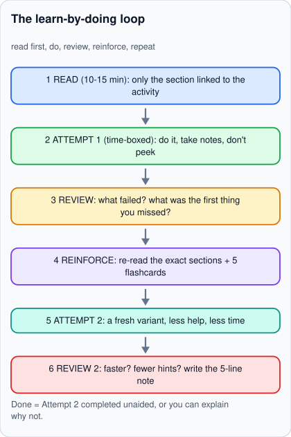
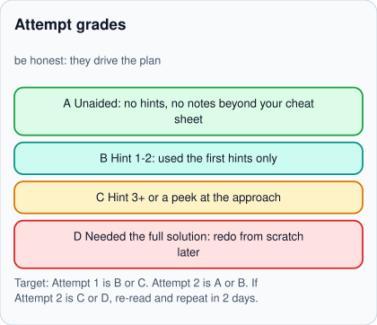
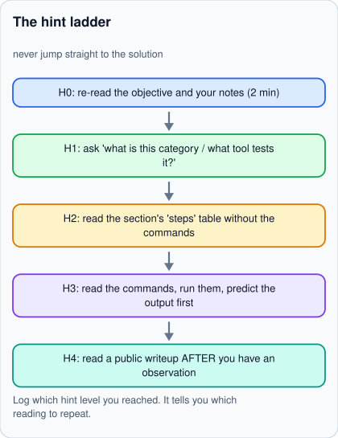
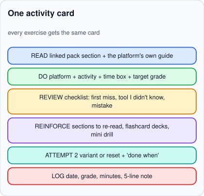

# 23. Learn by doing: the workflow and 16 written labs

This chapter changes how you use the whole pack. You will **not** read everything first. For every activity you follow one loop: **read the small piece that's linked, do the exercise, review what went wrong, reinforce with a targeted re-read, then try again and review again.**

## 1. The loop



| Step | What you do | Time box | What you write |
|---|---|---|---|
| **1 Read** | Only the pack section linked to the activity (and the platform's own intro if it has one) | 10-15 min | one line: "this activity is about ___" |
| **2 Attempt 1** | Do the exercise with your cheat sheet only | per activity | commands tried, first observation, where stuck |
| **3 Review** | Compare with the solution/hints *after* the attempt | 10 min | first miss; tool you didn't know; one mistake |
| **4 Reinforce** | Re-read the exact sections the review points to; do 5 flashcards; run a mini drill | 10-20 min | what changed in your understanding |
| **5 Attempt 2** | A fresh variant, or the same activity reset, with less help and less time | ≤ 60% of Attempt 1 time | commands, time |
| **6 Review 2** | Did you get faster? fewer hints? | 5 min | 5-line note + grade |

**Why two attempts.** The first attempt shows you the gaps. The second proves the gap is closed. Learning is the difference between them.

## 2. Grade every attempt honestly



| Grade | Meaning | What it tells you |
|---|---|---|
| A | Unaided | the skill is yours |
| B | Hint 1-2 | nearly there; reinforce once |
| C | Hint 3+ or peeked at the approach | re-read and repeat in 2 days |
| D | Needed the full solution | go back one level of difficulty |

**Target:** Attempt 1 should feel like a B or C. If Attempt 1 is an A, the activity was too easy: skip it. If it is a D, choose an easier prerequisite.

## 3. The hint ladder



Use hints in order; log the highest rung you used. Never read a full writeup before you have your own first observation.

## 4. The activity card



Every activity in the platform books uses this card. Copy it into your notes for any new exercise:

```text
ACTIVITY: <id> <name>              PLATFORM: <name>      TIME BOX: <min>
READ:       <pack section(s)>  +  <platform guide>
DO:         <exactly what to do>
ATTEMPT 1:  date __  grade __  minutes __  hints __
REVIEW:     first miss: __   tool I didn't know: __   mistake: __
REINFORCE:  re-read: __   flashcards: __   mini drill: __
ATTEMPT 2:  date __  grade __  minutes __  variant: __
REVIEW 2:   faster? __   fewer hints? __   5-line note: __
DONE WHEN:  <evidence>
```

## 5. How to use the platform books

| Book | Platform | Use for |
|---|---|---|
| 24 | TryHackMe | guided rooms: Linux, web, Windows/AD, forensics |
| 25 | OverTheWire | Bandit, Natas, Leviathan, Narnia |
| 26 | VulnHub | attacking a whole machine |
| 27 | picoCTF / picoGym | jeopardy skills by category |
| 28 | Parrot CTFs and Cybrary | micro labs, VM challenges, video courses |

Each activity names the **reading to do first**, the **exercise**, the **review checklist**, the **reinforce** step and the **second attempt**. Platforms change names and access levels: **search the room or challenge by its name or topic, and check whether it's free before you plan around it.**

---

# Part A: 16 written labs (no platform needed)

Each lab is a self-contained exercise with data printed here. Do **Version A** as Attempt 1. Read the review notes in the answer key, re-read the linked section, then do **Version B** as Attempt 2. Answers are at the end of this chapter: **don't look until you've done the attempt.**

---

## Lab 1: Log reading with the shell

**Read first:** Module 7 §7.1 (Linux survival) and Bandit commands: `grep`, `sort`, `uniq`, `awk`.
**Time box:** 20 min.

**Version A: web access log**

```text
10.0.0.5 - - [10/Nov:09:01:02] "GET /index.html" 200
10.0.0.9 - - [10/Nov:09:01:05] "GET /login" 200
10.0.0.9 - - [10/Nov:09:01:07] "POST /login" 401
10.0.0.9 - - [10/Nov:09:01:09] "POST /login" 401
10.0.0.9 - - [10/Nov:09:01:11] "POST /login" 401
10.0.0.9 - - [10/Nov:09:01:13] "POST /login" 200
10.0.0.5 - - [10/Nov:09:02:00] "GET /admin" 403
10.0.0.9 - - [10/Nov:09:02:10] "GET /admin" 200
10.0.0.7 - - [10/Nov:09:03:00] "GET /index.html" 200
10.0.0.9 - - [10/Nov:09:03:20] "GET /backup.zip" 200
```

Save it as `a.log`. Questions:
1. Which IP made the most requests? (give the command that counts)
2. How many `401` responses?
3. Describe what the top IP did, in order.
4. What file left the server?

**Version B (Attempt 2): a different log**

```text
172.16.1.3 - - [10/Nov:10:00:01] "GET /" 200
172.16.1.8 - - [10/Nov:10:00:05] "GET /search?q=1'" 500
172.16.1.8 - - [10/Nov:10:00:09] "GET /search?q=1' OR '1'='1" 200
172.16.1.8 - - [10/Nov:10:00:14] "GET /search?q=' UNION SELECT 1,2" 500
172.16.1.8 - - [10/Nov:10:00:20] "GET /search?q=' UNION SELECT 1,2,3" 200
172.16.1.3 - - [10/Nov:10:01:00] "GET /about" 200
```

Questions: (1) Which IP is attacking and what is it attempting? (2) How many `500`s and what does each reveal? (3) How many columns does the original query have? (4) What would you check next on the server?

**Reinforce:** Module 7 §7.1, Module 3 §3.3 (SQLi), flashcards "Linux and Bandit" (grep/sort/uniq cards).

---

## Lab 2: Encoding onions

**Read first:** Module 4 §4.1 (encoding vs encryption, recognition chart).
**Time box:** 15 min.

**Version A:** decode this (identify each layer before choosing a tool):

```text
NTA0NzUzN2I2NTcyNmU3MTVmNjc3NTcyNjE1ZjcxNjI3ZA==
```

**Version B (Attempt 2):** a different layer order:

```text
66586c796447567958325275595639335a576c325a584a37526c5244
```

For each: write the layers in order, the tool for each layer, and the flag. Then write a 3-line Python function that does the whole chain.

**Reinforce:** Module 4 §4.1; flashcards "Crypto and encodings" (recognition cards); Bandit L10-12.

---

## Lab 3: XOR and Caesar

**Read first:** Module 4 §4.2 (XOR) and §4.3 (classical ciphers).
**Time box:** 25 min.

**Version A**
1. Single-byte XOR, flag starts `CTF{`: `7463714c4f5845685b5655685859524a`
2. Repeating-key XOR (the key is a 3-letter lowercase word, flag starts `CTF{`): `28313f10171c1b00181f0c170c3a120e1c04`
3. Caesar (unknown shift): `JAM{zopma_if_zlclu}`

**Version B (Attempt 2)**
1. `2e392b1615021f32010c0f32191a02320f10` (single-byte XOR, flag starts `CTF{`)
2. A repeating-key XOR using a *different* 3-letter key than A (recover it from the first bytes of the known prefix): you'll create this yourself in the answer key, then solve it.
3. `NEQ{mcfep_lww_dstqed}` (Caesar, unknown shift)

**Reinforce:** Module 4 §4.2 and 4.3, Module 11 §11.3 (printable scoring), flashcards "Crypto and encodings".

---

## Lab 4: Tiny RSA

**Read first:** Module 4 §4.6 (RSA).
**Time box:** 20 min.

**Version A:** `n = 2537`, `e = 13`, `c = 550`. Factor `n`, compute `φ` and `d`, decrypt to one ASCII character.

**Version B (Attempt 2):** `n = 4087`, `e = 7`, `c = 1950`. Same steps.

Then answer: what made this breakable, and how large must `n` be for it to be safe?

**Reinforce:** Module 4 §4.6 and §4.8 worked example; flashcards RSA cards; Lab 12 (scripting) for a reusable helper.

---

## Lab 5: Authentication log story

**Read first:** Module 2 §2.5 (logs) and Module 13 §13.5 (event IDs).
**Time box:** 25 min.

**Version A: Linux auth log**

```text
03:12:01 sshd: Failed password for root from 203.0.113.9
03:12:03 sshd: Failed password for root from 203.0.113.9
03:12:05 sshd: Failed password for admin from 203.0.113.9
03:12:08 sshd: Failed password for admin from 203.0.113.9
03:12:10 sshd: Failed password for test from 198.51.100.4
03:12:14 sshd: Failed password for root from 203.0.113.9
03:12:20 sshd: Accepted password for admin from 203.0.113.9
03:15:02 sshd: session opened for user admin
03:15:40 sudo: admin : COMMAND=/bin/bash
03:16:11 useradd: new user: name=backup2
```

Questions: attacker IP; failed attempts before success; compromised account; three actions after login; two containment steps.

**Version B (Attempt 2): Windows events**

```text
09:00:11  4625  admin  from 198.51.100.20  Logon Type 3
09:00:12  4625  admin  from 198.51.100.20  Logon Type 3
09:00:14  4625  svc_sql from 198.51.100.20 Logon Type 3
09:00:20  4624  svc_sql from 198.51.100.20 Logon Type 3
09:00:21  4672  svc_sql  (special privileges assigned)
09:02:40  7045  service installed: "Updater"  path C:\ProgramData\u.exe
09:03:15  4698  scheduled task created: "Maintenance"
09:05:00  1102  Security log cleared
```

Questions: what happened in order? Which two persistence mechanisms? Why is `1102` important? What would you collect next?

**Reinforce:** Module 2 §2.5, Module 13 §13.5-13.7, flashcards "Windows forensics" and "Forensics".

---

## Lab 6: A packet capture as a story

**Read first:** Module 2 §2.3 (pcap workflow, filters).
**Time box:** 20 min.

**Version A**

| # | Time | Proto | Info |
|---|---|---|---|
| 1 | 00:01 | DNS | A files.corp.test |
| 2 | 00:02 | HTTP | GET /tools/update.zip → 200 (1.2 MB) |
| 3 | 00:05 | TCP | 10.0.0.5 → 203.0.113.7:4444 (long-lived) |
| 4 | 00:09 | FTP | USER anonymous / PASS user@x / STOR notes.txt |
| 5 | 00:14 | DNS | TXT query x7f3a9c1b.evil.test (×40) |

Questions: which packets suggest delivery, remote control, staging and covert exfiltration? Give the Wireshark filter for each. What would you export first?

**Version B (Attempt 2)**

| # | Time | Proto | Info |
|---|---|---|---|
| 1 | 10:00 | HTTP | POST /login (user=bob&pass=Winter2025!) → 302 |
| 2 | 10:01 | HTTP | GET /download?file=../../etc/passwd → 200 |
| 3 | 10:03 | TLS | Client Hello to 198.51.100.50:443 (SNI cdn-update.test) |
| 4 | 10:04 | SMB | Tree connect \\\\FS01\\Finance$ |
| 5 | 10:06 | SMB | Read budget.xlsx (4.1 MB) |

Questions: which are cleartext credentials, a path traversal, and data access? What follow-up questions would you ask?

**Reinforce:** Module 2 §2.3, flashcards "Forensics", worked writeups B5.

---

## Lab 7: Identify files by magic bytes

**Read first:** Module 2 §2.2 and the magic-bytes chart.
**Time box:** 10 min.

**Version A:** identify each and give the tool that opens it.

```text
file1: 1f8b 0808 ...
file2: 504b 0304 1400 ...
file3: 8950 4e47 0d0a 1a0a ...
file4: 7f45 4c46 0201 01 ...
file5: 2550 4446 2d31 2e34 ...
```

**Version B (Attempt 2):**

```text
file6: 424d 3e00 ...
file7: 4d5a 9000 0300 ...
file8: ffd8 ffe0 0010 4a46 4946 ...
file9: 5261 7221 1a07 ...
file10: 377a bcaf 271c ...
```

Then answer: you have a PNG whose last bytes are `49454e44ae426082504b0304`. What is in it and how do you extract it?

**Reinforce:** Module 2 §2.2 and §2.8; flashcards "Forensics" magic cards.

---

## Lab 8: SQL injection, in your head

**Read first:** Module 3 §3.3 and worked writeups B7.
**Time box:** 20 min.

**Version A.** The server builds `SELECT * FROM users WHERE name = '<name>' AND pass = '<pass>'`. For each input to `name` (pass = `x`), write the resulting query and what happens:
1. `bob`
2. `bob'`
3. `bob' --`
4. `' OR 1=1 --`
5. `bob' AND 1=2 --`

**Version B (Attempt 2).** The server builds `SELECT title, body FROM posts WHERE id = <id>` (numeric, no quotes). Inputs:
1. `5`
2. `5 OR 1=1`
3. `5 ORDER BY 3`
4. `-1 UNION SELECT 1,2`
5. `-1 UNION SELECT username,password FROM users`

Which of these tell you the column count? Which returns data from another table? What is the one fix that stops all of them?

**Reinforce:** Module 3 §3.3; flashcards "Web".

---

## Lab 9: Access control

**Read first:** Module 3 §3.6.
**Time box:** 15 min.

**Version A.** You are `alice` (user id 12). Requests and responses:

| Request | Response |
|---|---|
| `GET /api/profile/12` | alice's profile |
| `GET /api/profile/13` | bob's profile (name, email, phone) |
| `GET /api/orders?user=12` | alice's orders |
| `PUT /api/profile/12 {"role":"admin"}` | 200 OK, profile now shows `role: admin` |
| `GET /admin/users` | 403 |

Name each flaw, its class, and the fix.

**Version B (Attempt 2).**

| Request | Response |
|---|---|
| `GET /invoice/1001` | your invoice |
| `GET /invoice/1002` | 403 |
| `GET /invoice/1002.pdf` | the PDF, 200 |
| `POST /api/transfer {"from":"acct-77","to":"acct-90","amt":50}` where acct-77 is *not yours* | 200 |
| `GET /api/export?file=report.csv` | CSV |
| `GET /api/export?file=../../etc/hostname` | hostname |

Name each flaw and the test that found it.

**Reinforce:** Module 3 §3.6-3.7; flashcards "Web".

---

## Lab 10: Cron and privilege escalation

**Read first:** Module 6 §6.3 and Bandit walkthrough levels 21-23.
**Time box:** 15 min.

**Version A**

```text
/etc/crontab:
*/2 * * * *  root  /opt/backup.sh

$ ls -l /opt/backup.sh
-rwxrwxrwx 1 root root 120 Nov 10 08:00 /opt/backup.sh

$ id
uid=1001(dev) gid=1001(dev) groups=1001(dev)
```

Explain the weakness and describe (no code needed) how you would exploit it and how you'd fix it.

**Version B (Attempt 2)**

```text
$ sudo -l
User dev may run the following commands:
    (root) NOPASSWD: /usr/bin/find
$ find / -perm -4000 -type f 2>/dev/null
/usr/bin/passwd
/usr/bin/sudo
/opt/tools/backup-helper
$ ls -l /opt/tools/backup-helper
-rwsr-xr-x 1 root root 16744 ... /opt/tools/backup-helper
```

Which two entries are concerning and why? Which reference would you consult? What would you ask of the person who owns this server?

**Reinforce:** Module 6 §6.3; flashcards "Privesc, network and AD".

---

## Lab 11: A process tree

**Read first:** Module 2 §2.4.
**Time box:** 15 min.

**Version A**

```text
PID  PPID  Name
  4     0  System
448     4  smss.exe
620   448  csrss.exe
712   620  svchost.exe
2840 1984  WINWORD.EXE
3120 2840   powershell.exe
3320 3120    cmd.exe
3500 3320     whoami.exe
```

What is suspicious? Name four Volatility 3 plugins you'd run next and the question each answers.

**Version B (Attempt 2)**

```text
PID  PPID  Name
 488     4  smss.exe
 712   488  services.exe
 900   712  svchost.exe
1520   712  svchost.exe   (path: C:\Users\Public\svchost.exe)
2100  1520   cmd.exe
```

What looks wrong? Which plugin shows the file path? Which shows network connections?

**Reinforce:** Module 2 §2.4; flashcards "Forensics".

---

## Lab 12: Python scripting

**Read first:** Module 11 §11.3.
**Time box:** 30 min.

**Version A.** Write these functions and test each with the examples:

1. `xor_bytes(data: bytes, key: bytes) -> bytes` → `xor_bytes(b"AB", b"\x01")` returns `b"@C"`.
2. `b64_pad(s: str) -> bytes` decodes base64 even when padding is missing → `b64_pad("QUJD")` returns `b"ABC"`.
3. `top_ips(lines: list[str], n: int)` returns the `n` most frequent first fields.

**Version B (Attempt 2).** Without looking at your first versions:

1. `rot13(s)`; `rot13("Uryyb")` returns `"Hello"`.
2. `hexdump_header(path, n=8)` returns the first `n` bytes as hex.
3. `find_flags(data: bytes)` returns all matches of `CTF{...}`.

Run each on small inputs and print the results.

**Reinforce:** Module 11; Bandit commands (`tr`, `xxd`, `grep`).

---

## Lab 13: A fictional OSINT chain

**Read first:** Module 12 §12.1-12.4.
**Time box:** 20 min. (All data is fictional.)

**Version A.** Question: "Which city is the café in?" Clues:
- the photo's EXIF has a camera model and a date, but no GPS;
- the sign says "Fermé le lundi" and a stop sign says both ARRÊT and STOP;
- prices are in `$`;
- a tram line crosses the street.

List your reasoning ladder, the searches you'd run, and how you'd verify.

**Version B (Attempt 2).** Question: "Who runs the domain `northwind-demo.test` and what did it host before?" Which five public sources do you consult, in what order, and what does each give?

**Reinforce:** Module 12; flashcards "OSINT and misc".

---

## Lab 14: Reading assembly

**Read first:** Module 5 §5.3.
**Time box:** 15 min.

**Version A**

```text
  mov  eax, DWORD PTR [rbp-4]
  cmp  eax, 0x539
  jne  .fail
  call success
  jmp  .end
.fail:
  call failure
.end:
```

1. What integer makes it succeed? 2. Rewrite it as C. 3. Where would you set a breakpoint?

**Version B (Attempt 2)**

```text
  lea  rdi, [rbp-0x40]
  lea  rsi, [rip+secret]
  call strcmp
  test eax, eax
  jne  .fail
```

1. What is being compared? 2. How could `ltrace` solve this? 3. What would a stripped binary change?

**Reinforce:** Module 5 §5.2-5.6; flashcards "Reverse and pwn".

---

## Lab 15: Cloud permissions

**Read first:** Module 14 §14.2-14.3.
**Time box:** 15 min.

**Version A.** Policy fragment:

```json
{"Effect":"Allow","Action":"s3:*","Resource":"*"}
```

What does it allow? Why is it risky? Rewrite it so the principal can only read objects from one bucket named `reports-bucket`.

**Version B (Attempt 2).** For each finding, say the risk and the fix: (1) a storage bucket listing is public; (2) a VM role can `iam:*`; (3) SSH open to `0.0.0.0/0`; (4) access keys committed to a repo; (5) audit logging disabled.

**Reinforce:** Module 14; flashcards "Cloud".

---

## Lab 16: Triage and writeup

**Read first:** Module 1 §1.3-1.6.
**Time box:** 20 min.

**Version A.** Rank by points per minute and pick the first three:

| ID | Category | Points | Est. minutes |
|---|---|---|---|
| A | warmup | 30 | 5 |
| B | forensics | 120 | 30 |
| C | crypto | 100 | 20 |
| D | web | 250 | 50 |
| E | rev | 200 | 40 |
| F | pwn | 300 | 90 |

**Version B (Attempt 2)**

| ID | Category | Points | Est. minutes |
|---|---|---|---|
| A | warmup | 10 | 2 |
| B | forensics | 90 | 15 |
| C | crypto | 200 | 50 |
| D | web | 150 | 25 |
| E | rev | 300 | 75 |
| F | warmup | 40 | 10 |

Then write a five-line writeup of **any** lab above using the template (what it was; first observation; technique and command; mistake; how to spot it again).

**Reinforce:** Module 1; mock exam Part D.

---

# Answer key (don't read before your attempt)

## Lab 1
**A.** (1) `awk '{print $1}' a.log | sort | uniq -c | sort -rn` → `10.0.0.9` (7 requests). (2) `grep -c ' 401$' a.log` → 3. (3) loaded the login page, failed to log in three times (401), succeeded on the fourth POST, then reached `/admin` (200) and downloaded `/backup.zip`. (4) `/backup.zip`.
**B.** (1) `172.16.1.8`: SQL injection. (2) two 500s: the stray `'` broke the SQL (error), and `UNION SELECT 1,2` failed because the column count was wrong. (3) 3 columns (the `1,2,3` union returned 200). (4) the application's DB/error logs for that IP, whether data was returned, and parameterising the query.

## Lab 2
**A.** base64 → hex digits → ROT13: `CTF{read_then_do}`. Layers: base64 decode gives `5047537b...`, hex decode gives `PGS{erng_gura_qb}`, ROT13 gives the flag.
**B.** hex → base64 → reverse: `CTF{review_and_retry}`. Layers: hex decode gives a base64 string, base64 decode gives the reversed text, reverse it.

## Lab 3
**A.** (1) key `0x37`: `CTF{xor_lab_one}`. (2) key `key`: `CTF{repeating_key}`; derive it by XORing the first three bytes with `CTF`. (3) shift 7 back (or try all): `CTF{shift_by_seven}`.
**B.** (1) key `0x6d`: `CTF{xor_lab_two_b}`. (2) you chose the key; the check is you recovered it from the first three bytes. (3) shift 11 back: `CTF{brute_all_shifts}`.

## Lab 4
**A.** `2537 = 43 × 59`, `φ = 42 × 58 = 2436`, `d = 937`, `m = 550^937 mod 2537 = 71` → `G`.
**B.** `4087 = 61 × 67`, `φ = 3960`, `d = 2263`, `m = 79` → `O`. Breakable because `n` is tiny: real keys use 2048+ bit moduli whose factors can't be found.

## Lab 5
**A.** Attacker `203.0.113.9`; 5 failures before success; account `admin`; actions: privileged shell (`sudo bash`), created `backup2`, new session; containment: block the IP and disable/reset `admin` and `backup2`; audit other hosts.
**B.** Password spray from `198.51.100.20` against `admin` and `svc_sql`; success as `svc_sql`; privileges assigned; persistence by service `Updater` and task `Maintenance`; then `1102` (log cleared) is anti-forensics. Collect `u.exe`, the task XML, the Security log backups, and network logs.

## Lab 6
**A.** Delivery: #2 (`http.request` with the filename); remote control: #3 (`tcp.port == 4444`); staging: #4 (`ftp`); covert channel: #5 (`dns.qry.type == 16`). Export the zip first and hash it.
**B.** Cleartext creds: #1 (POST login over HTTP); path traversal: #2; data access: #4-#5 (`smb2`). Questions: was the TLS destination known? who is `bob`? was the file sensitive?

## Lab 7
**A.** gzip (`gzip -d`/`zcat`); ZIP/Office/JAR (`unzip`); PNG; ELF; PDF.
**B.** BMP; Windows PE (exe/dll); JPEG; RAR; 7-Zip. The PNG: IEND followed by `PK\x03\x04` = an appended ZIP; `binwalk -e` or `unzip img.png`.

## Lab 8
**A.** (1) normal; (2) `...name = 'bob'' AND ...` unbalanced quote → error; (3) `...name = 'bob' -- ' AND ...` login as bob without a password; (4) `... name = '' OR 1=1 -- ...` returns all rows; (5) `bob' AND 1=2 --` returns nothing (false), a boolean test.
**B.** (2) always true, returns multiple rows; (3) column-count probe (error when too high); (4) `UNION SELECT 1,2` tests columns and shows which appear on the page; (5) other-table data. Fix: parameterised queries.

## Lab 9
**A.** IDOR on `/api/profile/13` (broken object-level access); mass assignment/privilege escalation on `PUT` `role`; `/admin/users` correctly blocked. Fixes: server-side ownership check; allow-list updatable fields.
**B.** `/invoice/1002.pdf` bypasses the check (inconsistent authorisation across routes); the transfer accepts a source account you don't own; `file=../../etc/hostname` is path traversal. Found by changing ids, extensions and parameters.

## Lab 10
**A.** World-writable script run by root every 2 minutes: any user can append commands that root runs (e.g. add a user, copy a shell binary with setuid). Fix: root-owned, `chmod 750`, absolute paths, audit.
**B.** `sudo find` NOPASSWD: `find -exec` can spawn a root shell (GTFOBins). The unusual setuid `backup-helper` needs review (strings, `ltrace`, does it call tools without absolute paths?). Ask the owner why each is needed.

## Lab 11
**A.** Word spawning PowerShell, then cmd, then whoami: macro-driven shell activity. Plugins: `cmdline` (what ran), `netscan` (connections), `filescan` (which files), `dumpfiles` (extract the document).
**B.** A `svchost.exe` from `C:\Users\Public` with `services.exe` as parent but unusual path: masquerading. `windows.cmdline`/`dlllist` shows the path; `netscan` shows connections.

## Lab 12
**A.** Reference answers:

```python
def xor_bytes(data, key):
    return bytes(b ^ key[i % len(key)] for i, b in enumerate(data))
def b64_pad(s):
    import base64
    return base64.b64decode(s + "=" * (-len(s) % 4))
def top_ips(lines, n):
    from collections import Counter
    return Counter(l.split()[0] for l in lines).most_common(n)
```

**B.** `rot13` via `codecs.encode(s, "rot13")`; `hexdump_header` via `open(path,"rb").read(n).hex()`; `find_flags` via `re.findall(rb"CTF\{.*?\}", data)`.

## Lab 13
**A.** Ladder: language (French) → bilingual signage → dollar prices → tram → candidate cities in Quebec (Montreal/Quebec City); search "Fermé le lundi" + street view comparisons; verify shadows and storefront. **B.** WHOIS/RDAP (registrar, dates), DNS records, certificate transparency (subdomains), Wayback Machine (past content), search-engine dorks for documents.

## Lab 14
**A.** `0x539 = 1337`. C: `if (x == 1337) success(); else failure();`. Break at the `cmp`. **B.** Your input buffer against a stored secret string; `ltrace` shows `strcmp(input, secret)`; stripped binaries lose function names but the `call strcmp` pattern remains.

## Lab 15
**A.** All S3 actions on all resources; any compromise grants full data access, deletion and policy change. Least privilege: `"Action":["s3:GetObject"],"Resource":"arn:aws:s3:::reports-bucket/*"`. **B.** (1) data exposure → block public access; (2) full IAM control → least-privilege role; (3) brute force surface → restrict source/bastion; (4) credential leak → rotate, scan; (5) no evidence → enable and retain logs.

## Lab 16
**A.** Ratios: A 6.0, C 5.0, D 5.0, E 5.0, B 4.0, F 3.33 → start with **A, then C, E, D**. **B.** Ratios: B 6.0, D 6.0, A 5.0, C 4.0, E 4.0, F 4.0 → start with **B, D, A**.

---

## Logging your work

Add each attempt to `tracker/activities.csv` or run:

```bash
python scripts/activity.py log LAB-01 1 B 22      # activity id, attempt number, grade, minutes
python scripts/activity.py log LAB-01 2 A 12
python scripts/activity.py status
```
