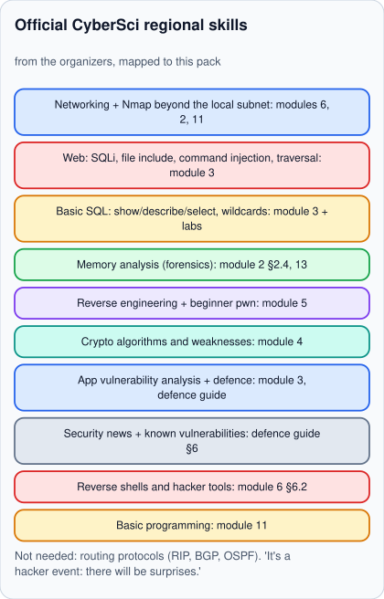
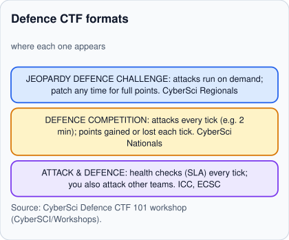
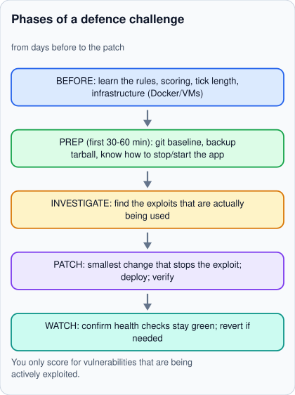
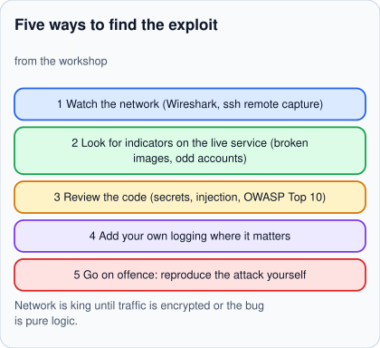
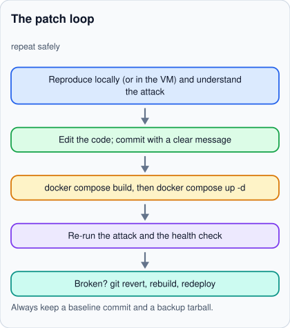

# 24. The official skills list and defence challenges

Two things from the organizers change how you should prepare:

1. **The official list of skills** for the regional event.
2. **Defence challenges.** CyberSci's own Defence CTF 101 workshop says the Regionals include a *jeopardy-style defence challenge*: you're given a vulnerable service, automated attacks run against it, and **you score by patching** it, not by exploiting it.

Sources: the skills text you pasted from the organizers, and the public repositories `CyberSCI/Workshops` (Defence CTF 101, 2026) and `CyberSCI/PastChallenges` (including the regionals' defence services).

## 1. The official skills list, mapped to this pack



| Official skill (as given) | What it means in practice | Read first | Do |
|---|---|---|---|
| Networking: TCP/IP (first 4 layers), commands and tools, **Nmap including outside the local subnet** | know the layers; scan other subnets (routing/gateway matters), `-Pn`, `-sn`, `-p-` | Module 6 §6.1; Module 2 §2.3 layers | Lab 17 (nmap output), THM Nmap rooms |
| HTML/web servers: SQLi, file includes, command injection, directory traversal | the classic web classes | Module 3 §3.3, §3.7 | Labs 1, 8, 9; PortSwigger; Natas |
| Basic SQL: **show, describe, enumerate databases and tables; SELECT and wildcards** | read data with SQL by hand | §2 below | the SQL mini-lab below |
| Forensics: **memory analysis** | Volatility: processes, network, command lines | Module 2 §2.4; Module 13 | Lab 11; Volatility rooms |
| Reverse engineering and **beginner binary exploitation** | Ghidra, gdb, ret2win, simple overflows | Module 5 | Lab 14; crackmes; pwn basics |
| Cryptography: **algorithms and their weaknesses** | ECB/CBC/CTR, RSA misuse, classical ciphers, encodings | Module 4 | Labs 2-4; past crypto challenges |
| Application vulnerability analysis | read code and find bugs; OWASP Top 10 | Module 3; §4 below | the defence lab |
| Latest security news and known vulnerabilities | follow feeds; know recent CVEs | §6 below | 10 minutes daily |
| Hacker tools and techniques: **create and interact with a reverse shell** | listener, payload, stabilise | Module 6 §6.2 | THM reverse-shell/privesc rooms; lab VMs only |
| Basic programming | Python/Bash scripts | Module 11 | Lab 12 |

**Not needed:** routing protocols (RIP, BGP, OSPF). **And:** "It's a hacker event; there will be surprises… and no apologies!" Past events confirm it: Enigma crypto, punched cards, a 16-bit DOS program, a BASIC web app, a gopher server, an AI prompt-injection challenge.

## 2. Basic SQL: mini-lab

**Read first:** this section. **Time box:** 25 min. Use any SQLite or MySQL practice database (DVWA's, or `sqlite3` on a sample file).

| Goal | MySQL/MariaDB | SQLite |
|---|---|---|
| list databases | `SHOW DATABASES;` | (one file per DB) `.databases` |
| choose a database | `USE shop;` | `sqlite3 shop.db` |
| list tables | `SHOW TABLES;` | `.tables` |
| describe a table | `DESCRIBE users;` or `SHOW COLUMNS FROM users;` | `.schema users` / `PRAGMA table_info(users);` |
| read rows | `SELECT * FROM users;` | same |
| pick columns | `SELECT name, email FROM users;` | same |
| filter | `SELECT * FROM users WHERE role='admin';` | same |
| wildcard | `SELECT * FROM users WHERE name LIKE 'a%';` (`%` any length, `_` one char) | same |
| count | `SELECT COUNT(*) FROM users;` | same |
| sort/limit | `ORDER BY id DESC LIMIT 5;` | same |
| from injection | `information_schema.tables`, `information_schema.columns` | `sqlite_master` |

**Attempt 1:** create a table `users(id, name, email, role)` with 5 rows, then write queries that (a) list all admins, (b) find names starting with `a`, (c) count rows per role (`GROUP BY`).
**Review:** which statement did you have to look up?
**Reinforce:** Module 3 §3.3 (how these become injection payloads: `UNION SELECT`, `information_schema`).
**Attempt 2:** answer the same three questions on a different table without notes.

## 3. Defence challenges: the concept



**Plain English.** In an attack challenge you break a service. In a defence challenge someone else's attack scripts break *your* service, and you win by making them fail without breaking the service for legitimate users.

| Term | Meaning |
|---|---|
| tick | one round of scoring (e.g. every 2 minutes) |
| health check / SLA | automated test that the service still works for normal users |
| exploit script | the automated attack the organizers run |
| patch | a change that makes the exploit fail |
| revert | going back to the last known-good version |

**Scoring logic you must assume (from the workshop):** you only get points for patching vulnerabilities that are **actively exploited**; downtime usually costs you; blocking the attacker's IP backfires because health checks and exploits come from the same place.

### Phases



## 4. Before the event: the defence checklist

| Item | Why | Command / action |
|---|---|---|
| Know Docker and Docker Compose | CyberSci services are containers | `docker compose ps`, `build`, `up -d`, `down`, `logs -f` |
| Know SSH into the VM | you work on the box | `ssh user@host -p PORT` |
| Source control | you will break something | `git init`, `git add -A`, `git commit -m "baseline"`, `git revert` |
| Backups | fastest way back | `tar czf backup.tar.gz app/`; `scp -P PORT user@host:backup.tar.gz .` |
| Small VM resources | heavy editors can crash it | check `top`; avoid memory-hungry remote editors |
| Team plan | who patches, who deploys, where you talk | agree before the day |
| Rules and scoring | tick length, grace period, penalties | read the rules twice |

## 5. Investigating: find the real exploit



### 5.1 Network is king

You can capture traffic from the VM with Wireshark's **SSH remote capture (sshdump)**: *Capture → Options → SSH remote capture*. Filter with `http`, trigger the attack, and read the request that follows. Look for injection strings in paths, parameters, headers or bodies.

When the network isn't king: **TLS** (use the key-log or capture behind the TLS terminator) and **logic bugs** (traffic looks like normal health checks).

### 5.2 Indicators of compromise on the live service

- images that never load (`` payloads leave a broken-image icon);
- strange accounts, posts or rows in the database;
- unexpected files dropped on disk;
- new processes or listeners.

### 5.3 Source review

Start at the entry point (`main.go`, `app.py`, `index.php`), trace requests inward, and search for:

```bash
grep -rniE "password|secret|token|api_key" .
grep -rniE "exec|system|eval|os\.popen|subprocess|Runtime" .
grep -rniE "SELECT .*\+|query\(.*\+|f\"SELECT" .
grep -rniE "innerHTML|dangerouslySetInnerHTML|render_template_string" .
```

Typical findings (OWASP Top 10 style): hard-coded secrets, injection (SQL/command), XSS, broken access control, unsafe deserialisation, weak crypto, missing authentication on admin routes.

### 5.4 Add your own logging

Read what the app already logs, then add a log line at the interesting handler (login, search, upload). Rebuild and watch `docker compose logs -f`. The workshop shows a SQL injection login caught this way.

### 5.5 Go on offence

Reproduce the attack yourself against a copy of the app. If you can exploit it, you understand it well enough to patch it.

## 6. Patching



| Principle | Detail |
|---|---|
| **Stop the bleeding** | a small fix that stops the exploit is enough for scoring, even if it isn't the perfect fix |
| **Fix the cause when you can** | parameterised queries, output encoding, authentication checks, remove dangerous functions |
| **Network blocking is a patch of last resort** | the workshop shows a string match rule that blocks a known payload; it's instant but a signature, not a fix, and can break health checks |
| **Don't block the attacker's IP** | health checks come from the same place; you'll score downtime |
| **Revert fast** | `git revert --no-edit HEAD`, rebuild, redeploy |
| **Verify twice** | re-run the attack *and* confirm normal use still works |

Examples of the kind of fix to expect (illustrative):

```text
SQL injection:   build the query with placeholders, never string concatenation
XSS:             escape output / strip event handlers, set a restrictive CSP
Command inj.:    avoid shells; use argument lists; validate against an allow-list
Dangerous eval:  remove the call (the workshop's BASIC app had an EVAL$ leak)
Hard-coded key:  move to an environment variable; rotate
Auth bypass:     verify tokens properly (signature, algorithm, user exists)
```

## 7. Latest security news (10 minutes a day)

The organizers list this as a skill. Pick three sources and skim headlines daily; for each notable item write one line: *what product, what flaw, what could an attacker do, is it exploited in the wild?*

| Source | Use |
|---|---|
| CISA Known Exploited Vulnerabilities catalog | what attackers are actually using |
| Canadian Centre for Cyber Security alerts and advisories | Canadian context |
| NVD (nvd.nist.gov) and vendor advisories | details on a CVE |
| SANS Internet Storm Center diaries | daily analysis |
| Krebs on Security, BleepingComputer, The Hacker News | news and breaches |

Then ask: could a CTF challenge be built around this bug class? (Many are: file upload RCE, SSRF, prompt injection, JWT misuse.)

## 8. The defence lab: Defence CTF 101

The organizers' workshop is a runnable lab: a vulnerable Candidate Registry app in a small VM, an automated attacker on demand, and slides that walk through preparing, investigating and patching. It is in the cloned repo at `external/Workshops/2026/defence-ctf-101`.

**Requirements:** Docker with Compose (4 GB memory), free ports 80, 67, 666, 2222, 6767, internet for the first build, git and an SSH client; Wireshark optional. Every port is bound to `127.0.0.1`: keep it that way, because the app is vulnerable on purpose and the VM container is privileged.

```bash
cd Workshops/2026/defence-ctf-101
docker compose up -d          # slides at http://localhost ; wait for 3 green lights (first build 10-15 min)
docker compose down           # stop (changes kept)
docker compose down -v        # reset to a clean slate
```

> I have **not run** this lab. I read its README and slides only. Review `compose.yaml` before running anything from a downloaded repo, run it only on a machine you control, and don't expose the ports.

### Activity: the full cycle

| Step | What to do | Reading |
|---|---|---|
| **Read** | slides sections *Before the CTF* and *Preparation*; §3-4 above | this chapter §3-5 |
| **Attempt 1** | do the prep phase (git baseline, backup tarball, start/stop); then investigate attack scenario 4 with Wireshark; find the exploit; patch it; rebuild; re-run the attack | time box 90 min; grade it |
| **Review** | what gave it away first: network, logs, or code? what almost broke the service? | note the first indicator |
| **Reinforce** | re-read Module 3 §3.3-3.7 and the OWASP Top 10 list; flashcards "Defence" | 20 min |
| **Attempt 2** | reset (`down -v`), do a different attack scenario using **source review and your own logging first, Wireshark second** | ≤ 60 min |
| **Review 2** | which method found it fastest? which patch was minimal? | 5-line note |

Done when you can: back up and restore, find an exploit from traffic *and* from code, patch it, redeploy, and revert after a deliberate mistake.

## 9. Past defence services to study afterwards

From `CyberSCI/PastChallenges` (read the folder READMEs, then try the services in a lab):

| Event | Defence service |
|---|---|
| Regionals 2025/26 | **Inventory**: a vulnerable inventory app written in BASIC (the published fix removes an `EVAL$` call that leaks data such as an admin password) |
| Regionals 2024/25 | **Chatbot** (QA chatbot) and **Voter Registry** (Python web app with voter and admin roles) |
| Nationals 2024/25 | Candidate Registry, ElectoMap, Voter Registry, Vote Tabulation Service |
| Nationals 2025/26 | Banking service, CySpace, Deployment Hell, Peak Science |

## 10. Flashcards and logging

Defence flashcards are in the **Defence** deck (Anki and EPUB). Log each attempt with `python scripts/activity.py log DEF-01 1 B 90`.

## 11. Check yourself

1. What are the three defence CTF formats and which appears at the Regionals?
2. Why is blocking the attacker's IP a bad idea?
3. Name three ways to find the exploit that's actually being used.
4. What two things must you have *before* you start patching?
5. What is the difference between a signature block and a real fix?
6. Why do you re-run the health check after a patch?
