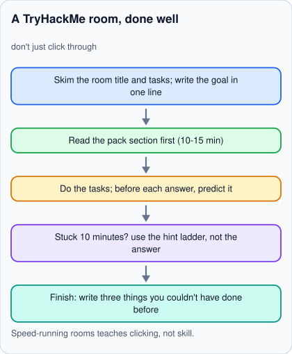

# 26. TryHackMe activity book

TryHackMe (THM) gives guided "rooms": short lessons with an attackable machine. It's the best place to **do** what the modules describe.

> **Verify before you plan.** Room names, free/premium status and order change. Community roadmaps of free rooms exist, but none is official. **Search each room by its name or topic and check whether it's free on the room page.** If a room is premium, use the listed substitute topic or a PortSwigger/Bandit equivalent.

## How to do a room well



Standard review questions after **every** room (answer them in your notes):

1. What was the first command or observation that moved me forward?
2. Which tool or flag did I not know?
3. What did I get wrong or guess?
4. Could I do this again with only my cheat sheet?

Standard reinforce step: re-read the linked section, do 5 flashcards from the named deck, then run the **mini drill** (do the key action once more without the room's help).

## Priority for the next 10 days

**P1 = do before Nov 21. P2 = after.**

## Activities

| ID | Pri | Room / topic to search | Read first | Time | Attempt 2 (variant) |
|---|---|---|---|---|---|
| THM-01 | P1 | **Linux Fundamentals** (Parts 1-3) | Module 7 §7.1; Bandit commands | 90 min | redo the permissions + `find`/`grep` tasks from memory |
| THM-02 | P1 | **Nmap** (and live-host discovery) | Module 6 §6.1; official skills §1 (Nmap beyond the local subnet) | 60 min | scan a different target with `-Pn`, `-p-`, `-sV` and explain each flag |
| THM-03 | P1 | **OWASP Top 10** (2021 or newer version) | Module 3 §3.1-3.7 | 90 min | redo the injection and access-control tasks unaided |
| THM-04 | P1 | **SQL Injection** room | Module 3 §3.3; SQL mini-lab (chapter 24 §2) | 60 min | write the payloads for a new input without the room's hints |
| THM-05 | P1 | **Juice Shop** room | Module 3; Juice Shop notes | 90 min | solve two more Juice Shop challenges by hand |
| THM-06 | P1 | **Wireshark** (Basics / traffic analysis) | Module 2 §2.3 | 60 min | answer Lab 6 (pcap story) |
| THM-07 | P1 | **Volatility** / memory analysis | Module 2 §2.4; Lab 11 | 60 min | redo from the command list only |
| THM-08 | P1 | **Linux PrivEsc** (enumeration, then privilege escalation) | Module 6 §6.3; Lab 10 | 90 min | root a second box using your own checklist |
| THM-09 | P1 | **Crack the Hash** / password cracking basics | Module 4 §4.4; Lab 16 | 45 min | identify and crack 3 new hashes |
| THM-10 | P2 | **Burp Suite** basics | Module 3 §3.2 | 60 min | intercept and replay a login by hand |
| THM-11 | P2 | **Windows PrivEsc** | Module 6 §6.4 | 90 min | |
| THM-12 | P2 | **Active Directory Basics** then an AD attack room | Module 6 §6.5 | 120 min | |
| THM-13 | P2 | **Windows event logs / Sysmon / forensics** | Module 13 | 90 min | Lab 5 version B |
| THM-14 | P2 | **OSINT** rooms (a beginner OSINT room) | Module 12 | 60 min | Lab 13 |
| THM-15 | P2 | A beginner **CTF-style room** (e.g. a "Basic Pentesting"-type room) | Module 6 + 3 | 120 min | redo with the recon checklist only |
| THM-16 | P2 | **Reverse shell** / shells room | Module 6 §6.2 | 45 min | stabilise a shell twice |

## Per-room review prompts

| Room family | Extra review prompts |
|---|---|
| Linux | Which commands did I type from memory? Which permission bits confused me? |
| Nmap | Why did the scan miss ports? What does `-Pn` change? |
| Web | Which input did the server trust? What was the smallest working payload? |
| Forensics | What was the first artefact that gave the story? |
| PrivEsc | Which enumeration step found the path? Which GTFOBins entry did I use? |

## Logging

```bash
python scripts/activity.py log THM-01 1 B 80      # attempt 1, grade B, 80 minutes
python scripts/activity.py log THM-01 2 A 40      # attempt 2
```

## Check yourself

1. Why predict the answer before typing it into a room?
2. How do you decide when to use a hint?
3. What's the difference between completing a room and learning it?
