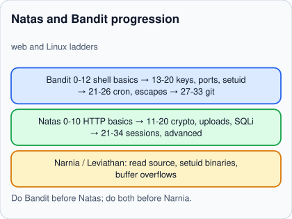

# 27. OverTheWire activity book

OverTheWire (OTW) hosts wargames you play over SSH or in a browser. They're free, and they build the habits that jeopardy events reward.



> **Private notes only.** OverTheWire asks players not to publish solutions. Passwords are earned, never copied.

## The ladder

| Game | Skill it builds | Do it after |
|---|---|---|
| **Bandit** | Linux shell, files, SSH, ports, cron, git | nothing: start here |
| **Natas** | HTTP, web basics, then injection, crypto and uploads | Bandit 0-20 |
| **Krypton** | classical cryptography | Module 4 §4.3 |
| **Leviathan** | setuid binaries, `ltrace`, simple reversing | Bandit 20+ |
| **Narnia** | reading C source, buffer overflows | Leviathan; Module 5 |
| **Behemoth** | binaries and exploitation (harder) | Narnia |

Other OTW games exist (Utumno, Maze and more); skip them for now.

## Activities

Use the workflow: **Read, Attempt 1, Review, Reinforce, Attempt 2, Review 2.** For wargames, **Attempt 2 means redoing the same levels from a fresh login in 60% of the time, using only your notes.**

### Bandit

| ID | Levels | Read first | Time | Attempt 2 |
|---|---|---|---|---|
| OTW-B1 | 0-5 (login, odd filenames, hidden files, `file`) | Bandit practice guide cluster A; walkthrough part 1 (L0-4); commands.md §2-3 | 45 min | redo 0-5 in 25 min |
| OTW-B2 | 6-9 (`find`, `grep`, `sort`/`uniq`, `strings`) | cluster B-C; walkthrough part 1; commands.md §4-5 | 50 min | redo in 30 min |
| OTW-B3 | 10-12 (base64, ROT13, compression onion) | cluster D; Module 4 §4.1 | 60 min | do it again with a Python script |
| OTW-B4 | 13-16 (SSH keys, `nc`, TLS, `nmap`) | cluster E-F; walkthrough part 2 | 75 min | redo 14-16 in 30 min |
| OTW-B5 | 17-20 (`diff`, remote commands, setuid, sockets) | cluster G-H; walkthrough part 2 | 75 min | explain each in two sentences |
| OTW-B6 | 21-26 (cron, brute force, restricted shell) | cluster I-K; walkthrough part 3 | 120 min | P2 |
| OTW-B7 | 27-33 (git, uppercase shell) | cluster L-M; walkthrough part 4 | 90 min | P2 |

**Review prompts:** which command did I search for? which gotcha cost me time (`./-`, quoting, `2>/dev/null`, permissions)?

### Natas

Themes (typical; check each level page): **0-10** viewing source and files, robots, headers and cookies, simple includes; **11-20** crypto in cookies, file uploads, SQL injection and blind SQLi; **21-34** sessions, stored data, deserialisation and harder logic.

| ID | Levels | Read first | Time | Attempt 2 |
|---|---|---|---|---|
| OTW-N1 | 0-10 | Module 3 §3.1-3.2 (HTTP, recon with `curl -i`) | 75 min | redo using `curl` only |
| OTW-N2 | 11-20 | Module 3 §3.3, §3.5, §3.7; Module 4 §4.2 (XOR) | 120 min | P2 |
| OTW-N3 | 21-34 | Module 3 §3.4-3.8 | after Nov 21 | |

### Krypton, Leviathan, Narnia

| ID | Game / levels | Read first | Time | Attempt 2 |
|---|---|---|---|---|
| OTW-K1 | **Krypton** 0-3 | Module 4 §4.3 (classical ciphers) | 60 min | write a frequency-analysis script |
| OTW-L1 | **Leviathan** 0-3 | Module 5 §5.2 (`ltrace`, `strings`) | 90 min | P2 |
| OTW-A1 | **Narnia** 0-2 | Module 5 §5.7 (stack, ret2win) | after Nov 21 | |

## Logging and mastery

```bash
python scripts/activity.py log OTW-B2 1 B 55
python scripts/activity.py log OTW-B2 2 A 28
```

Mastery check for Bandit 0-20: replay all levels in under 30 minutes without hints (grade A on Attempt 2).

## Check yourself

1. What does the second attempt prove that the first doesn't?
2. Which Bandit level taught you about stderr and why?
3. What's your fastest way to identify an unknown file?
