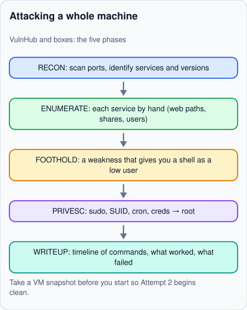

# 28. VulnHub activity book

VulnHub provides downloadable vulnerable virtual machines. You attack a whole machine from recon to root, which matches the "realistic IT environment" part of CyberSci.

> **Check availability.** VulnHub appears online (the site hosts mirrors and checksums), but individual downloads may move, and I couldn't confirm that every box named below is still downloadable. **Verify the checksum on the entry page** before you import a VM. VMs from a community site are untrusted: run them only on an isolated **host-only** network, snapshot first, and never bridge them.



## Lab setup (once)

| Step | Detail |
|---|---|
| Network | VMware host-only network with your Kali VM and the target; no bridging |
| Snapshots | snapshot Kali and the target before you start |
| Import | download the OVA/VMDK, verify the checksum, import |
| Find the target | `sudo nmap -sn <host-only-subnet>` or the VMware network editor |
| Notes | one folder per box with `scans/`, `notes.md`, `loot/` |

## The five phases (use on every box)

1. **Recon:** `nmap -sC -sV -p- <ip>`, note every open port.
2. **Enumerate:** each service by hand (web paths with `ffuf`/`gobuster`, SMB shares, FTP anonymous, SSH banner).
3. **Foothold:** the weakness that gives a shell as a low-privilege user.
4. **Privesc:** `id`, `sudo -l`, SUID, cron, writable files, credentials, kernel (last).
5. **Writeup:** timeline of commands, what worked, what failed.

## Activities

| ID | Box (search on VulnHub) | Why | Read first | Time box | Attempt 2 |
|---|---|---|---|---|---|
| VH-01 | **Kioptrix: Level 1** | classic beginner; old service exploits | Module 6 §6.1-6.3 | 120 min | reset the snapshot; finish in 60 min from your notes |
| VH-02 | **Basic Pentesting: 1** | web + service enumeration, simple privesc | Module 3 §3.2, Module 6 §6.3 | 120 min | same |
| VH-03 | **Mr-Robot: 1** | themed multi-stage box | Module 3, 6 | 150 min | P2 |
| VH-04 | **DC: 1** (the DC series) | web CMS to root | Module 3, 6 | 150 min | P2 |

If a box is unavailable, substitute any **beginner-rated** VulnHub machine.

## Review checklist after every box

- What was the first useful observation (port, path, banner)?
- Where did I lose the most time? (enumeration gaps, wrong rabbit hole, a command I didn't know)
- Which privesc check found the path?
- Could I repeat the foothold from my notes alone?

## Reinforce

Re-read the module sections the box used; update your **privesc checklist**; add 5 flashcards from the commands you looked up (Anki deck "Privesc, network and AD").

## Logging

```bash
python scripts/activity.py log VH-01 1 C 135
python scripts/activity.py log VH-01 2 B 70
```

## Check yourself

1. Why host-only networking and snapshots?
2. What are the five phases?
3. What does a good writeup contain?
