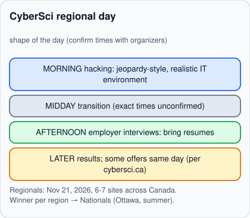
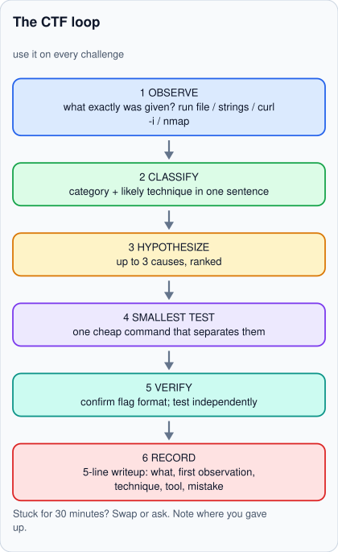
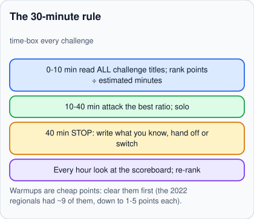
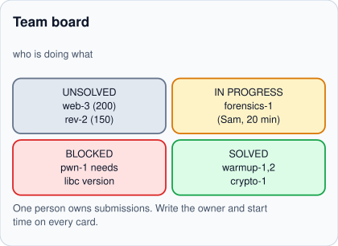

# 1. CTF method and competition day

How to approach any challenge, how to run a day of competition, and what CyberSci specifically looks like. Read this first; every other module assumes it.

## 1.1 What a CTF is

A **Capture The Flag** gives you puzzles that each hide a short secret string (the *flag*, like `CTF{n0t_th1s_0ne}`). You submit flags for points.

| Format | What it is | CyberSci regionals |
|---|---|---|
| **Jeopardy** | independent challenges by category, points per solve | **yes** (modified, in a realistic IT environment) |
| Attack/defend | each team runs services, attacks others | no |
| King of the hill | hold a machine | no |

Typical categories: **web**, **forensics**, **crypto**, **reverse engineering (rev)**, **binary exploitation (pwn)**, **OSINT**, **misc**, and **warmups**.

## 1.2 What CyberSci looks like



Facts from the official site and CTFtime:

- **Regionals: Saturday, Nov 21, 2026**, on site in six or seven Canadian cities.
- **Teams of up to 4** (5 with a woman or Indigenous member). Max 2 teams per school. Register through your school.
- One day: **hacking in the morning, interviews in the afternoon**, some same-day job offers.
- **Organizers said AI tools are not allowed** (relayed 2026-10-15). Own notes/scripts/internet rules are still to confirm.

What past regionals looked like (2022-23, from the CTFtime task list): **8 forensics** tasks, **~9 warmups** (points from 1 to 125), plus a **"vault" series** (reverse, pwn, crypto, a zip) and tiered series like *Layer Vault 1-4*.

Nationals are different: a themed **scenario** (2021 "Command and Control", 2023 "PowerGPT", 2025 "Val Verde") where recon, exploitation, reversing and crypto chain together.

## 1.3 The loop you use on every challenge



Why it works: most wasted time is *acting before observing*. Observing is cheap and rules things out.

| Step | Example (given `backup.zip`) |
|---|---|
| Observe | `file backup.zip`; `unzip -l backup.zip` |
| Classify | forensics / archive, maybe password-protected |
| Hypothesize | weak password; flag in a file; flag in metadata |
| Smallest test | `unzip -l` shows `flag.txt` and requires a password |
| Verify | crack with `fcrackzip`/`john`; flag format matches |
| Record | 5-line note in your writeups folder |

## 1.4 Time management



**Points per effort** decides order, not points alone. A 50-point warmup in 5 minutes beats a 300-point stuck for an hour.

Rules of thumb:

1. **Triage first (10 min):** read every challenge and write `ID | category | points | est minutes | owner`.
2. **30-minute rule:** when you hit 30 minutes without a new observation, stop. Write down what you tried and swap.
3. **Don't tunnel on a single hint.** If a challenge has a free hint cost, buy it only after the 30-minute mark.
4. **Re-rank each hour** as the scoreboard changes.
5. **Reserve the last 20 minutes** for verification and submitting what you have.

## 1.5 Team roles



For a team of four:

| Role | Focus |
|---|---|
| Web | web challenges, Burp, scripts |
| Rev/pwn | binaries, Ghidra, gdb |
| Forensics/crypto | pcaps, memory, files, math |
| Floater/IC | warmups, OSINT, triage, submissions, notes |

Agree on: one shared board, one **submission owner**, how to ask for help (say the *category* and what you've tried), and a break plan (eat and drink; fatigue causes silly errors).

## 1.6 Notes that pay off

After every solved challenge, write five lines:

```text
Challenge: <name>  Category: <cat>  Points: <n>
What it was:   <one sentence>
First clue:    <the first observation that mattered>
Technique:     <name + tool + key command>
Mistake/time:  <what slowed me down>
```

Keep a one-page cheat sheet per category (see module 7). Re-read them the night before.

## 1.7 Interview afternoon

Employers are at the event. Bring several printed resumes. Be ready for:

| Question | What they want |
|---|---|
| "Tell me about a challenge you solved." | method, not just the flag |
| "What did you get stuck on?" | honesty + how you recovered |
| "What do you do outside school?" | home lab, wargames, notes |
| "How do you work in a team?" | roles, communication |

Prepare **three stories**: a lab you built, a challenge you solved step by step, and a mistake you learned from.

## 1.8 Ethics and rules

- Only attack **in-scope** targets given by the competition. Scanning outside scope can disqualify the team.
- No attacking the scoring server or other teams.
- Don't share flags between teams. Don't post writeups before the event ends.
- Follow the AI/tool rules exactly as written. If unsure, ask a marshal before using anything.

## 1.9 Practice plan for this module

| Day | Exercise |
|---|---|
| 1 | Pick 5 old challenges; write triage lines for each (category, est minutes) |
| 2 | Time-boxed 90 minutes: solve what you can; stop at 30 minutes per challenge |
| 3 | Do a 5-line writeup for each solved item |
| 4 | Role-play: one person plays "submission owner" and logs everything |
| 5 | Explain your method to a teammate in 3 minutes |

## 1.10 Check yourself

1. What is the 30-minute rule, and what do you write down when you stop?
2. Why rank by points *per minute*?
3. List the three things you do before running any exploit.
4. What does the interview afternoon require that the hacking morning does not?

## Handoff note (one screen)

When you pass a challenge to a teammate, or come back to it after a break, write this so someone else can repeat your work. (Adapted from the team field guide in `practice-resources/field-guide/competition-workflow.md`.)

```text
Question and expected answer format:
Owner and check-in time:
Artifact, SHA-256, source and time range:
Observation and exact command or GUI settings:
Expected result, actual result and exit status:
Best interpretation and one alternative:
Control result (a known-good case):
Next discriminating test and who owns it:
```

If another person cannot repeat the command or find the source frame, byte or time interval, the note is incomplete. Run `sha256sum` on the original first and work on a copy.

