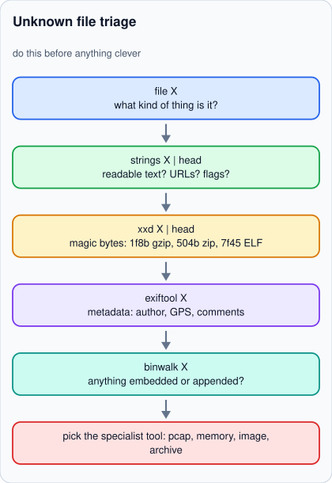
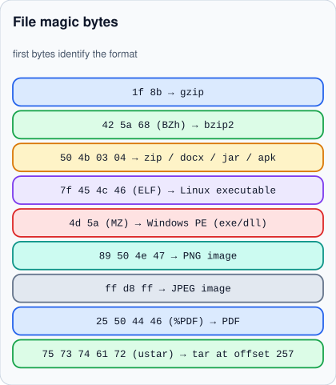
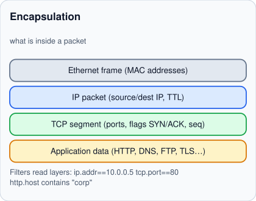
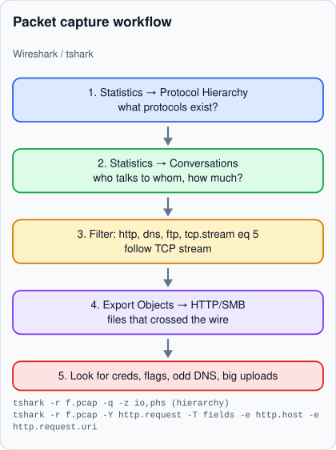
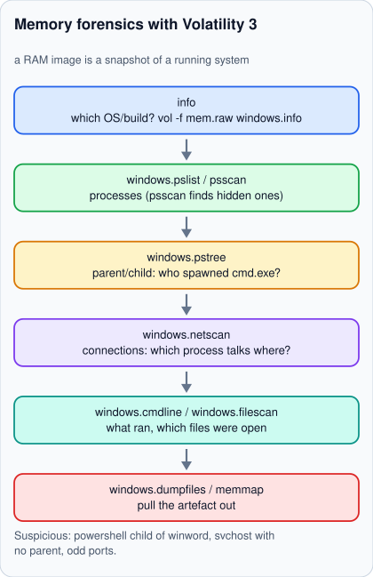
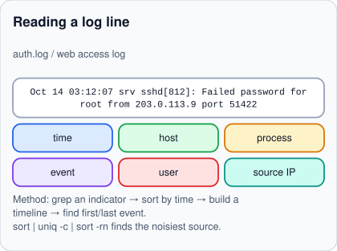
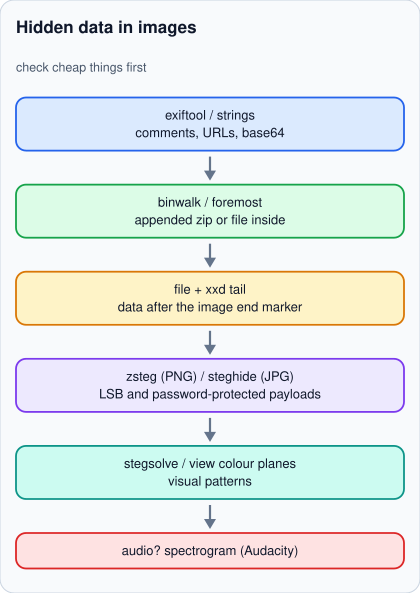

# 2. Forensics and network analysis

Forensics was the **largest category** in the 2022-23 CyberSci regionals (8 of 25 tasks). It rewards patience and a repeatable method more than clever tricks.

## 2.1 What forensics asks

You are handed *evidence* (a file, a packet capture, a memory image, a log) and asked a question: "what did the attacker do?", "which file was stolen?", "what is the password?". The flag is usually inside the evidence, not on a server.

## 2.2 Unknown-file triage



```bash
file mystery            # identify by magic bytes
strings -n 6 mystery | head -50
xxd mystery | head
exiftool mystery        # metadata
binwalk mystery         # embedded/appended files
```

| Output of `file` | Next |
|---|---|
| `data` | `xxd`, check entropy, `strings`; may be encrypted/compressed |
| `gzip`/`bzip2`/`Zip`/`tar` | extract with the matching tool (module bandit L12) |
| `PNG/JPEG` | image checklist (2.8) |
| `pcap`/`pcapng` | packet analysis (2.3) |
| `ELF`/`PE32` | reverse engineering (module 5) |
| `ASCII text` | read it; look for encodings (module 4) |



## 2.3 Packet captures

A **pcap** is a recording of network traffic. Each *packet* is nested like envelopes:



### Workflow



1. **Protocol hierarchy** shows which protocols exist; unusual ones (FTP, Telnet, SMB, IRC) are leads.
2. **Conversations** lists IP pairs by volume; large transfers are candidates.
3. **Follow stream** reassembles a TCP conversation into readable text.
4. **Export objects** saves files that crossed the wire (HTTP, SMB, TFTP).

### Display filters worth memorising

| Goal | Filter |
|---|---|
| a host | `ip.addr == 10.0.0.5` |
| a port | `tcp.port == 4444` |
| HTTP requests | `http.request` |
| HTTP POSTs | `http.request.method == "POST"` |
| DNS queries | `dns.qry.name contains "evil"` |
| TLS handshakes | `tls.handshake` |
| FTP creds | `ftp.request.command == "USER" \|\| ftp.request.command == "PASS"` |
| a stream | `tcp.stream eq 3` |
| string anywhere | `frame contains "flag"` |

### tshark equivalents

```bash
tshark -r cap.pcap -q -z io,phs                     # protocol hierarchy
tshark -r cap.pcap -q -z conv,tcp                   # conversations
tshark -r cap.pcap -Y http.request -T fields -e ip.src -e http.host -e http.request.uri
tshark -r cap.pcap -Y 'tcp.stream eq 5' -q -z follow,tcp,ascii,5
tshark -r cap.pcap --export-objects http,out_dir    # extract files
```

### Worked example

**Question:** "What file did the user download, and from where?"

| Step | Action | Result |
|---|---|---|
| 1 | Protocol Hierarchy | HTTP dominates |
| 2 | Filter `http.request` | one GET to `/update.zip` from `203.0.113.7` |
| 3 | Export Objects → HTTP | `update.zip` saved |
| 4 | `file update.zip`; `unzip -l` | contains `invoice.exe` |
| 5 | `sha256sum`, strings | malware indicators |

### Pitfalls

- **Encrypted traffic (TLS)**: you see handshakes and sizes, not content. Look for a **keylog file** in the challenge (`SSLKEYLOGFILE`) and load it in Wireshark (Preferences → Protocols → TLS).
- **Non-standard ports**: use Decode As.
- **Fragmented transfers**: follow the *TCP stream*, not single packets.

## 2.4 Memory forensics with Volatility 3



A **memory image** (`.raw`, `.mem`, `.vmem`, `.dmp`) is a copy of RAM. It contains running processes, network connections, command lines, keys and files that never touched disk.

```bash
python3 vol.py -f mem.raw windows.info
python3 vol.py -f mem.raw windows.pslist
python3 vol.py -f mem.raw windows.psscan      # finds hidden/terminated
python3 vol.py -f mem.raw windows.pstree
python3 vol.py -f mem.raw windows.netscan
python3 vol.py -f mem.raw windows.cmdline
python3 vol.py -f mem.raw windows.filescan | grep -i flag
python3 vol.py -f mem.raw -o out windows.dumpfiles --virtaddr 0xADDR
```

(For Linux images use the `linux.*` plugins; they need matching symbols.)

| Red flag | Why it matters |
|---|---|
| `winword.exe` → `powershell.exe` | macro launching a shell |
| `svchost.exe` with unusual parent | masquerading |
| process path outside `System32` | likely malware |
| connection to odd port from `notepad.exe` | injected process |
| one process only in `psscan` | hidden/unlinked |

**Typical flag locations:** command line arguments, a file in `filescan`, clipboard, environment variables, registry hives (`windows.registry.hivelist`).

## 2.5 Logs



```bash
# Who tried to log in, ranked
grep "Failed password" auth.log | awk '{print $(NF-3)}' | sort | uniq -c | sort -rn | head

# Successful logins after many failures
grep "Accepted" auth.log

# Web log: top requested paths and status codes
awk '{print $7}' access.log | sort | uniq -c | sort -rn | head
awk '$9 ~ /^5/' access.log | head
```

Method: **pick an indicator → timeline → first and last event → pivot** (the IP, user, file, process you found becomes the next search).

Windows event IDs to know:

| ID | Meaning |
|---|---|
| 4624 / 4625 | logon success / failure |
| 4688 | process created |
| 4672 | admin privileges assigned |
| 4768 / 4769 | Kerberos TGT / service ticket |
| 7045 | service installed |
| 1102 | audit log cleared |

## 2.6 Disk and file system

| Task | Tool |
|---|---|
| mount/inspect an image | `fdisk -l img`, `mmls`, `fls`, `icat` (Sleuth Kit) |
| browse GUI | Autopsy |
| recover deleted files | `foremost`, `photorec`, Autopsy |
| timeline | `fls -r -m / img > body`, `mactime` |

Things to check: deleted files, alternate data streams (NTFS), browser history (SQLite), shell history, recent files, scheduled tasks.

## 2.7 Documents, archives and passwords

```bash
unzip -l a.zip; zipinfo a.zip
7z l a.7z
zip2john a.zip > h; john --wordlist=/usr/share/wordlists/rockyou.txt h
pdfid.py x.pdf; pdf-parser.py x.pdf        # PDFs
olevba doc.docm                            # macros in Office docs
```

Office files (`docx`, `xlsx`) are zip archives: `unzip` and read `word/document.xml` and `word/media/`.

## 2.8 Image and audio steganography



```bash
exiftool img.jpg
strings -n 8 img.png | head
binwalk -e img.png
zsteg -a img.png           # PNG LSB
steghide extract -sf img.jpg   # try empty password first
```

Audio: open in Audacity; switch to **spectrogram view**; try changing sample rate or reversing.

## 2.9 Practice plan

| Day | Practice | Source |
|---|---|---|
| 1 | 2 pcap exercises: answer questions before checking | malware-traffic-analysis.net |
| 2 | 5 stego/file challenges | picoGym forensics |
| 3 | Volatility labs | CyberDefenders, THM Volatility |
| 4 | Log analysis: build a timeline | BTLO, CyberDefenders |
| 5 | Timed set: 3 mixed forensics challenges, 90 minutes | your pick |

## 2.10 Check yourself

1. What are the first three commands for an unknown file?
2. Which Wireshark view shows how much data each pair of hosts exchanged?
3. Why use `psscan` as well as `pslist`?
4. How do you recover a file that crossed the network over HTTP?
5. What does event ID 4688 tell you?
