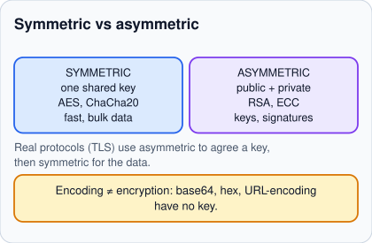
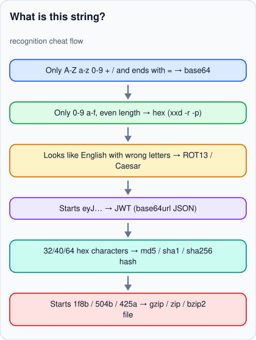
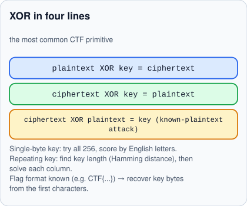
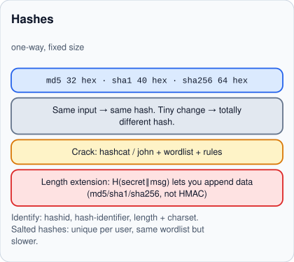
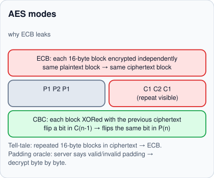
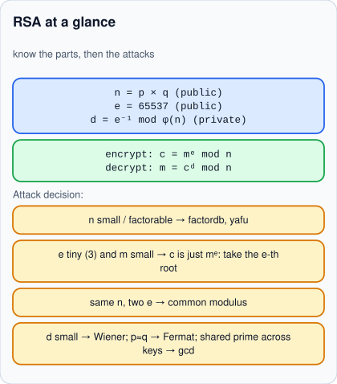

# 4. Cryptography and encodings

CTF crypto is rarely about breaking AES. It is about **recognising a mistake**: a reused key, a tiny exponent, a repeated block, a weak random number. Learn to identify the family, then apply the known attack.

## 4.1 Encoding is not encryption



| Thing | Has a key? | Reversible by anyone? |
|---|---|---|
| Encoding (base64, hex, URL) | no | yes |
| Obfuscation (ROT13, XOR with a short key) | trivial | yes, quickly |
| Encryption (AES, RSA) | yes | only with the key (or a flaw) |
| Hash (SHA-256) | no | no (one-way); can be guessed |



Fast decoding toolkit:

```bash
echo 'aGVsbG8=' | base64 -d              # base64
echo '68656c6c6f' | xxd -r -p            # hex
echo 'uryyb' | tr 'A-Za-z' 'N-ZA-Mn-za-m'  # rot13
python3 -c "print(bytes.fromhex('68656c6c6f'))"
python3 -c "import urllib.parse as u;print(u.unquote('%68%65'))"
```

CyberChef (offline copy!) chains these visually, and its **Magic** operation guesses layers.

## 4.2 XOR



XOR (`^`) compares bits: same → 0, different → 1. It is its own inverse.

```python
def xor(data, key):
    return bytes(b ^ key[i % len(key)] for i, b in enumerate(data))

# single-byte brute force, score by printable ASCII
ct = bytes.fromhex("1b37373331363f78151b7f2b783431333d78397828372d363c78373e783a393b3736")
for k in range(256):
    pt = bytes(b ^ k for b in ct)
    if all(32 <= c < 127 for c in pt):
        print(k, pt)
```

Strategy ladder:

1. Known prefix (`CTF{`, `flag{`) → key bytes = `ct[i] ^ prefix[i]`.
2. Single-byte key → brute force 256.
3. Repeating key → find key length (Hamming distance between blocks), then single-byte solve each column.
4. One-time pad reuse (two ciphertexts with the same key) → `c1 ^ c2 = p1 ^ p2`; guess a word (crib dragging).

## 4.3 Classical ciphers

| Cipher | Clue | Tool |
|---|---|---|
| Caesar/ROT | letters shifted | brute force 25 shifts |
| Atbash | A↔Z mirror | `tr A-Za-z ZYXWVUTSRQPONMLKJIHGFEDCBAzyxwvutsrqponmlkjihgfedcba` |
| Vigenère | repeating keyword | Kasiski/IC; dcode.fr |
| Substitution | each letter replaced | frequency analysis (quipqiup) |
| Rail fence, columnar | letters reordered | try ranks/columns |
| Morse, Baconian, Braille | symbols | decoders |

Frequency order in English: `ETAOIN SHRDLU`.

## 4.4 Hashes



```bash
echo -n 'password' | md5sum           # -n: no trailing newline!
hashid 5f4dcc3b5aa765d61d8327deb882cf99
hashcat -m 0 hash.txt rockyou.txt     # 0 md5, 100 sha1, 1400 sha256, 1800 sha512crypt, 3200 bcrypt
john --wordlist=rockyou.txt --format=raw-md5 hash.txt
```

Common mistakes to spot: unsalted password hashes (rainbow-table lookup), `H(secret || message)` MACs (length extension), truncated hashes, comparing hashes with `==` timing.

## 4.5 Symmetric ciphers (AES)



| Mode | Weakness | Attack |
|---|---|---|
| **ECB** | identical blocks → identical output | detect repeats; byte-at-a-time chosen-plaintext |
| **CBC** | malleable; padding oracle | bit-flipping; padding oracle decrypts without the key |
| **CTR/OFB** | keystream; **nonce reuse** | XOR two ciphertexts = XOR of plaintexts |
| **GCM** | nonce reuse | forge tags, recover keystream |

Detect ECB:

```python
def has_repeats(ct, bs=16):
    blocks = [ct[i:i+bs] for i in range(0, len(ct), bs)]
    return len(blocks) != len(set(blocks))
```

Padding oracle (idea): the server tells you whether padding is valid. By changing the previous block's bytes and watching valid/invalid, you recover each plaintext byte. Libraries: `padbuster`, `paddingoracle` (Python).

## 4.6 RSA



You are usually given `n`, `e`, `c` (and sometimes more) and must recover `m`.

```python
from Crypto.Util.number import long_to_bytes, inverse
d = inverse(e, (p-1)*(q-1))
m = pow(c, d, n)
print(long_to_bytes(m))
```

Attack lookup:

| What you see | Attack | Tool |
|---|---|---|
| `n` small (< ~200 bits) | factor | `factordb.com`, `yafu`, `msieve` |
| `e = 3`, `m^3 < n` | cube root of `c` | `gmpy2.iroot` |
| many `(n,c)` with `e=3` | Håstad broadcast (CRT) | sympy `crt` |
| two messages, same `n`, coprime `e1,e2` | common modulus | extended gcd |
| `d` small | Wiener | RsaCtfTool |
| `p` and `q` close | Fermat | RsaCtfTool |
| two keys share a prime | `gcd(n1,n2)` | python |
| `p` known partially | Coppersmith | Sage |

Automation: `RsaCtfTool --publickey key.pem --uncipherfile ct` tries many attacks.

## 4.7 Diffie-Hellman, ECC, randomness

| Topic | Look for |
|---|---|
| DH | small prime / small subgroup; `p-1` smooth → Pohlig-Hellman |
| ECC | invalid curve points; small order; reused nonce in ECDSA |
| PRNG | Python `random` seeded by time; LCG with known parameters; `randcrack` after 624 outputs |
| Signatures | nonce reuse → recover private key (ECDSA) |

## 4.8 Worked example

**Given:** `n = 3233`, `e = 17`, `c = 2790`.

1. `n` is small → factor: `3233 = 61 × 53`.
2. `φ = 60 × 52 = 3120`; `d = 17⁻¹ mod 3120 = 2753`.
3. `m = 2790^2753 mod 3233 = 65` → ASCII `A`.

Check with Python (`pow(c, d, n)`), then wrap into the flag format.

## 4.9 Practice plan

| Day | Practice |
|---|---|
| 1 | CryptoHack: Introduction + General |
| 2 | XOR scripts from memory; solve 5 xor challenges |
| 3 | CryptoHack: Mathematics + Symmetric |
| 4 | CryptoHack: RSA (all); write a one-page attack table |
| 5 | Cryptopals Set 1 (first 6) |

## 4.10 Check yourself

1. Why is base64 not encryption?
2. You see repeated 16-byte blocks in ciphertext: what mode and why?
3. `e=3` and a short message: what is the attack?
4. How do you recover a key from a known-plaintext XOR?
5. Why does `echo` vs `echo -n` change a hash?
