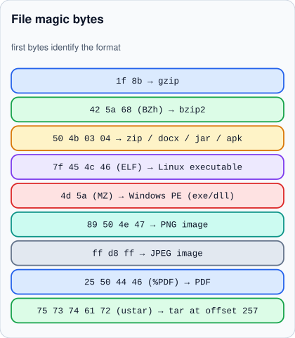
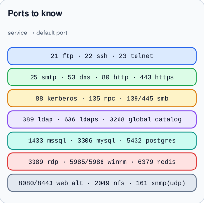

# 7. Cheat sheets (read the night before)

One compact sheet per category. Print or keep on your phone. If you can reproduce a sheet from memory, you know the material.

## 7.1 Linux survival

| Need | Command |
|---|---|
| where / who | `pwd` `whoami` `id` |
| list all | `ls -la` |
| type of file | `file X` |
| readable text in binary | `strings -n 6 X` |
| search text | `grep -rn "pat" dir` |
| find by property | `find / -type f -size 33c -user U 2>/dev/null` |
| unique / counts | `sort f \| uniq -c \| sort -rn` |
| fields | `cut -d' ' -f2` · `awk '{print $2}'` |
| decode | `base64 -d` · `xxd -r -p` · `tr` |
| archives | `tar xf` · `gzip -d` · `unzip` |
| networking | `nc` · `ss -tlnp` · `curl -i` |

## 7.2 Web

| Class | Test | Payload |
|---|---|---|
| SQLi | `'` | `' OR 1=1 --` · `' UNION SELECT NULL,NULL --` |
| XSS | reflect? | `<script>alert(1)</script>` · `"><svg onload=alert(1)>` |
| Cmd inj | `;` `\|` `$()` | `;id` · `$(id)` |
| LFI | `../` | `../../../etc/passwd` |
| SSTI | `{{7*7}}` | engine-specific |
| SSRF | URL param | `http://127.0.0.1/` · `169.254.169.254` |
| IDOR | change id | `id=1001` → `1002` |
| JWT | alg | `none` · weak secret · role claim |

## 7.3 Forensics

```text
file → strings → xxd | head → exiftool → binwalk
pcap: hierarchy → conversations → follow stream → export objects
memory: info → pslist/psscan → pstree → netscan → cmdline → filescan
logs: grep indicator → sort → timeline → pivot
stego: exiftool → strings → binwalk → zsteg/steghide → colour planes
```



## 7.4 Crypto

```text
base64: A-Za-z0-9+/ and = padding        hex: 0-9a-f
ROT13: tr 'A-Za-z' 'N-ZA-Mn-za-m'        XOR: p^k=c, c^p=k
RSA: m=c^d mod n ; try factordb, e=3 cube root, common modulus, wiener
ECB repeats blocks ; CBC bit-flip/padding oracle ; CTR nonce reuse
hash lengths: 32 md5, 40 sha1, 64 sha256
```

## 7.5 Reverse / pwn

```text
file; strings; ltrace; strace; checksec
ghidra: main → rename → strings xrefs
gdb: b main; r; ni; x/s $rdi; x/20wx $rsp; info registers
offset: cyclic(200) → crash value → cyclic_find
pwntools: p64(addr), ELF(), process(), remote(), sendlineafter
```

## 7.6 Privesc and AD

```text
linux: id; sudo -l; find / -perm -4000; getcap -r /; cron; ss -tlnp; history
windows: whoami /all; services; tasks; stored creds; SeImpersonate
AD: enum → AS-REP/Kerberoast → crack → spray/PtH → BloodHound → DA
pivot: ssh -L/-D ; chisel ; proxychains
```



## 7.7 Competition day checklist

```text
Before:  charger, ID, USB, resumes, cheat sheets, water/snacks
Start:   read ALL challenges, rank points/minute, assign owners
Rule:    30 minutes without a new observation → swap
Verify:  flag format, no trailing spaces, one owner submits
Notes:   5 lines per solve (first clue, technique, tool, mistake)
End:     20 min buffer; submit what you have; interviews after
```

## 7.8 Command-line flag quick reference

| Tool | Flags to remember |
|---|---|
| `ls` | `-la` all+long |
| `find` | `-type f -size Nc -user U -perm -4000 -exec` |
| `grep` | `-i -v -n -r -E -o -A -B` |
| `sort` | `-n -r -u -k` ; `uniq -c -u -d` |
| `nmap` | `-sC -sV -p- -Pn -oN` |
| `curl` | `-i -I -X -d -H -b -k -L` |
| `ssh` | `-p -i -L -D -t` |
| `tar` | `xf cf tf -z -j -C` |
| `hashcat` | `-m MODE -a 0` |
| `tshark` | `-r -Y -T fields -e -z` |
