# 8. The cybersecurity field map (wide scope)

CyberSci tests a slice of the field: the part that looks like puzzles. Real security work is wider. This module is the map: what each area is in plain English, how it connects to what you are practising, and where to go next. Read it once now, then use it as a compass.

> **How this chapter teaches.** Every area follows the same shape: *plain English → picture → how it really works → how you practise → how it links to CyberSci.* Skim the pictures first; read the words when a picture raises a question.

## 8.1 What "security" actually is

**Plain English.** Security is making sure the *right people* can do the *right things* with the *right information*, and nobody else can, even when something goes wrong.

**Analogy.** A building: locks (access control), cameras (detection), a fire plan (incident response), insurance (risk transfer), and the building code (compliance). It is *layers*, not one lock.

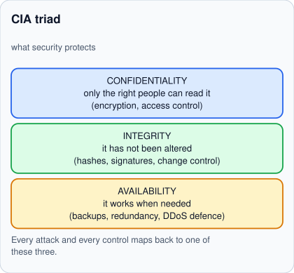

| Property | Question it answers | Typical attack | Typical control |
|---|---|---|---|
| Confidentiality | who can read it? | data theft, eavesdropping | encryption, access control |
| Integrity | was it changed? | tampering, malware | hashes, signatures, change control |
| Availability | can I use it? | ransomware, DDoS | backups, redundancy |

Two more words you will hear everywhere:

- **Threat**: something that could cause harm (an attacker, a flood).
- **Vulnerability**: a weakness (unpatched software, weak password).
- **Risk**: likelihood × impact of a threat using a vulnerability. A vulnerability with no exposure and no value is low risk.

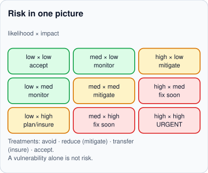

## 8.2 The map

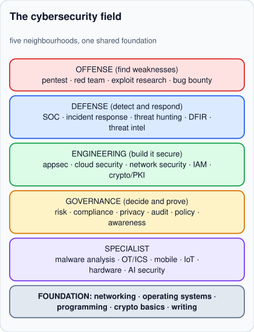

| Neighbourhood | Core question | Roles |
|---|---|---|
| **Offense** | how could this be broken? | pentester, red teamer, vulnerability researcher, bug bounty hunter |
| **Defense** | what is happening, and how do we stop it? | SOC analyst, incident responder, threat hunter, DFIR, threat intel |
| **Engineering** | how do we build it so it resists attack? | appsec, cloud security, network security, IAM, crypto/PKI engineer |
| **Governance** | what are we obliged to do, and what is acceptable risk? | risk analyst, compliance, privacy, auditor, CISO |
| **Specialist** | deep expertise in one technical area | malware analyst, OT/ICS, mobile, embedded, AI security |

**Purple team** = offense and defense working together: attack a technique, then check whether it was detected, then improve the detection. It is the most efficient way to improve a defence.

## 8.3 The shared foundation

Everything above stands on five things. Depth needed varies by role.

| Foundation | Minimum useful | Where CyberSci touches it |
|---|---|---|
| Networking | TCP/IP, DNS, HTTP, TLS, routing, firewalls | pcaps, scanning, pivoting |
| Operating systems | Linux CLI, Windows basics, processes, permissions | Bandit, privesc, forensics |
| Programming/scripting | Python, Bash, reading C | exploit scripts, parsers, automation |
| Cryptography basics | symmetric vs asymmetric, hashes, TLS | crypto challenges, JWT, hashes |
| Communication | clear writing, reports, explaining risk | writeups, interviews |

**Mastery check:** can you explain what happens, step by step, when you type a URL and press Enter (DNS → TCP → TLS → HTTP → render)? If yes you have the networking spine.

## 8.4 Offense: finding weaknesses on purpose

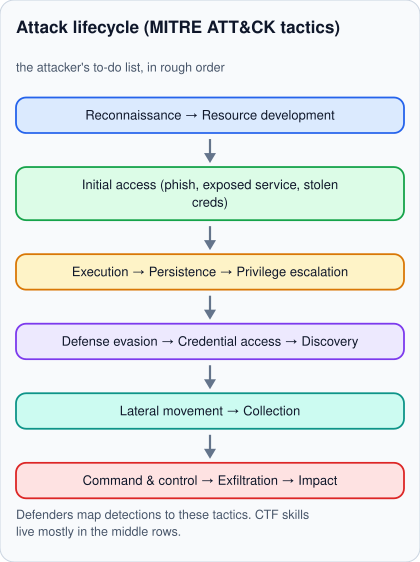

### Penetration testing
**Plain English.** A permitted, scoped attempt to break into a system, then a report on what was found and how to fix it.
**Analogy.** Hiring a locksmith to try your doors, then asking for a written list.
**Typical workflow.** Scope and rules of engagement → recon → scanning → exploitation → post-exploitation (proving impact) → reporting.
**Deliverable that matters.** The report: findings ranked by risk, evidence, and clear fixes.
**CyberSci link.** web, network, privesc and AD tracks; the "realistic IT environment" is pentest-shaped.

### Red teaming
**Plain English.** A longer, goal-driven simulation of a real adversary (e.g. "reach the finance database") that also tests the *defenders'* ability to notice.
**Difference from pentest.** Pentest = breadth (find many issues). Red team = depth and stealth (reach the goal, test detection).

### Vulnerability research and exploit development
Finding new bugs in software/hardware (fuzzing, reverse engineering) and turning them into working proofs. Heavy on reverse/pwn skills.

### Bug bounty
Companies pay for responsibly disclosed vulnerabilities. Good practice for web skills; high variance income. Always follow the programme's scope and rules.

### Social engineering
Attacking people rather than machines: phishing, pretexting, vishing. **Defence** is process (verification callbacks) and training.

## 8.5 Defense: detecting and responding

### Security operations centre (SOC)

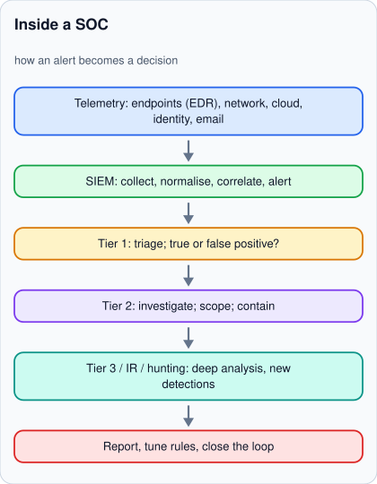

**Plain English.** The team that watches telemetry all day, decides which alerts are real, and acts.
**Key terms.** SIEM (collects and correlates logs), EDR (endpoint detection and response), alert fatigue, true/false positive, playbook, escalation.
**Skills used.** log analysis, understanding attacker behaviour, writing detections, clear tickets.
**CyberSci link.** forensics/log tasks; every log timeline you build is SOC work.

### Incident response (IR)

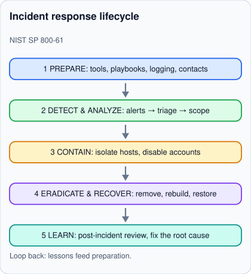

**Plain English.** What you do when something has already gone wrong: contain it, remove it, recover, and learn.
**Rule of thumb.** Preserve evidence *before* you wipe; decide who communicates; don't alert the attacker unnecessarily.

### Digital forensics (DFIR)
Recovering and interpreting evidence from disks, memory, network captures and logs, in a way that stands up to scrutiny (chain of custody). This is the engine behind your forensics challenges.

### Threat hunting and threat intelligence
- **Hunting:** proactively searching for attackers that did not trigger alerts, based on a hypothesis ("someone may be using scheduled tasks for persistence").
- **Threat intel:** knowing who attacks organisations like yours and how (TTPs), and turning that into detections.

### Detection engineering
Writing, testing and maintaining the rules (Sigma, SIEM queries, EDR logic) that find malicious behaviour. A strong bridge role between offense and defense.

### Vulnerability management
Inventory assets → scan → prioritise (CVSS, exploitability, exposure) → patch or mitigate → verify. Identifiers: **CVE** (a specific flaw), **CWE** (a class of weakness), **CVSS** (severity 0-10).

## 8.6 Engineering: building it secure

### Application security (appsec)

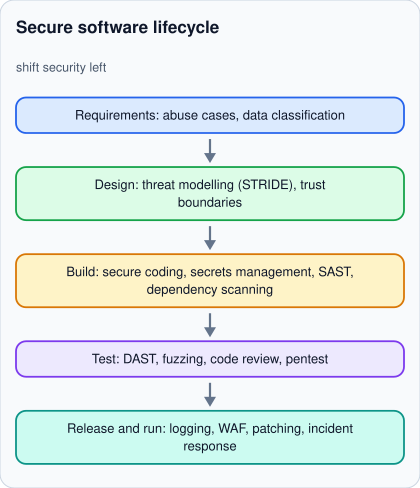

Reviewing code, threat-modelling designs, scanning, and teaching developers. The **OWASP Top 10** lists the most common web risks (broken access control, cryptographic failures, injection, insecure design, security misconfiguration, vulnerable components, authentication failures, integrity failures, logging failures, SSRF in the 2021 edition; check for a newer edition).

**Threat modelling (STRIDE):** Spoofing, Tampering, Repudiation, Information disclosure, Denial of service, Elevation of privilege. Ask of each component and data flow: "which of these could happen here?"

### Cloud security

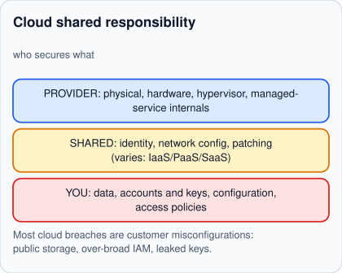

Identity and access management (IAM), network controls, storage permissions, key management, logging. The biggest real-world failures are *misconfiguration*, not exotic exploits.

### Network security
Firewalls, segmentation, VPNs, IDS/IPS, DNS security, **zero trust** ("never trust, always verify": authenticate and authorise every request, not just the perimeter).

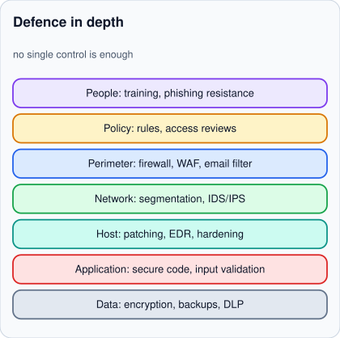

### Identity and access management
Authentication (who are you?), authorisation (what may you do?), MFA, single sign-on, privileged access management. **Least privilege**: give the minimum rights for the shortest time.

### Cryptography and PKI in practice
Choosing algorithms, managing keys, certificates and TLS configuration. The usual failures are *implementation and key management*, not broken maths (which is exactly what CTF crypto trains you to spot).

### Endpoint and host security
Patching, hardening baselines (CIS Benchmarks), EDR, application allow-listing, disk encryption.

## 8.7 Governance, risk and compliance (GRC)

**Plain English.** Deciding what to protect, how much to spend, and proving it to regulators and customers.

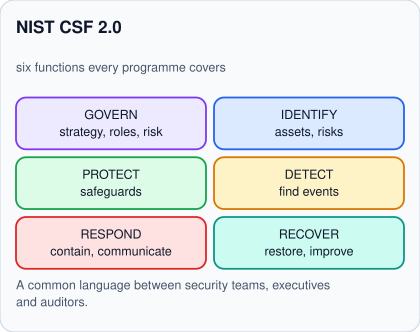

| Framework / law | What it is | Used for |
|---|---|---|
| **NIST CSF 2.0** | six functions: Govern, Identify, Protect, Detect, Respond, Recover | common language and maturity planning |
| **ISO/IEC 27001** | standard for an information security management system | certification customers ask for |
| **CIS Controls** | prioritised list of defensive actions | practical hardening roadmap |
| **MITRE ATT&CK** | knowledge base of attacker tactics and techniques | detection coverage, threat modelling |
| **OWASP** (Top 10, ASVS, WSTG) | web/app security guidance | developers, testers |
| **PCI DSS** | payment-card security requirements | anyone handling card data |
| **SOC 2** | attestation about a service provider's controls | SaaS vendors |
| **PIPEDA** (and provincial laws such as Quebec's Law 25) | Canadian privacy rules for personal information | breach reporting, consent |
| **GDPR** | EU data protection regulation | any organisation handling EU residents' data |

**Risk treatments:** avoid, reduce (mitigate), transfer (insure/contract), accept. Written decisions and owners matter as much as the technical fix.

**Business continuity and disaster recovery (BC/DR):** backups you have *tested restoring*, recovery time and recovery point objectives (RTO/RPO).

## 8.8 Specialist areas

| Area | Plain English | Entry points |
|---|---|---|
| **Malware analysis** | work out what a malicious program does | static (strings, PE/ELF, Ghidra), dynamic in sandbox; YARA |
| **OT/ICS security** | protecting factories, utilities, pipelines | Purdue model, Modbus/DNP3, safety first |
| **Mobile** | iOS/Android app and device security | OWASP MASVS, APK reversing |
| **IoT/embedded/hardware** | security of devices and firmware | firmware extraction, UART/JTAG, binwalk |
| **AI/ML security** | attacks on and with models | prompt injection, data poisoning, model theft; OWASP LLM Top 10 |
| **Privacy engineering** | build systems that minimise personal data risk | data mapping, anonymisation, consent |

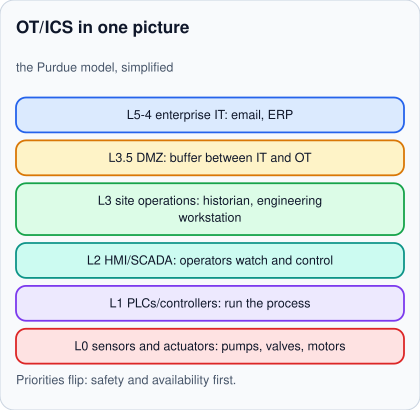

## 8.9 How attacks are described and how defenders think

| Model | Steps | Use |
|---|---|---|
| **Cyber kill chain** | recon → weaponise → deliver → exploit → install → command & control → actions | break the chain at any link |
| **MITRE ATT&CK** | 14 tactics (recon … impact) with hundreds of techniques | detection and emulation mapping |
| **Diamond-style analysis** | adversary, capability, infrastructure, victim | linking incidents |
| **STRIDE** | six threat types | design review |

**Defender mindset in one line:** *assume breach; make the attacker's path noisy, slow and narrow.*

## 8.10 Ethics, law and professionalism

- **Authorisation first.** Testing systems without written permission is illegal in most places (in Canada, the Criminal Code's unauthorised-use-of-computer offences).
- **Scope discipline.** Stay inside rules of engagement; report anything out of scope instead of exploring it.
- **Responsible disclosure.** Report vulnerabilities privately with enough detail to fix; give time to patch.
- **Data handling.** Don't keep or share data you don't need; redact in writeups.
- **Honesty in reports.** State what you proved and what you assumed.

## 8.11 Careers, certifications and a Canadian lens

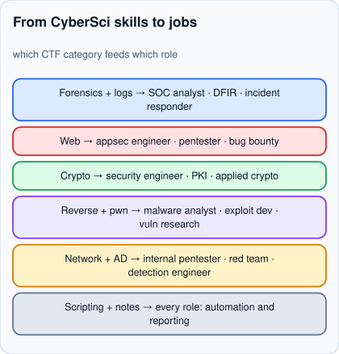

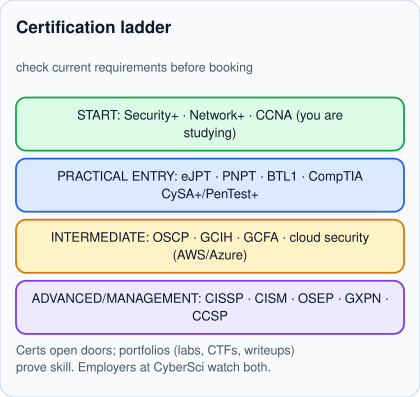

| Stage | What employers see | Evidence to build |
|---|---|---|
| Student | curiosity, fundamentals | CyberSci result, writeups, home lab |
| Entry (SOC/IT sec/appsec junior) | tools + method | certs (Security+, BTL1/eJPT), internships |
| Mid | depth in one area | OSCP/GCIH-type exam, projects, talks |
| Senior | judgement, leadership | designs, incidents led, mentoring |

**Canadian context.** The **Canadian Centre for Cyber Security** (Cyber Centre, part of CSE) publishes guidance and alerts; CyberSci partners with Canadian employers and sends winners to national and international events (ECSC, ICC); regulated sectors (finance, telecom, critical infrastructure) drive demand for GRC and SOC roles.

## 8.12 A 12-month plan after CyberSci (T-shaped)

*Broad* means every neighbourhood at "can explain it". *Deep* means one specialty at "can do it".

| Months | Focus | Output |
|---|---|---|
| 1-2 | Close CyberSci gaps; finish backlog | notes, 30 writeups |
| 3-4 | Defensive depth: Windows event logs, Sysmon, Sigma, Splunk/ELK lab | 10 detections, 3 IR reports |
| 5-6 | Pick your deep area (appsec, cloud, malware, AD) | a portfolio project |
| 7-8 | Cloud basics: IAM, storage, logging; one provider's free tier | a misconfiguration lab write-up |
| 9-10 | GRC literacy: map a small org to NIST CSF; write a risk register | a one-page risk assessment |
| 11-12 | Certification or capstone; mentor newer students | exam passed or public project |

## 8.13 Glossary (50 terms you will hear)

| Term | One-line meaning |
|---|---|
| Authentication | proving who you are |
| Authorisation | what you may do |
| Payload | the code an exploit delivers |
| Exploit | method that abuses a vulnerability |
| Zero-day | vulnerability with no vendor fix yet |
| Patch | fix for a vulnerability |
| CVE | public ID for a vulnerability |
| CVSS | 0-10 severity score |
| IOC | indicator of compromise (hash, IP, domain) |
| TTP | tactics, techniques and procedures |
| C2 / C&C | command-and-control channel |
| Beacon | periodic call-home from malware |
| Lateral movement | moving between hosts after initial access |
| Persistence | way to survive reboots/logouts |
| Privilege escalation | gaining higher rights |
| Pivoting | using a compromised host to reach others |
| Exfiltration | stealing data out |
| Ransomware | encrypts data for payment |
| Phishing | deceptive messages to steal creds/run code |
| MFA | second proof of identity |
| SSO | one login for many apps |
| SIEM | log collection and correlation |
| EDR | endpoint detection and response |
| IDS/IPS | network intrusion detection / prevention |
| WAF | web application firewall |
| Sandbox | isolated environment to run untrusted code |
| Honeypot | decoy system to study attackers |
| Hash | fixed-size fingerprint of data |
| Salt | random value added before hashing |
| PKI | certificates and trust infrastructure |
| TLS | encryption layer for network traffic |
| VPN | encrypted tunnel |
| Segmentation | splitting networks to limit spread |
| Least privilege | minimum necessary access |
| Defence in depth | layered controls |
| Zero trust | verify every request |
| Threat model | structured list of what could go wrong |
| Attack surface | all the places an attacker can interact |
| Red/Blue/Purple team | attack / defend / together |
| Rules of engagement | what testers may and may not do |
| Chain of custody | documented handling of evidence |
| RTO / RPO | recovery time / data-loss objectives |
| BCP / DRP | business continuity / disaster recovery plans |
| SBOM | list of software components |
| Supply-chain attack | compromise via a vendor or dependency |
| Insider threat | harm from someone with legitimate access |
| Shadow IT | unapproved tech in use |
| Tabletop exercise | discussion-based incident drill |
| Bug bounty | paid vulnerability disclosure |
| Fuzzing | feeding random input to find crashes |

## 8.14 Teach it back

1. Explain risk to a non-technical manager in three sentences.
2. Name five neighbourhoods of the field and one role in each.
3. What is the difference between a pentest and a red team?
4. Which CyberSci category feeds SOC work, and why?
5. Why are most cloud breaches configuration problems?
6. What does "assume breach" change about how you design a network?
