# 9. Worked writeups: how experts actually think

A flag is the least interesting part of a CTF challenge. What you want to keep is the **thinking**: what was noticed, why that mattered, and what made the next step obvious. This chapter walks through 14 worked cases:

- **Part A**: four cases drawn from **public CyberSci writeups** (2021-2022), explained at concept level.
- **Part B**: ten **archetype** cases with small, hand-checkable data you can redo with pencil and a Python prompt.

> **Taste profile for this chapter.** Plain English first, a picture before the mechanism, then the exact steps, then a "teach it back" prompt. If a case feels easy, jump to *Variations*; if it feels hard, read *Plain English* and the picture, then try the steps again.

## 9.0 How to read (and write) a writeup

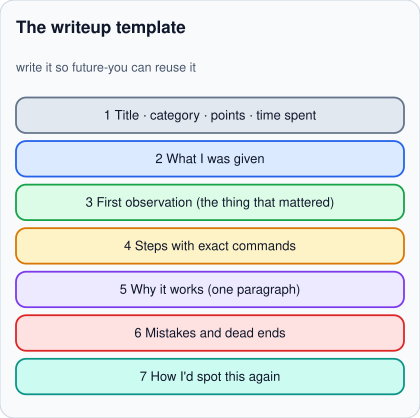

Read every writeup in three passes:

1. **Cover the solution.** Read only the challenge text. Write your own triage line: category, first command, first hypothesis.
2. **Read until the first surprise.** Stop at the first observation that you would not have made. That is the lesson.
3. **Reproduce** the key step yourself. A writeup you only read is trivia; a step you ran is a skill.

Where to find writeups (all public):

| Source | Good for |
|---|---|
| CTFtime writeups (`ctftime.org/writeups`) by event/task | the broadest index |
| Team blogs and GitHub repos (e.g. UofTCTF, crimist/ctf, Green-Avocado/CTF) | CyberSci 2022 |
| picoCTF, HTB, OverTheWire community writeups | beginner-friendly |
| Conference talks and the PortSwigger Research blog | technique depth |

Respect the rules: don't read writeups for an event while it is running, and don't publish solutions for platforms that ask you not to (OverTheWire).

---

# Part A: CyberSci cases (explained from public writeups)

Sources are the public writeups listed in `cybersci-writeups.md`. These summaries are *concept-level* explanations in my own words.

## A1. "Warmup": the hidden virtual host (CyberSci Regionals 2022)

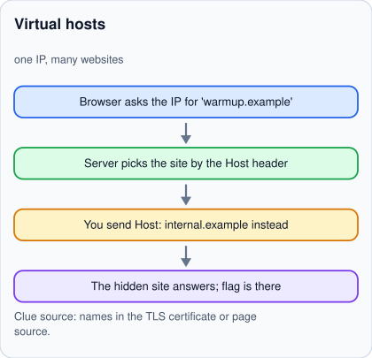

**Plain English.** One server address can host many different websites. The server decides which to show by reading the **Host header** you send. The challenge hid its flag on a site whose name was only visible as a *second name* in the server's certificate.

**What you are given.** An IP address of a web server (an internal range, `10.0.2.x`).

**Triage.** category *web / recon*; cost: tiny; first observation: look at what the server *tells you about itself*.

**Steps (concept).**

| # | Do | Why |
|---|---|---|
| 1 | request the page by IP over **https** and inspect the certificate | a certificate lists the names it is valid for |
| 2 | notice a second name besides the public one (e.g. `internal.*`) | that is a site the owner didn't advertise |
| 3 | repeat the request with that name in the `Host` header | the server picks the matching virtual host |
| 4 | read the response | the flag is on the hidden site |

```bash
# generic form: ask the same IP for a different site
curl -k -H 'Host: internal.example.test' https://10.0.2.21/
```

**Pitfall in the original.** The first attempt used `http` instead of `https`: the hidden site only existed on the TLS listener. When a request returns something unrelated, change *one* thing at a time (scheme, port, header).

**Why it works.** Name-based virtual hosting: the TLS server and the web server both use the requested name to choose a configuration. Nothing prevents you from *asking* for another name.

**Where else you will see it.** Bug bounty "subdomain discovery", internal admin panels, staging sites. Defence: don't rely on obscurity of a hostname; require authentication.

**Teach it back.** "Why does the same IP answer differently depending on a header the client chooses?"

## A2. "Vault": the two-symbol file (CyberSci Regionals 2022)

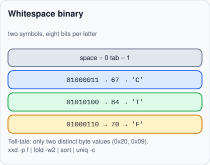

**Plain English.** A file looked like random encrypted data, but it was made of only two different characters. Two symbols = a binary code in disguise.

**Triage.** category *crypto/forensics*; first command: `xxd file | head`; first observation: **only two byte values appear** (0x20 space and 0x09 tab).

**Method.**

```bash
xxd -p file | fold -w2 | sort | uniq -c      # how many distinct byte values?
```

| # | Do | Why |
|---|---|---|
| 1 | count distinct bytes | 2 values → binary alphabet |
| 2 | map `space → 0`, `tab → 1` (and try the opposite) | bits |
| 3 | group into 8 → ASCII | many CTF encodings are exactly this |
| 4 | the output was *another layer* (hex text, then bytes) | keep peeling with `file`/`xxd` |

Toy example you can check by hand: the letters `CTF` are `01000011 01010100 01000110`; write `0` as space and `1` as tab and you have the file.

```python
def decode(ws):
    bits = "".join("1" if ch == "\t" else "0" for ch in ws if ch in " \t")
    return bytes(int(bits[i:i+8], 2) for i in range(0, len(bits) - 7, 8))
```

**Lesson.** *Histogram first.* Counting byte values takes ten seconds and tells you whether you face text, binary, a two-symbol code or real encryption (all 256 values, roughly equal).

**Variations.** Morse as dots and dashes, Bacon cipher as A/B, DNA codes (ACGT = 2 bits), QR as black/white.

## A3. "String Storage": the yes/no oracle (CyberSci Regionals 2022, pwn)

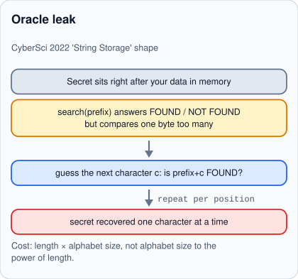

**Plain English.** The program won't tell you the secret. But it will answer "is this a match?", and a tiny bug makes the answer depend on the secret. If you can ask unlimited questions, you can recover the secret one letter at a time.

**What you are given.** Only the **source code** and a service. No binary exploitation required.

**The bug (shape).**

```c
/* entries are stored back-to-back; the secret sits right after the last one */
int matches(const char *entry, size_t len, const char *query) {
    return strncmp(entry, query, len + 1) == 0;   /* BUG: compares len+1 bytes */
}
```

**Reasoning.**

| Step | Thought |
|---|---|
| 1 | `len + 1` includes the byte *after* the entry, which is the first secret byte |
| 2 | so `matches(entry, entry + c)` is true only when `c` equals that secret byte |
| 3 | try every candidate `c`; the one that returns "found" is the first secret char |
| 4 | move the window: store the new, longer prefix and repeat |

**Cost.** about `length × alphabet` queries (≈ 40 × 62), not `62^40`. That difference is why oracles are dangerous.

**What this teaches.**

- Read source for **comparison length, loop bounds and adjacent data**, not just for memory corruption.
- Any "valid / invalid" signal (error text, timing, status code) can be an oracle: padding oracles, login enumeration, boolean SQLi, timing leaks in string compares.
- Fix: compare exact lengths; compare secrets in constant time; don't expose the oracle.

## A4. The multi-stage chain (CyberSci Nationals 2021 "Command and Control")

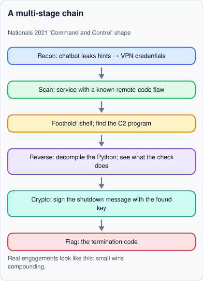

**Plain English.** A scenario where each step unlocks the next, like a game level. The public writeup describes a track about taking down a criminal group's command-and-control server.

**The chain (as described publicly).**

| Stage | What happened | Skill |
|---|---|---|
| 1 Recon | talk to a chatbot; it leaks answers to security questions and a VPN password | OSINT / social reasoning |
| 2 Service | a port scan shows a data-processing service with a *known* remote-code flaw | scanning + CVE lookup |
| 3 Foothold | a public exploit module gives a shell; the C2 program is in the root directory | exploitation basics |
| 4 Reverse | compiled Python is decompiled; the "shutdown" command is unimplemented and the signing function returns nothing | decompiling (uncompyle6) |
| 5 Crypto | implement the missing signature with RSA + SHA-256 using a private key found on the box | applied crypto |
| 6 Flag | the server accepts the signed command and returns a termination code | verifying the result |

**Why it is a great study case.** Each stage is *easy* alone. The difficulty is **sequencing and not giving up**: after every step, ask "what do I now have that I didn't?" (a credential, a path, a key, a program) and "what does it unlock?".

**Practice.** Rebuild a tiny version in your own lab: a vulnerable service, a Python program with a check, a key file. Writing the puzzle is the best way to understand it.

---

# Part B: archetype cases (data small enough to check by hand)

## B1. The onion (layered encodings)

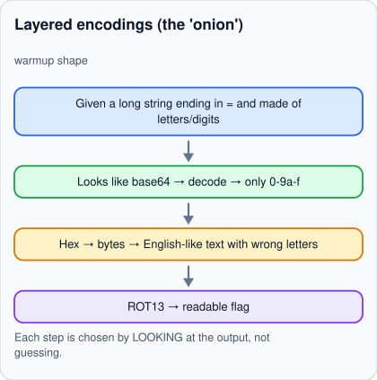

**Given:** `NTA0NzUzN2I2MzcyNzI3OTVmNjc3NTcyNWY2MjYxNzY2MjYxN2Q=`

| Step | Observation | Action | Result |
|---|---|---|---|
| 1 | letters, digits, ends with `=` | base64 decode | `5047537b6372...` |
| 2 | only `0-9a-f`, even length | hex → bytes | `PGS{crry_gur_bavba}` |
| 3 | braces and a 3-letter prefix; letters wrong | ROT13 | `CTF{peel_the_onion}` |

```bash
echo 'NTA0Nz...=' | base64 -d | xxd -r -p | tr 'A-Za-z' 'N-ZA-Mn-za-m'
```

**Plain-English rule:** at each step, say what the string *looks like* before choosing a tool. Alphabet and length are the clues (see the recognise chart in module 4).

**Variations.** Add gzip in the middle; reverse the string; URL-encode it.

## B2. Single-byte XOR

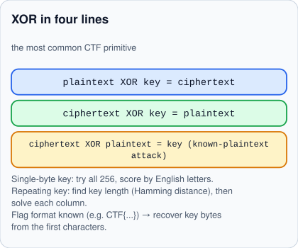

**Given:** hex ciphertext `697e6c5152455875435975435e5975455d447543445c4f58594f57`; flag format `CTF{...}`.

**Plain English.** XOR flips bits using a key. Using the *same key twice* undoes it. If the key is one byte, there are only 256 keys.

| Step | Do |
|---|---|
| 1 | bytes = hex decode |
| 2 | for k in 0..255: plaintext = each byte XOR k |
| 3 | print the ones that start with `CTF{` or are all printable |

```python
ct = bytes.fromhex("697e6c5152455875435975435e5975455d447543445c4f58594f57")
for k in range(256):
    pt = bytes(b ^ k for b in ct)
    if pt.startswith(b"CTF{"):
        print(hex(k), pt)
```

**Answer path (checked):** key `0x2a`, plaintext `CTF{xor_is_its_own_inverse}`.

**Known-plaintext shortcut.** `key = ciphertext[0] XOR ord('C')` → `0x69 ^ 0x43 = 0x2a`. One known byte gives the key.

**Variations.** Repeating key (find length via Hamming distance, then solve each column); key reuse across two messages (`c1 ^ c2 = p1 ^ p2`).

## B3. Tiny RSA

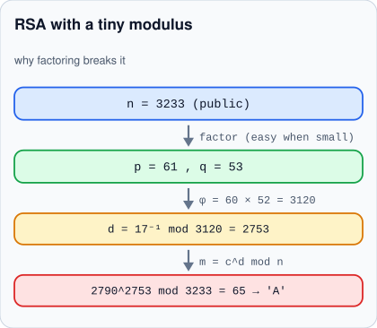

**Given:** `n = 62773913`, `e = 65537`, `c = 25260084`.

**Plain English.** RSA's safety rests on one hard problem: splitting `n` into its two primes. If `n` is small, anyone can split it.

| Step | Do | Result |
|---|---|---|
| 1 | factor `n` (trial division or factordb) | `7919 × 7927` |
| 2 | `φ = (p-1)(q-1)` | `62758068` |
| 3 | `d = e⁻¹ mod φ` | `48837473` |
| 4 | `m = c^d mod n` | `0x435446` |
| 5 | bytes | `CTF` |

```python
p, q, e, c = 7919, 7927, 65537, 25260084
n = p * q
d = pow(e, -1, (p - 1) * (q - 1))
print(pow(c, d, n).to_bytes(3, "big"))     # b'CTF'
```

**Sanity example (classic):** `n=3233=61×53`, `e=17`, `c=2790` → `d=2753` → `m=65` = `A`.

**Variations.** `e=3` with a short message (cube root), same message sent to three recipients (CRT), shared prime across two moduli (`gcd`).

## B4. The log story

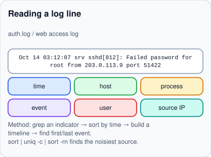

**Given:** an excerpt of `auth.log`:

```text
03:12:01 sshd: Failed password for root from 203.0.113.9
03:12:03 sshd: Failed password for root from 203.0.113.9
03:12:05 sshd: Failed password for admin from 203.0.113.9
03:12:08 sshd: Failed password for admin from 203.0.113.9
03:12:10 sshd: Failed password for test from 198.51.100.4
03:12:14 sshd: Failed password for root from 203.0.113.9
03:12:20 sshd: Accepted password for admin from 203.0.113.9
03:15:02 sshd: session opened for user admin
03:15:40 sudo: admin : COMMAND=/bin/bash
03:16:11 useradd: new user: name=backup2
```

**Questions and filters.**

| Question | Command | Answer |
|---|---|---|
| Which IP failed most? | `grep Failed f \| awk '{print $NF}' \| sort \| uniq -c \| sort -rn` | `203.0.113.9` (5), `198.51.100.4` (1) |
| Did anyone get in? | `grep Accepted f` | `admin` at 03:12:20 |
| After how many failures? | count `Failed` before that time from that IP | 5 |
| What happened next? | read lines after the success | root shell via sudo, then a new account |

**The story (what a SOC writes).** Password spray from `203.0.113.9` against `root` and `admin` → success as `admin` at 03:12:20 → privilege escalation (`sudo bash`) → persistence (new user `backup2`). **Containment:** block the IP, disable `admin`/`backup2`, rotate credentials, review other hosts for the same IP.

**Lesson.** Frequency counts find *who*; ordering by time finds *what happened next*; the **pivot** (IP, user, process) feeds the next search.

## B5. The capture as a story

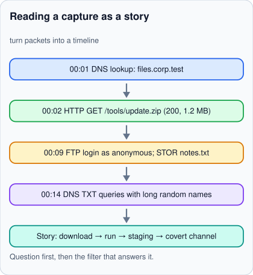

**Given:** a capture summarised as:

| Time | Protocol | Detail |
|---|---|---|
| 00:01 | DNS | A query `files.corp.test` |
| 00:02 | HTTP | GET `/tools/update.zip` → 200 (1.2 MB) |
| 00:09 | FTP | USER anonymous, PASS (email), STOR notes.txt |
| 00:14 | DNS | many TXT queries to `x7f3….evil.test` |

**Reasoning.**

| Observation | Meaning | Check |
|---|---|---|
| an executable-looking zip fetched over cleartext HTTP | possible malware delivery | export the object; `file`, hash |
| anonymous FTP upload | data staged to an open server | follow the FTP stream for file contents |
| long random DNS TXT queries | likely covert channel (DNS tunnelling) | decode the labels; check entropy and volume |

**Filter ladder.** `http.request` → `ftp` → `dns.qry.type == 16` (TXT) → `dns.qry.name.len > 40`.

## B6. Memory snapshot: spot the odd process

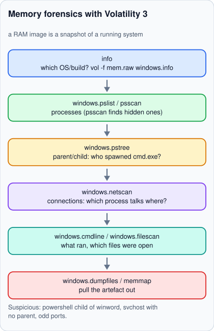

**Given:** `windows.pstree` summarised:

```text
PID  PPID  Name
  4     0  System
448     4  smss.exe
620   448  csrss.exe
2840 1984  WINWORD.EXE
3120 2840   powershell.exe
3320 3120    cmd.exe
```

**Reasoning.** Word (`WINWORD.EXE`) should not spawn PowerShell, which spawns `cmd.exe`. That parent-child chain is the classic **malicious macro** pattern.

| Next step | Plugin |
|---|---|
| what did PowerShell run? | `windows.cmdline` |
| where did it connect? | `windows.netscan` |
| what file was opened? | `windows.filescan` |
| extract the document | `windows.dumpfiles` |

**Lesson.** Learn what *normal* looks like (process tree, paths, parents); anomalies pop out.

## B7. Web: reading the query in your head

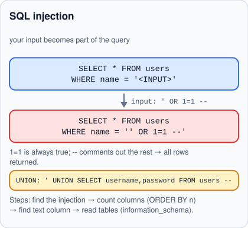

**Given:** a login form. You suspect the server builds:

```text
SELECT * FROM users WHERE name = '<name>' AND pass = '<pass>'
```

| You type in `name` | Query becomes | Effect |
|---|---|---|
| `admin` | `... name = 'admin' AND pass = '...'` | normal |
| `admin'` | `... name = 'admin'' AND ...` | quote unbalanced → **error** → input reaches SQL |
| `admin' --` | `... name = 'admin' -- ' AND pass = ...` | rest commented out → login as admin without password |

**Plain English.** The server pastes your text into its question; a quote lets you end the string and write your own words.

**Evidence ladder.** error message → boolean difference (`' AND 1=1 --` vs `1=2`) → UNION with matching column count → read other tables.

**Fix.** Parameterised queries. This reasoning is also how you review code: search for string concatenation near a query.

## B8. IDOR

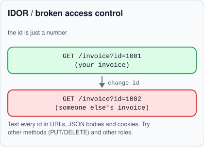

**Given:** after login you see `GET /api/invoice/1001` (yours).

**Reasoning.** The id is a number the client controls. Request `/api/invoice/1002`. If it returns someone else's data, the server checks *that you are logged in* but not *that it is yours*.

**Checklist.** Other ids, other methods (PUT/DELETE), ids in JSON bodies and cookies, GUIDs (leaked elsewhere?), mass assignment (`"role":"admin"` in a profile update).

## B9. File tricks: data hidden after the end

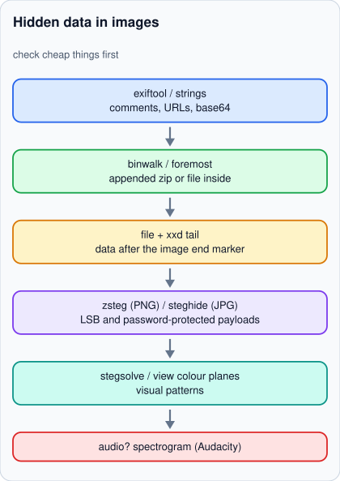

**Given:** `holiday.png` that opens normally. `xxd holiday.png | tail -3` shows:

```text
...  49 45 4e 44 ae 42 60 82  50 4b 03 04 14 00 ...   IEND.B`.PK....
```

**Reasoning.** `49 45 4e 44 ae 42 60 82` is the PNG **IEND** chunk: the image ends there. `50 4b 03 04` right after is a **ZIP** signature. A zip is appended after the image.

```bash
binwalk -e holiday.png           # or:
unzip holiday.png                # unzip tolerates leading data
```

**Lesson.** Magic bytes at *unexpected offsets* reveal embedded files. Also check metadata (`exiftool`) and strings for passwords.

## B10. A crackme in ten minutes

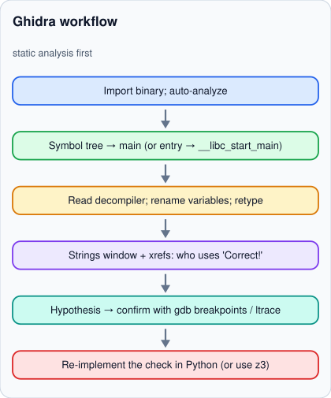

**Given:** a program asking for a password. `ltrace ./crackme` shows:

```text
printf("Password: ")
fgets("guess\n", 64, stdin)
strcmp("guess\n", "s3cr3t_pass")
puts("Wrong!")
```

**Reasoning.** The program compares your input to a fixed string using `strcmp`. `ltrace` prints both arguments, so the secret is visible. No decompiler needed.

**When it isn't that easy.** The comparison happens after a *transform*: the program hashes or XORs your input and compares to a stored constant. Then you: find the transform in Ghidra, reproduce it in Python, and invert or brute-force it.

**Lesson.** Always try the cheap tools first: `strings`, `ltrace`, `strace`. They solve more easy crackmes than expertise does.

---

# Part C: building your own writeup library

## C1. Routine (20 minutes per challenge)

| Minute | Do |
|---|---|
| 0-5 | read the brief; write the triage line |
| 5-15 | try; stop at the first solid observation |
| 15-20 | read one public writeup *after* you have an observation; compare |

Then write five lines in the template (see 9.0) and tag the technique (e.g. `oracle`, `vhost`, `two-symbol-code`). Search by tag before an event.

## C2. Taste checklist: make each writeup work for *you*

- Start with a **picture** (diagram, table of steps).
- Put **plain English** first, then the mechanism.
- Keep a **"how I'll recognise this again"** line.
- End with a **teach-back sentence**: explain it to a smart friend who has never done a CTF.

## C3. Progress markers

| Level | Evidence |
|---|---|
| Recognise | you can name the technique after seeing the data |
| Reproduce | you can redo it from scratch with notes |
| Vary | you can solve a modified version |
| Create | you can build a challenge using the same idea |

Aim for **Create** on at least five techniques before November 21: oracle, layered encoding, two-symbol code, vhost, tiny RSA.

## C4. Check yourself

1. In A3, why is the cost *length × alphabet* rather than *alphabet^length*?
2. What are the first three commands for a mystery file that only has two byte values?
3. In B4, which command finds the attacker, and which finds what they did next?
4. In B6, why is `WINWORD.EXE → powershell.exe` suspicious?
5. Explain a hidden virtual host to a friend in two sentences.
