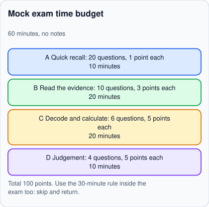
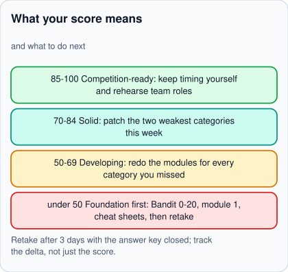

# 10. Mock exam (60 minutes, 100 points)

A closed-book self-test that mimics the *shape* of a CyberSci day: quick recall, reading evidence, decoding, and judgement. Take it cold, score it honestly, then fix what you missed.



## Rules

1. **60 minutes, no notes, no internet, no AI.** Pen and paper (or Notes app) plus a Python prompt for Part C if you like.
2. Answer on a separate sheet; **don't peek at the answer key** (it begins after the questions on the "Answer key" page).
3. If you stall on a question for more than 2 minutes, write `skip` and move on, then come back.
4. Score yourself with the key, then use the score map at the end.
5. Retake in 3 days with different pacing. Track the change.

---

# Questions

## Part A: quick recall (20 questions, 1 point each)

**A1.** What does `2>/dev/null` do?

**A2.** Which command identifies a file's type from its contents?

**A3.** How many hex characters is a SHA-256 hash?

**A4.** Default ports for SSH and for Kerberos?

**A5.** What does the `s` in `-rwsr-xr-x` mean?

**A6.** Name the three families of XSS.

**A7.** What does IDOR stand for, and what do you test?

**A8.** What is the cloud metadata IP address abused by SSRF?

**A9.** Encoding versus encryption: what is the difference?

**A10.** Write the RSA decryption formula.

**A11.** What does AES in ECB mode leak?

**A12.** Which Volatility 3 plugin lists network connections?

**A13.** Which Windows Security event ID means a failed logon?

**A14.** What does the NX protection do?

**A15.** In the x86-64 System V convention, which register holds the first argument?

**A16.** What does `sort f | uniq -u` print?

**A17.** What is the *first* step of the CTF loop?

**A18.** What is the 30-minute rule?

**A19.** CyberSci regionals: what date, what format, and is AI allowed?

**A20.** What are the three letters of the CIA triad?

## Part B: read the evidence (10 questions, 3 points each)

**B1.** `file prog` prints `ELF 64-bit LSB pie executable, x86-64, dynamically linked, not stripped`. Name two things this tells you that help a reverse engineer.

**B2.** The first bytes of a download are `1f 8b 08 00`. What is the file, and what command extracts it?

**B3.** Read this log excerpt.

```text
10:01:02 Failed password for admin from 198.51.100.7
10:01:04 Failed password for admin from 198.51.100.7
10:01:06 Failed password for root  from 198.51.100.7
10:01:30 Failed password for bob   from 203.0.113.20
10:01:41 Failed password for admin from 198.51.100.7
10:01:45 Accepted password for admin from 198.51.100.7
10:02:10 sudo: admin : COMMAND=/usr/bin/crontab -e
```

(a) Which IP is the attacker? (b) Which account was compromised and after how many failures from that IP? (c) What persistence step is likely next?

**B4.** A packet summary shows `FTP USER bob`, `FTP PASS Winter2025!`, and a `TLS Client Hello`. Which traffic exposes credentials, why, and what display filter finds it?

**B5.** `pstree` shows `WINWORD.EXE → powershell.exe → cmd.exe`. What does this pattern suggest and which two Volatility plugins do you run next?

**B6.** A cookie starts `eyJhbGciOiJub25lIiwidHlwIjoiSldUIn0`. Decode its header and state the risk.

**B7.** A shop shows your invoice at `/api/invoice?id=1001`. Describe the test for broken access control and one defence.

**B8.** A C program does `char buf[64]; gets(buf);`. Name the bug class and what an attacker can overwrite.

**B9.** `ls -l /usr/bin/find` shows `-rwsr-xr-x 1 root root`. Why is this a privilege-escalation concern?

**B10.** `/etc/crontab` has `* * * * * root /opt/backup.sh` and `ls -l /opt/backup.sh` shows `-rwxrwxrwx`. Explain the weakness and how it is exploited.

## Part C: decode and calculate (6 questions, 5 points each)

**C1.** Decode (base64, then ROT13): `UEdTe3lubHJlZl96YnB4X2Jhcn0=`

**C2.** Single-byte XOR; the flag starts with `CTF{`. Recover the key and plaintext from the hex: `190e1c212933343d363f0538232e3f05313f2327`

**C3.** RSA: `n = 2773`, `e = 17`, `c = 927`. Factor `n`, compute `d`, and decrypt `m` (one ASCII letter).

**C4.** Decode these bits to ASCII: `01001000 01101001 00100001`

**C5.** What are the first six hex characters of the MD5 of the string `admin` (no trailing newline)?

**C6.** Caesar cipher (shift 3 forward): `FWI{fdhvdu_zrz}`. Decrypt it.

## Part D: judgement (4 questions, 5 points each)

**D1.** Rank these challenges for the first hour by points per minute and say what you do first.

| ID | Category | Points | Est. minutes |
|---|---|---|---|
| A | warmup | 20 | 4 |
| B | forensics | 100 | 25 |
| C | crypto | 150 | 50 |
| D | web | 300 | 60 |
| E | warmup | 75 | 10 |

**D2.** You have worked 40 minutes on a pwn challenge with no new observation. A teammate suggests pasting the challenge into a chatbot. What do you do and why?

**D3.** While scanning your assigned challenge host you notice another IP answers on the same network that is *not* in your scope. What do you do?

**D4.** An interviewer says: "Walk me through how you approach an unfamiliar challenge." Give a 5-step answer.

---

# Answer key

## Part A

| # | Answer | Review |
|---|---|---|
| A1 | sends stderr (fd 2) to the null device, hiding error messages | Bandit L6 |
| A2 | `file` | module 2 §2.2 |
| A3 | 64 | module 4 §4.4 |
| A4 | SSH 22; Kerberos 88 | module 6 §6.1 |
| A5 | setuid: the program runs with the file owner's privileges | Bandit L19 |
| A6 | reflected, stored, DOM-based | module 3 §3.4 |
| A7 | insecure direct object reference; change the id and see whether you get another user's object | module 3 §3.6 |
| A8 | 169.254.169.254 | module 3 §3.8 |
| A9 | encoding has no key and is reversible by anyone; encryption needs a key | module 4 §4.1 |
| A10 | m = c^d mod n | module 4 §4.6 |
| A11 | identical plaintext blocks produce identical ciphertext blocks (patterns leak) | module 4 §4.5 |
| A12 | `windows.netscan` | module 2 §2.4 |
| A13 | 4625 | module 2 §2.5 |
| A14 | marks the stack non-executable (blocks injected stack shellcode) | module 5 §5.7 |
| A15 | `rdi` | module 5 §5.3 |
| A16 | only the lines that occur exactly once (after sorting groups duplicates) | Bandit L8 |
| A17 | Observe (look at what you were given before acting) | module 1 §1.3 |
| A18 | after 30 minutes without a new observation, stop, write down what you know and swap or ask | module 1 §1.4 |
| A19 | Saturday, Nov 21, 2026; jeopardy-style in a realistic IT environment with interviews after; AI tools are not allowed (organizer reply; confirm in writing) | module 1 §1.2 |
| A20 | Confidentiality, Integrity, Availability | module 8 §8.1 |

## Part B (3 points: full answer = 3, partly right = 1-2)

**B1.** *Not stripped* means symbol names (functions, globals) are present, so the decompiler shows meaningful names; *PIE* means the base address is randomised at run time (affects exploitation); *dynamically linked* means it calls libc functions you can trace with `ltrace`. Any two = full marks.

**B2.** gzip. `gzip -d` (rename to `.gz` first) or `tar xzf` if it's a tar.gz; `file` confirms.

**B3.** (a) `198.51.100.7`. (b) `admin`, after **4** failures from that IP (admin, admin, root, admin). (c) Persistence via a cron job (`crontab -e`); also check new users, SSH keys, startup items.

**B4.** FTP: credentials are sent in cleartext. Filter `ftp.request.command == "PASS"` (or follow the TCP stream). TLS traffic hides content. Fix: SFTP/FTPS.

**B5.** A malicious macro executing a script then a shell. Run `windows.cmdline` (what PowerShell ran) and `windows.netscan` (where it connected); `windows.filescan` / `dumpfiles` to extract the document is also acceptable.

**B6.** Header decodes to `{"alg":"none","typ":"JWT"}`. Risk: if the server accepts `alg:none`, an attacker can forge any payload (e.g. role=admin) without a signature. Servers must reject `none` and verify with a fixed algorithm.

**B7.** Log in as user A, capture the request, change the id to a neighbouring value (and try other methods); if another user's invoice returns, access control is broken. Defence: server-side ownership check on every object access (don't rely on hidden ids).

**B8.** Stack buffer overflow (unbounded `gets`). Can overwrite saved registers and the return address → control of execution (ret2win/ROP). Fix: bounded reads (`fgets`), stack canaries, etc.

**B9.** A setuid-root `find` can run arbitrary commands as root with `-exec` (e.g. spawn a shell), so any local user can escalate; see GTFOBins. Setuid should be removed from such binaries.

**B10.** A world-writable script that cron runs as root: any user can append commands (copy a shell, add an SSH key, create a user) and cron executes them within a minute. Fix: root-owned, not writable by others; use absolute paths.

## Part C (5 points each)

| # | Answer | How |
|---|---|---|
| C1 | `CTF{layers_mock_one}` | base64 → `PGS{ynlref_zbpx_bar}` → ROT13 |
| C2 | key `0x5a`; `CTF{single_byte_key}` | key = `0x19 ^ ord('C')` = `0x5a`; XOR every byte |
| C3 | `n = 47 × 59`; `φ = 2668`; `d = 157`; `m = 72` = `H` | `pow(927, 157, 2773)` |
| C4 | `Hi!` | 0x48, 0x69, 0x21 |
| C5 | `21232f` | MD5 `21232f297a57a5a743894a0e4a801fc3` |
| C6 | `CTF{caesar_wow}` | shift each letter back by 3 |

Partial credit: 2 points for the correct method with an arithmetic slip.

## Part D (5 points each)

**D1.** Points per minute: A 5.0, B 4.0, C 3.0, D 5.0, E 7.5. Order: **E, A, D, B, C** (A and D tie; take the cheaper one first). Do the warmups first for fast points and confidence, then re-rank. *Full marks need the ratios and the logic.*

**D2.** Stop at the 30-minute mark: write what you know, swap or ask a teammate, and record where you gave up. **Don't paste it into a chatbot: AI tools are not allowed at CyberSci**, and using one would break the rules you agreed to. (Using it during *study* is fine.)

**D3.** Don't scan or touch it. Stay in scope, note it, and tell a marshal/organizer. Out-of-scope testing can disqualify the team and may be illegal.

**D4.** Any 5-step answer in the loop: *Observe* what you were given (file/strings/curl), *Classify* the category and likely technique, *Hypothesize* causes, run the *smallest test* to separate them, *Verify* and *Record* (notes), time-boxing and asking for help. Bonus: mention a specific example.

---

# Score map



| Questions you missed | Study next |
|---|---|
| A1-A2, A16 | module 1, Bandit 0-12 |
| A3, A9-A11, C1-C6 | module 4 (crypto), flashcards "Crypto" |
| A6-A8, B6-B7 | module 3 (web) |
| A12-A13, B2-B5 | module 2 (forensics) |
| A14-A15, B1, B8 | module 5 (rev/pwn) |
| A4-A5, B9-B10 | module 6, Bandit 17-26 |
| D1-D4, A17-A19 | module 1 (method) |
| A20, anything in module 8 | module 8 (field map) |

## Score log

| Date | Part A /20 | Part B /30 | Part C /30 | Part D /20 | Total /100 | Weakest area |
|---|---|---|---|---|---|---|
| | | | | | | |
| | | | | | | |
