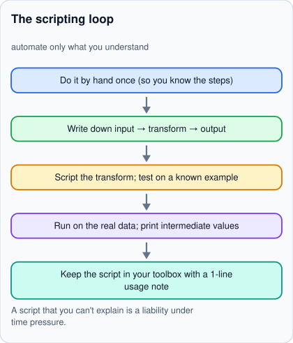
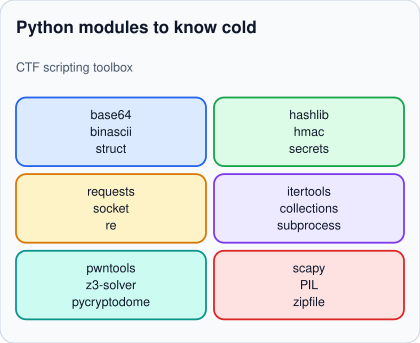
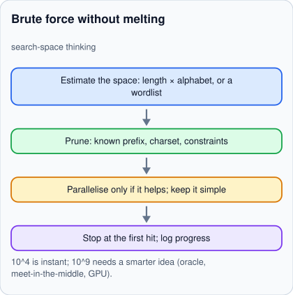
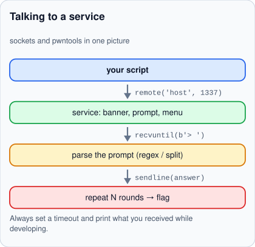

# 11. Scripting for CTFs

Every category ends in a script: decode a blob, brute-force a small space, talk to a service, parse a log. Fast scripting is the single biggest speed multiplier you control. Python 3 is the default language; Bash handles one-liners.

## 11.1 The scripting loop



**Plain English.** A script is a recipe you already know by hand. Do the steps manually once so you know what the input and output look like, then let the computer repeat them.

**Rule.** Test the transform on a *known* example before pointing it at the real data. If you can't explain a line, don't run it on the challenge.

## 11.2 The toolbox



| Need | Module | One line |
|---|---|---|
| bytes ↔ text/hex | built-ins | `bytes.fromhex("41")`, `b"A".hex()`, `.decode()`, `.encode()` |
| base64 | `base64` | `base64.b64decode(s)` |
| hashes | `hashlib` | `hashlib.sha256(b"x").hexdigest()` |
| HTTP | `requests` | `requests.get(url, headers=h, timeout=5)` |
| raw sockets | `socket` / pwntools | `remote(host, port)` |
| regex | `re` | `re.findall(rb"CTF\{.*?\}", data)` |
| binary structs | `struct` | `struct.unpack("<I", b)` |
| combinations | `itertools` | `product("abc", repeat=4)` |
| run tools | `subprocess` | `subprocess.run([...], capture_output=True, text=True)` |
| maths/crypto | `pycryptodome`, `sympy`, `gmpy2` | `inverse`, `long_to_bytes`, `isqrt` |
| constraints | `z3-solver` | `Solver()`, `BitVec` |
| images | `PIL` | `Image.open(p).getpixel((x,y))` |
| archives | `zipfile`, `tarfile` | `ZipFile(p).extractall(pwd=b"x")` |
| packets | `scapy` | `rdpcap("f.pcap")` |

## 11.3 Snippets you should be able to write from memory

### Decode helpers

```python
import base64, binascii, codecs

def b64(s):      return base64.b64decode(s + "=" * (-len(s) % 4))
def hexd(s):     return bytes.fromhex(s.replace(" ", ""))
def rot13(s):    return codecs.decode(s, "rot13")
def xor(data, key):
    key = key if isinstance(key, bytes) else bytes([key])
    return bytes(b ^ key[i % len(key)] for i, b in enumerate(data))
```

### Printable scoring (for single-byte XOR and Caesar)

```python
def score(b):
    return sum(32 <= c < 127 for c in b) / max(len(b), 1)

ct = bytes.fromhex("1b37373331363f78151b7f2b783431333d78397828372d363c78373e783a393b3736")
best = max(range(256), key=lambda k: score(xor(ct, k)))
print(best, xor(ct, best))
```

### Find a flag in anything

```python
import re, sys
data = open(sys.argv[1], "rb").read()
for m in re.findall(rb"[A-Za-z0-9_]{2,10}\{[^}\n]{3,80}\}", data):
    print(m.decode(errors="replace"))
```

### Brute force a small space



```python
import itertools, string, hashlib
target = "5f4dcc3b5aa765d61d8327deb882cf99"       # md5("password")
alphabet = string.ascii_lowercase
for n in range(1, 6):
    for tup in itertools.product(alphabet, repeat=n):
        w = "".join(tup)
        if hashlib.md5(w.encode()).hexdigest() == target:
            print("found", w); raise SystemExit
```

Prefer a **wordlist** first: `for line in open("rockyou.txt", errors="ignore")`.

### Archive password

```python
import zipfile
z = zipfile.ZipFile("secret.zip")
for pw in open("words.txt", errors="ignore"):
    try:
        z.extractall(pwd=pw.strip().encode()); print("password:", pw.strip()); break
    except (RuntimeError, zipfile.BadZipFile):
        pass
```

## 11.4 HTTP scripts

```python
import requests
s = requests.Session()
r = s.post("http://target/login", data={"user": "a", "pass": "b"}, timeout=5)
print(r.status_code, r.headers.get("Set-Cookie"))
print(s.get("http://target/profile?id=2").text[:200])
```

**Patterns:**

| Task | Idea |
|---|---|
| enumerate ids | loop `id=1..N`, compare length/status, print differences |
| blind SQLi | loop positions × characters; true/false by response length |
| rate limit | `time.sleep`, rotate if allowed; don't hammer shared infra |
| CSRF token | GET the form, parse the token (regex/BeautifulSoup), POST with it |

## 11.5 Talking to a service



```python
from pwn import *
context.log_level = "info"
io = remote("host", 1337)
io.recvuntil(b"> ")
io.sendline(b"1")
data = io.recvline().decode().strip()
print(data)
io.interactive()
```

### "Answer 100 rounds quickly" challenges

```python
from pwn import *
import re
io = remote("host", 1337)
for _ in range(100):
    line = io.recvuntil(b"=").decode()                       # e.g. "123 + 456 ="
    a, op, b = re.search(r"(\d+)\s*([+\-*/])\s*(\d+)", line).groups()
    ans = eval(f"{a}{op}{b}")                                # trusted input from the CTF only
    io.sendline(str(ans).encode())
print(io.recvall(timeout=2).decode())
```

(Never `eval` untrusted input outside a CTF sandbox.)

### Plain sockets (when pwntools is unavailable)

```python
import socket
s = socket.create_connection(("host", 1337), timeout=5)
print(s.recv(4096).decode(errors="replace"))
s.sendall(b"hello\n")
print(s.recv(4096))
```

## 11.6 The oracle loop (String-Storage style)

```python
import string
alphabet = string.ascii_letters + string.digits + "_{}"
known = ""
while True:
    for c in alphabet:
        if ask(known + c):           # ask() returns True when the service says "found"
            known += c; print(known); break
    else:
        break                        # no extension: done
```

`ask()` is your function that sends one query and returns the boolean. Cost: length × alphabet queries.

## 11.7 Parsing artefacts

### Logs

```python
from collections import Counter
fails = Counter()
for line in open("auth.log", errors="ignore"):
    if "Failed password" in line:
        fails[line.split()[-1]] += 1
print(fails.most_common(5))
```

### Packet captures (scapy)

```python
from scapy.all import rdpcap, TCP, Raw
pk = rdpcap("cap.pcap")
for p in pk:
    if p.haslayer(TCP) and p.haslayer(Raw) and p[TCP].dport == 80:
        print(p[Raw].load[:100])
```

### Images (LSB extraction)

```python
from PIL import Image
im = Image.open("img.png").convert("RGB")
bits = []
for y in range(im.height):
    for x in range(im.width):
        r, g, b = im.getpixel((x, y))
        bits.append(r & 1)
bs = bytes(int("".join(map(str, bits[i:i+8])), 2) for i in range(0, len(bits) - 7, 8))
print(bs[:80])
```

## 11.8 Constraint solving with z3

```python
from z3 import *
x = BitVec("x", 32); y = BitVec("y", 32)
s = Solver()
s.add(x + y == 100, x ^ y == 20, x > 0, y > 0)
if s.check() == sat:
    print(s.model())
```

Use it when a binary performs a chain of arithmetic checks on your input: transcribe the checks as constraints.

## 11.9 Bash one-liners that save minutes

```bash
for f in *.png; do exiftool "$f" | grep -i comment; done
grep -rEo 'CTF\{[^}]+\}' .
find . -type f -exec file {} + | grep -v ASCII
xxd -p file | fold -w2 | sort | uniq -c | sort -rn | head      # byte histogram
for i in $(seq 1 50); do curl -s "http://t/item?id=$i" | wc -c; done
cat data | tr -d '\n' | base64 -d | gunzip
```

## 11.10 Habits that keep you fast

| Habit | Why |
|---|---|
| Keep a `~/ctf/tools/` folder with your helpers | one place, same names every event |
| One script per challenge in its own folder | easy to re-use as a writeup |
| Print intermediate values | most bugs are wrong assumptions about the data |
| Use `try/except` around network I/O | services stall; don't lose state |
| Save outputs to files | you can diff and grep |
| Version your helpers in git | you'll improve them after each event |

## 11.11 Practice plan

| Order | Practice |
|---|---|
| 1 | Re-implement 5 Bandit solutions as one Python script each |
| 2 | picoGym "General Skills" scripting challenges |
| 3 | A socket challenge with 100 rounds (e.g. picoCTF, HTB) |
| 4 | Write a base-N/XOR/Caesar auto-decoder that tries combinations |
| 5 | CryptoHack "Intro" with pure Python before using libraries |

## 11.12 Check yourself

1. Write, from memory, a function that XORs bytes with a repeating key.
2. How would you find the key length of a repeating-key XOR?
3. What does the oracle loop cost compared with brute-forcing the whole secret?
4. Why do you test the transform on a known example first?
5. Name three modules you'd use to parse a pcap, a log and an image.
