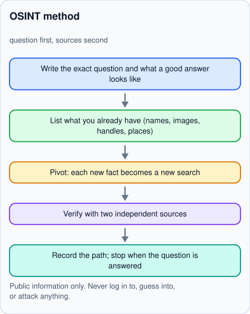
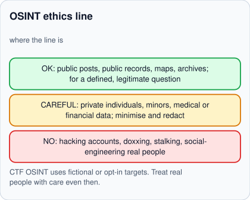
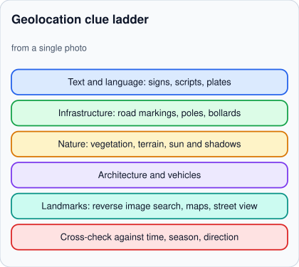
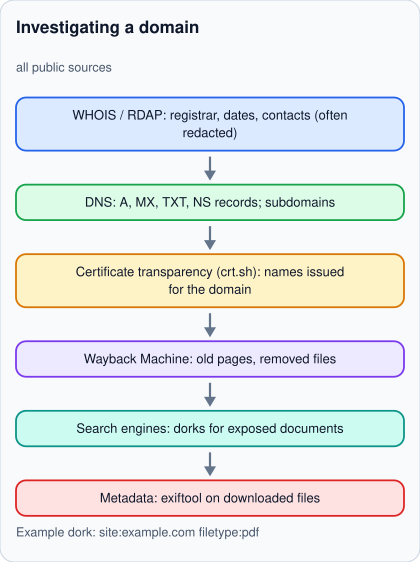

# 12. OSINT and miscellaneous challenges

**OSINT** (open-source intelligence) means answering a question using only public information. "Misc" is the drawer for everything that doesn't fit: odd encodings, puzzles, jails, QR codes, audio. Both reward patience, systematic pivoting and a good note-taking habit.

## 12.1 OSINT method



**Plain English.** You are a detective with a search engine. Every fact you find is a thread: where does it lead next?

| Step | Do | Example |
|---|---|---|
| Question | write the exact question and the answer format | "Which city was this photo taken in?" |
| Inventory | list every starting fact | image file, username, company, date |
| Pivot | each new fact becomes a new query | username → profile → photo → place |
| Verify | confirm with two independent sources | map + street view; two posts |
| Record | keep a timestamped trail | links, screenshots, notes |

### Ethics first



CTF OSINT targets are usually fictional or opt-in. Even so, practise the habits you'd need in a real investigation: **public information only, minimise, don't contact people, don't try to log in or guess passwords.**

## 12.2 Tools by question

| Question | Tool / technique |
|---|---|
| Who owns this domain? | WHOIS / RDAP (often redacted); registrar and dates still help |
| What's on it, historically? | Wayback Machine (`web.archive.org`), archive.today |
| What subdomains/certs exist? | `crt.sh` (certificate transparency), DNS records (A, MX, TXT, NS) |
| What documents are exposed? | search dorks: `site:`, `filetype:`, `intitle:`, `inurl:`, quotes, `-` |
| Where was this photo taken? | reverse image search (Google Lens, TinEye, Yandex), EXIF GPS, visual clues |
| Is this username elsewhere? | username search tools; check each hit manually (many false positives) |
| What was on this map/satellite view? | Google Maps / Earth, OpenStreetMap, Mapillary, Wikimapia |
| Which aircraft/ship? | public flight and vessel trackers (ADS-B, AIS) |
| What's in this file? | `exiftool`, `strings`, document properties |
| Who works at a company? | company websites, public professional profiles (public only) |

### Search operators that earn their keep

```text
site:example.com filetype:pdf "internal"
intitle:"index of" "backup"
"john smith" "Ottawa" -linkedin
inurl:admin site:example.edu
```

## 12.3 Geolocation: the clue ladder



Work from *cheap and decisive* to *expensive and fuzzy*:

1. **Text and language.** Alphabet, signage, plates, phone prefixes, currency, units.
2. **Infrastructure.** Road marking colours, driving side, utility poles, bollards, sign shapes, kilometre posts.
3. **Nature.** Vegetation, soil colour, mountains, coastline, climate; sun position and shadow direction narrow latitude/time.
4. **Architecture and vehicles.** Building styles, roof shapes, taxis, licence plate format.
5. **Landmarks.** Reverse image search, then confirm with street view.
6. **Consistency check.** Season, time of day, camera direction.

### Image metadata

```bash
exiftool photo.jpg                                  # everything
exiftool -gps:all photo.jpg                         # location only
exiftool -DateTimeOriginal -Make -Model photo.jpg
```

Many platforms strip EXIF; many CTF files keep it.

## 12.4 Investigating a domain or site



```bash
whois example.com
dig example.com ANY +noall +answer
dig TXT example.com +short
curl -s "https://crt.sh/?q=%25.example.com&output=json" | python3 -m json.tool | head
```

Look for: a hidden staging subdomain, a TXT record with a verification string or a flag, old pages in the archive, a robots.txt that lists a private path, an `index of` directory.

## 12.5 People and social OSINT in CTFs

Typical tasks (fictional persona):

| Clue | Next step |
|---|---|
| a username | search across sites; look for reused avatars/bios |
| a photo with a background | geolocate; read signs, reflections, shadows |
| a post date and weather | verify against historical weather data |
| a file posted publicly | metadata: author, software, edit times |
| a company name | domain, job posts (tech stack), employees (public) |

**Discipline:** write every claim with its source. In real investigations, a claim without a source is a rumour.

## 12.6 Misc: the drawer of oddities

### Encodings and symbols

| Looks like | Try |
|---|---|
| dots and dashes | Morse |
| 6-dot cells ⠃⠗⠁ | Braille |
| `++++++++[>++++...` | Brainfuck (interpreter) |
| spaces and tabs only | Whitespace language, or binary (module 9 A2) |
| `.-..` or `/` separators | Morse variants |
| `A/B` groups of five | Bacon cipher |
| flags/stick figures | Semaphore, pigpen |
| long hex or base-N | decode chain (module 4) |
| `ctf{...}` with leetspeak | read it, then check case |

### QR and barcodes

```bash
zbarimg code.png               # QR/barcodes
```

A damaged QR can often be repaired by editing the image (restore finder squares). Layered QR codes may hide a second code in colour channels.

### Audio

| Clue | Tool |
|---|---|
| spectrogram text | Audacity/Sonic Visualiser spectrogram view |
| beeps | DTMF decoder (`multimon-ng`), Morse |
| slow-scan TV | SSTV decoder |
| reversed/pitched | reverse, change speed |

### Jails and sandboxes (Python)

You can run only a restricted subset. Methods:

```python
# discover what exists
print(dir())
print(__builtins__)
# classic: reach builtins via objects
print(().__class__.__bases__[0].__subclasses__())
```

Ideas, not recipes: look for a way to import, read a file, or run a command without using blocked words; try encodings, string building, `getattr`. Always read the filter code if you're given it.

### Programming puzzles

Given an input format and rules, implement quickly; time limits often matter. Use Python; test on the sample; handle edge cases (empty, max size).

## 12.7 A worked OSINT case (fictional)

*Question:* "In which city was the photo `cafe.jpg` taken, and what is the name of the street?"

| Step | Observation | Action |
|---|---|---|
| 1 | `exiftool` shows no GPS but camera model and date | note the date |
| 2 | sign says "Fermé le lundi" | French → France/Quebec/Belgium/Switzerland |
| 3 | prices in `$`, bilingual stop sign | Quebec |
| 4 | tram wires and a distinctive storefront colour | candidates in Montreal |
| 5 | reverse image search + street view | match the storefront on one street |
| 6 | cross-check: shadow direction matches the date | confirmed |

**Answer format check:** does the challenge want a name, coordinates or a URL? Use exactly that.

## 12.8 Practice plan

| Order | Practice |
|---|---|
| 1 | A few GeoGuessr rounds with "no moving" to train clue spotting |
| 2 | Sourcing.games puzzles |
| 3 | TryOSINT / TryHackMe OSINT rooms |
| 4 | OSINT Framework as a tool directory |
| 5 | Write a one-page methodology for a domain investigation |
| 6 | Optional: ethical, consent-based events (e.g. organised OSINT CTFs) |

## 12.9 Check yourself

1. List the six rungs of the geolocation clue ladder.
2. Which public source shows what a website looked like last year?
3. Name three ways a TXT record or certificate can leak useful information.
4. What is the ethical line for OSINT, and how does a CTF respect it?
5. What are the first three things to try on a puzzle made of only spaces and tabs?
