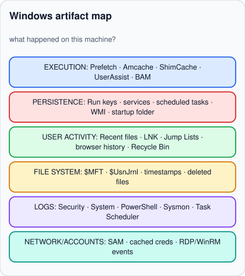
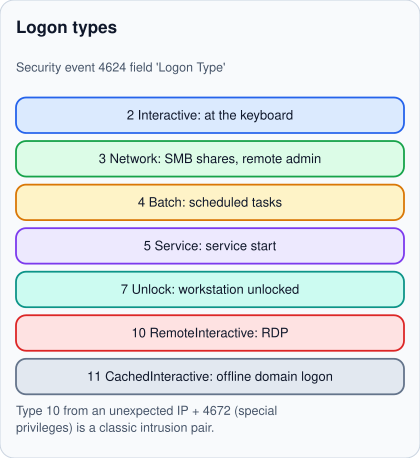
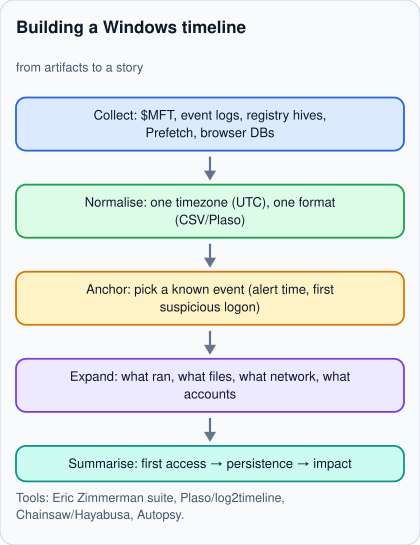

# 13. Windows forensics and event logs

CyberSci's "realistic IT environment" means Windows. Windows leaves a lot of evidence: this chapter is the map of where.

## 13.1 The artifact map



**Plain English.** Windows is a diary-keeper. It records what ran, what was opened, what changed, and who logged in, often in several places. Your job is to cross-check them to rebuild a story.

## 13.2 Where things live

| Evidence | Location | Tool |
|---|---|---|
| Event logs | `C:\Windows\System32\winevt\Logs\*.evtx` | Event Viewer, `Chainsaw`, `Hayabusa`, `EvtxECmd` |
| Registry hives (system) | `C:\Windows\System32\config\` (SAM, SECURITY, SOFTWARE, SYSTEM) | RegRipper, Registry Explorer |
| User hive | `C:\Users\<user>\NTUSER.DAT` | RegRipper |
| Prefetch | `C:\Windows\Prefetch\*.pf` | PECmd |
| Amcache | `C:\Windows\appcompat\Programs\Amcache.hve` | AmcacheParser |
| ShimCache (AppCompatCache) | `SYSTEM` hive | AppCompatCacheParser |
| LNK and Jump Lists | `...\AppData\Roaming\Microsoft\Windows\Recent\` | LECmd, JLECmd |
| Recycle Bin | `C:\$Recycle.Bin\<SID>\` ($I metadata, $R data) | RBCmd |
| Browser history | per-browser SQLite (e.g. Chrome `History`) | DB Browser, Hindsight |
| MFT and USN | `$MFT`, `$UsnJrnl:$J` | MFTECmd |
| Scheduled tasks | `C:\Windows\System32\Tasks\` | read XML |
| PowerShell history | `...\PSReadLine\ConsoleHost_history.txt` | read |

## 13.3 Evidence of execution

| Artifact | Tells you | Notes |
|---|---|---|
| Prefetch | program ran; first/last run times; run count; files loaded | 8 most recent run times per program |
| Amcache | program existed/executed; SHA-1; path | useful even if the file was deleted |
| ShimCache | file was present on the system | not proof of execution on newer Windows |
| UserAssist (NTUSER) | GUI programs the user launched; counts and times | **names are ROT13-encoded** (you can decode them) |
| BAM/DAM | last execution time per user | recent Windows versions |
| Sysmon (if installed) | process creation with command line and hashes | event ID 1 |

## 13.4 Persistence locations

| Mechanism | Where |
|---|---|
| Run keys | `HKCU/HKLM\Software\Microsoft\Windows\CurrentVersion\Run` (and `RunOnce`) |
| Services | `HKLM\SYSTEM\CurrentControlSet\Services`; event 7045 / 4697 |
| Scheduled tasks | `Tasks` folder; events 4698 (created), 4702 (updated) |
| Startup folders | `...\Start Menu\Programs\Startup` |
| WMI subscriptions | `root\subscription` |
| Winlogon, IFEO, AppInit | registry (classic tricks) |

## 13.5 Event logs you will read most

| Event | ID | Meaning |
|---|---|---|
| Logon success | 4624 | check **Logon Type** and source IP |
| Logon failure | 4625 | brute force / spraying signal |
| Special privileges assigned | 4672 | an admin-equivalent logon |
| Explicit credentials used | 4648 | `runas`, lateral movement |
| Process created | 4688 | with command line if auditing enabled |
| Service installed | 4697 (Security) / 7045 (System) | persistence or PsExec |
| Scheduled task created | 4698 | persistence |
| User account created | 4720 | |
| Added to local/group | 4732 / 4728 | privilege changes |
| Audit log cleared | 1102 (Security), 104 (System) | anti-forensics |
| PowerShell script block | 4104 | the actual code run |
| Kerberos TGT / service ticket | 4768 / 4769 | Kerberoasting signals |



## 13.6 Sysmon: the high-value feed (when present)

| ID | Meaning |
|---|---|
| 1 | process create (command line, parent, hashes) |
| 3 | network connection |
| 7 | image loaded (DLLs) |
| 8 | CreateRemoteThread (injection) |
| 10 | process access (credential dumping signal: LSASS) |
| 11 | file created |
| 13 | registry value set |
| 22 | DNS query |

## 13.7 Building the timeline



```text
anchor: 03:12 UTC  4624 type 10 from 203.0.113.9 as admin
  03:12  4672 privileges assigned
  03:14  4688 powershell.exe -enc ... (parent: explorer.exe)
  03:15  Sysmon 3: powershell → 198.51.100.7:443
  03:20  4698 task "Updater" created
  03:21  1102 Security log cleared
```

Method: **anchor → expand outward → note gaps**. A cleared log is a finding.

## 13.8 Worked example

*Question:* "How did the attacker keep access?"

| Step | Evidence | Reading |
|---|---|---|
| 1 | 4698 at 03:20: task `Updater` → `C:\ProgramData\u.exe` | persistence by scheduled task |
| 2 | Prefetch `U.EXE-xxxx.pf` run count 3 | it ran repeatedly |
| 3 | Amcache entry with SHA-1 | hash to look up |
| 4 | Event 4104 earlier showed a download cradle | the dropper |
| 5 | Run key under HKCU points to the same path | second persistence |

*Answer shape:* name the mechanisms, paths and times; recommend removing both and rotating credentials.

## 13.9 Common pitfalls

| Pitfall | Fix |
|---|---|
| Mixed timezones | convert everything to UTC first |
| Trusting file timestamps | compare $STANDARD_INFORMATION vs $FILE_NAME (timestomping) |
| Missing logs | check log size/retention; 1102/104 |
| Only looking at one source | confirm each fact with a second artifact |
| Opening evidence on the original | work on copies/hashes |

## 13.10 Practice plan

| Order | Practice |
|---|---|
| 1 | Read 20 event IDs aloud from the table until instant |
| 2 | CyberDefenders Windows labs; BTLO |
| 3 | Chainsaw/Hayabusa on a sample EVTX set (public sample repositories) |
| 4 | Parse Prefetch and Amcache with Eric Zimmerman tools on a lab VM |
| 5 | Build a timeline for a lab scenario and write a one-page report |

## 13.11 Check yourself

1. Which artifacts show a program ran even after deletion?
2. What does Logon Type 10 mean, and what makes it suspicious?
3. Which two event IDs show a service being installed, and where do they live?
4. How do you decode UserAssist names?
5. What is the first step when logs from different hosts disagree on time?
