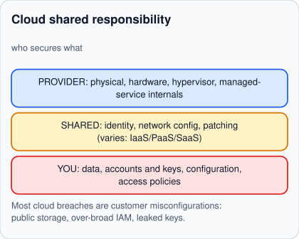
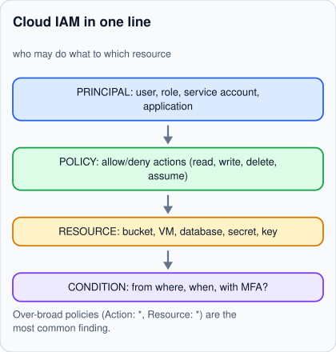
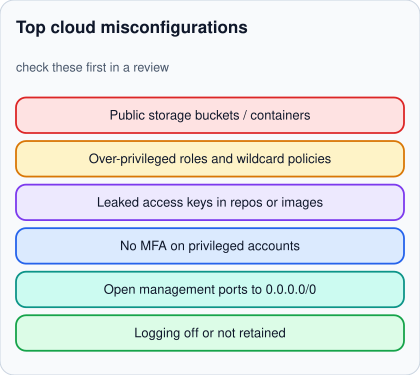
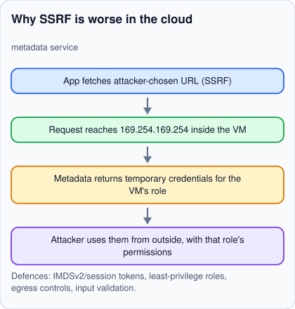

# 14. Cloud security basics

Many "realistic IT environments" now include cloud pieces: object storage, a few VMs, an identity provider. You don't need to be a cloud engineer for CyberSci, but you should know the vocabulary and the common mistakes.

## 14.1 Plain English

**The cloud is someone else's data centre, rented by the hour.** You get building blocks (compute, storage, networking, identity) and a web console or API to configure them. Security shifts from *protecting a building* to *configuring permissions correctly*.



| Model | You manage | Provider manages |
|---|---|---|
| IaaS (VMs) | OS, apps, data, identity, network rules | hardware, hypervisor |
| PaaS | apps, data, identity | OS, runtime |
| SaaS | data, users, settings | nearly everything else |

## 14.2 Identity is the new perimeter



| Term | Meaning |
|---|---|
| Principal | who is acting (user, role, service account) |
| Policy | what they may do (allow/deny actions on resources) |
| Role | a set of permissions assumed temporarily |
| Access key | long-lived credential (dangerous if leaked) |
| MFA | second factor on sensitive accounts |
| Least privilege | the minimum permissions needed |

Common bad policy: `"Action": "*", "Resource": "*"` (everything on everything).

## 14.3 The usual misconfigurations



| Mistake | Impact |
|---|---|
| public storage bucket | data exposed to the internet |
| world-open management port (`0.0.0.0/0` on SSH/RDP) | brute force/exploit surface |
| leaked key in a repo, image or log | full account access |
| over-privileged role on a VM | one bug = account compromise |
| no logging / short retention | can't investigate |
| default or weak service credentials | easy lateral movement |

## 14.4 SSRF and the metadata service



Cloud VMs can ask a link-local address for information about themselves, including **temporary credentials for the VM's role**. An SSRF bug lets an attacker make the VM fetch that address. Mitigations: require session tokens (IMDSv2-style), limit the role's permissions, block metadata egress from apps that don't need it, validate URLs.

## 14.4b Containers, in one paragraph

A **container** packages an application with its libraries and runs it isolated from other processes using kernel features (namespaces, cgroups). It is *not* a full VM. Risks: running as root, mounting the Docker socket or host filesystem, secrets baked into images, vulnerable base images, exposed registries or dashboards. Kubernetes adds an API server, kubelets, secrets and service accounts, all permission-driven.

## 14.5 Safe, legal practice

| Practice | Why |
|---|---|
| Use free/dedicated training platforms (e.g. CloudGoat, flaws.cloud, Kubernetes Goat) | intentionally vulnerable |
| Use your own free-tier account with billing alerts | stay within scope and budget |
| Never test someone else's cloud resources | unauthorised access |
| Rotate and delete keys after labs | habit |

Read-only discovery on your own account:

```bash
aws sts get-caller-identity
aws iam list-users
aws s3 ls
aws ec2 describe-instances --query 'Reservations[].Instances[].PublicIpAddress'
```

## 14.6 Defensive checklist

1. MFA on every privileged identity; no long-lived keys for humans.
2. Least-privilege roles; review wildcard policies.
3. Block public storage by default; review exceptions.
4. Restrict management ports to known addresses or a bastion/VPN.
5. Enable audit logging (CloudTrail-style) and keep it long enough to investigate.
6. Scan repositories and images for secrets.
7. Patch base images; scan containers.
8. Backups tested and separated from the primary account.

## 14.7 Scenario

*Alert:* a VM's role is calling storage APIs from an unfamiliar IP.

| Step | Question | Source |
|---|---|---|
| 1 | Which identity? Which key/session? | audit logs |
| 2 | What did it do? | list/read/delete calls over time |
| 3 | How did it get credentials? | app logs (SSRF?), repo leak, metadata |
| 4 | Contain | revoke session/keys, tighten role, block the IP |
| 5 | Fix | patch the SSRF, reduce permissions, enforce session tokens |

## 14.8 Check yourself

1. What's the difference between IaaS and PaaS in who manages the OS?
2. Why is a leaked access key worse than a leaked password with MFA?
3. How does SSRF lead to cloud credential theft?
4. List three top misconfigurations and one fix each.
5. Why isn't a container a security boundary as strong as a VM?
