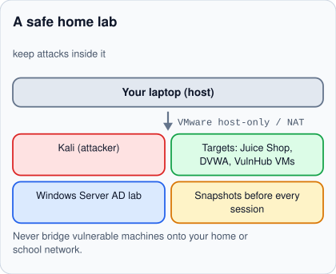
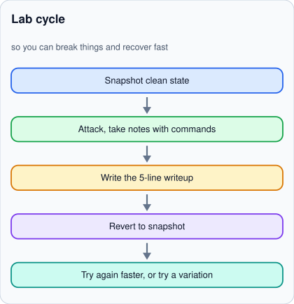

# 15. Labs and offline references

You learn security by doing it somewhere it's safe and legal. This chapter is the hands-on setup guide, plus how to build an **offline reference pack** for events where internet access is unavailable (and where the rules allow reference material).

## 15.1 The safe lab



**Principles**

1. **Isolation.** Vulnerable machines live on a host-only or NAT network, never bridged to your home or school network.
2. **Snapshots.** Snapshot a clean state; revert after every session.
3. **Legality.** Only attack machines you own or have explicit permission to test.
4. **Notes.** Every session ends with a 5-line writeup.

## 15.2 Your lab in layers

| Layer | What | How |
|---|---|---|
| Attacker | Kali VM (VMware) | snapshot after first boot; update tools monthly |
| Web targets | Juice Shop, DVWA, WebGoat | Docker (below) |
| Linux targets | VulnHub VMs, Metasploitable | import into VMware, host-only network |
| Windows/AD | Windows Server 2022 evaluation + Windows 10/11 client | a small domain; Kerberoast/BloodHound practice |
| Network | Packet Tracer/GNS3 for routing context | your CCNA labs |
| Services | your own CTFd for mock events | later (Dojo backlog) |

## 15.3 Web labs with Docker

A ready compose file lives in `labs/docker-compose.yml` in the repo. It binds each app to **localhost only**.

```yaml
services:
  juice-shop:
    image: bkimminich/juice-shop
    ports: ["127.0.0.1:3000:3000"]
  dvwa:
    image: vulnerables/web-dvwa
    ports: ["127.0.0.1:8081:80"]
  webgoat:
    image: webgoat/webgoat
    ports: ["127.0.0.1:8082:8080"]
```

```bash
docker compose -f labs/docker-compose.yml up -d
# Juice Shop  http://127.0.0.1:3000
# DVWA        http://127.0.0.1:8081   (set up the database from the login page)
# WebGoat     http://127.0.0.1:8082/WebGoat
docker compose -f labs/docker-compose.yml down
```

Image names and ports are the ones those projects publish; check each project's README if one changes. This file is **untested on your machine**.

## 15.4 The lab cycle



## 15.5 What to practise where

| Skill | Lab | Goal |
|---|---|---|
| SQLi, XSS, auth | Juice Shop, DVWA, PortSwigger | solve 2 per class by hand |
| Linux privesc | VulnHub, THM | root with manual enumeration |
| Windows/AD | your AD lab | Kerberoast, BloodHound path |
| Forensics | CyberDefenders, malware-traffic-analysis | answer questions before checking |
| Pwn/rev | pwn.college, crackmes.one | ret2win unaided |

## 15.6 Offline reference pack

Use only what the event rules allow. Ask the organizers whether **offline reference material (your own notes and public cheat sheets)** is permitted.

| Resource | What for | Typical size |
|---|---|---|
| Your notes, writeups, cheat sheets | everything | small |
| PayloadsAllTheThings | web payloads | tens of MB |
| HackTricks (repo) | technique reference | hundreds of MB |
| GTFOBins / LOLBAS | privesc binaries | small |
| SecLists (selected folders) | wordlists | large; take only what you use |
| CyberChef (offline release) | encodings/crypto | few MB |
| rockyou wordlist | cracking | ~130 MB |
| Tool man pages and `--help` outputs | syntax | small |
| Documentation PDFs (Wireshark, Volatility) | reference | small |

The repo includes a script that mirrors the public ones into a folder:

```bash
python scripts/fetch_offline_refs.py --dest D:/ctf-refs --only payloads gtfobins lolbas cyberchef
```

It uses shallow clones (`--depth 1`) to keep size down. Sizes grow over time, and it needs internet and `git`.

**Make the pack searchable.** Even without AI, `ripgrep` (or `grep -r`) across a folder of markdown is faster than scrolling PDFs:

```bash
rg -n "kerberoast" ~/ctf-refs
```

## 15.7 Verifying the bundle

| Check | How |
|---|---|
| everything opens offline | airplane-mode test |
| hashes recorded | `sha256sum` list saved with the bundle |
| paths documented | one README with where each tool lives |
| tools run | `nmap --version`, `python3 -c 'import pwn'`, `ghidraRun` opens |
| a restore plan | snapshot or USB image of the VM |

## 15.8 Check yourself

1. Why should vulnerable VMs never be bridged to your home network?
2. What is the lab cycle, and why revert to a snapshot?
3. Which three references are most useful offline for CTFs, and why?
4. What must you confirm with the organizers before bringing an offline pack?
