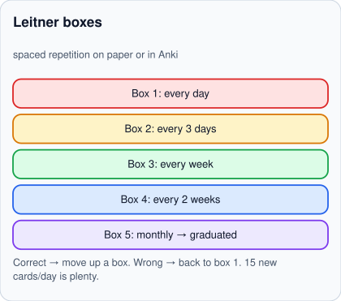
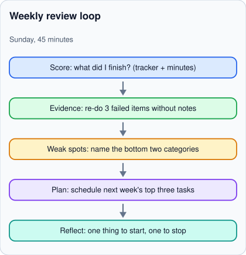

# 16. Review system and progress log

Reading isn't learning; **retrieval** is. This chapter is the system that turns the other chapters into skill, plus paper-style logs you can use on a phone or print.

## 16.1 The three loops

| Loop | Cadence | Purpose | Time |
|---|---|---|---|
| Daily | every day | flashcards + one hands-on item | 15 min + the day's plan |
| Weekly | Sunday | review, redo failures, re-plan | 45 min |
| Event | every CTF | writeups and gap list | 1 h after |

## 16.2 Daily: spaced repetition

**Plain English.** Things you can recall easily need less review; things you miss need more. Spaced repetition schedules this for you.

**With Anki:** import the decks; do 15 new cards and all due reviews. Use *Again/Hard/Good/Easy* honestly.

**Without an app (Leitner boxes):**

| Box | Review | Move |
|---|---|---|
| 1 | daily | correct → box 2; wrong → stay |
| 2 | every 3 days | correct → box 3; wrong → box 1 |
| 3 | weekly | correct → box 4; wrong → box 1 |
| 4 | every 2 weeks | correct → box 5; wrong → box 1 |
| 5 | monthly | correct → graduate; wrong → box 1 |

**The commute routine (15 minutes):**

1. Open the flip-deck or Anki.
2. Say each answer out loud *before* turning the page.
3. Tally misses on a note; re-read their pages before bed.

## 16.3 Weekly loop

Sunday checklist:

- [ ] Count minutes studied and items finished (tracker).
- [ ] Redo three failed items **without notes**.
- [ ] Name the two weakest categories.
- [ ] Take one section of the mock exam (rotate A, B, C, D).
- [ ] Schedule next week's top three tasks.
- [ ] Write one thing to start and one to stop.

## 16.4 Event loop (CTF or rehearsal)

| Step | Action |
|---|---|
| During | timestamp key decisions; mark where you got stuck |
| Within 24 h | five-line writeup per solved challenge |
| Within 48 h | read public writeups for unsolved ones; note the missed first observation |
| Within a week | add 5 flashcards from the missed techniques |

## 16.5 Skill ladder checklist

Mark a skill only when you can demonstrate it *without notes*.

| Level | Meaning |
|---|---|
| L1 | I can explain it |
| L2 | I can do it with notes |
| L3 | I can do it timed, unaided |
| L4 | I can teach it / build a challenge with it |

| Skill | L1 | L2 | L3 | L4 |
|---|---|---|---|---|
| Linux CLI and Bandit 0-20 | ☐ | ☐ | ☐ | ☐ |
| Encodings and decode chains | ☐ | ☐ | ☐ | ☐ |
| pcap analysis | ☐ | ☐ | ☐ | ☐ |
| Memory forensics basics | ☐ | ☐ | ☐ | ☐ |
| Windows event logs | ☐ | ☐ | ☐ | ☐ |
| SQL injection | ☐ | ☐ | ☐ | ☐ |
| XSS and auth bugs | ☐ | ☐ | ☐ | ☐ |
| SSRF / IDOR / uploads | ☐ | ☐ | ☐ | ☐ |
| XOR and classical crypto | ☐ | ☐ | ☐ | ☐ |
| RSA attacks | ☐ | ☐ | ☐ | ☐ |
| AES modes | ☐ | ☐ | ☐ | ☐ |
| Ghidra and gdb basics | ☐ | ☐ | ☐ | ☐ |
| ret2win | ☐ | ☐ | ☐ | ☐ |
| Linux privesc | ☐ | ☐ | ☐ | ☐ |
| Windows privesc and AD | ☐ | ☐ | ☐ | ☐ |
| Python scripting | ☐ | ☐ | ☐ | ☐ |
| OSINT | ☐ | ☐ | ☐ | ☐ |
| Writing a clear report | ☐ | ☐ | ☐ | ☐ |

## 16.6 Mock exam log

| Date | A /20 | B /30 | C /30 | D /20 | Total | Weakest |
|---|---|---|---|---|---|---|
| | | | | | | |
| | | | | | | |
| | | | | | | |

## 16.7 Writeup log

| Date | Challenge | Category | Time | Technique tag | Helpful link |
|---|---|---|---|---|---|
| | | | | | |
| | | | | | |

## 16.8 Plan for the final two weeks

| Days out | Focus |
|---|---|
| 14-8 | Fill the two weakest categories; one timed mock a day alternating categories |
| 7 | Dress rehearsal (full day, roles, bundle, offline) |
| 6-3 | Re-do failed items; cheat sheets; light practice |
| 2 | Logistics, rules re-read, team sync |
| 1 | Rest. No new topics |

## 16.9 Check yourself

1. Why does saying the answer *before* flipping a card matter?
2. What goes into the weekly review?
3. How do you know you've reached L3 on a skill?
4. What do you do within 48 hours of an event?
