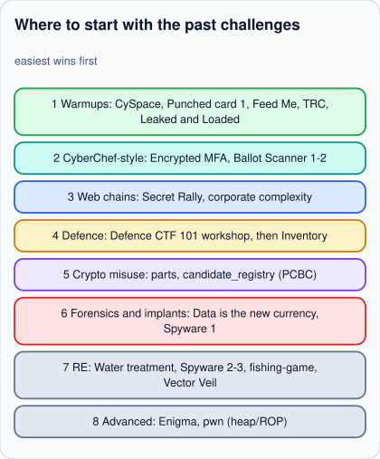
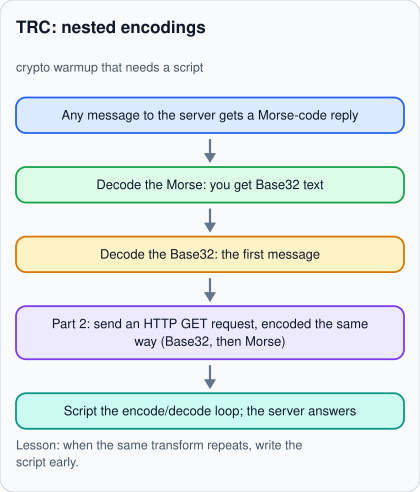
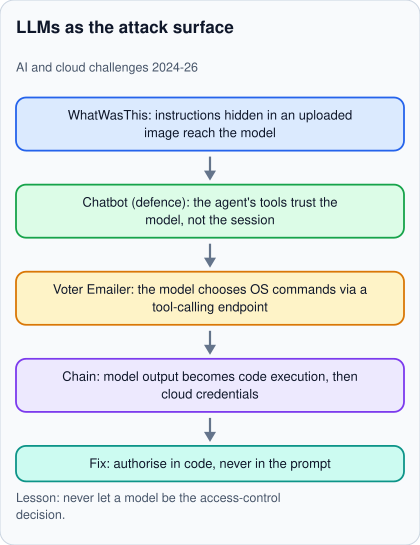
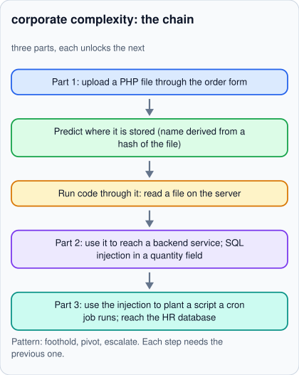
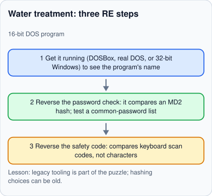
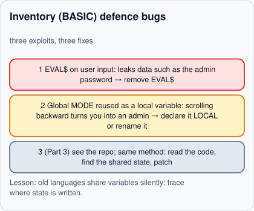
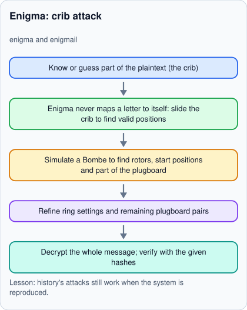

# 31. Writeups: CyberSci Regionals 2025/26

Concept-level writeups of the published challenges, in my own words, built from the organizers' README and walkthrough files in `CyberSCI/PastChallenges` (`challenges/regionals-2025-26/`). **Flags and answers are deliberately left out**; they're in the repo if you want to check.

> **How to use.** Try the challenge first from its `release_files` (or hosted details in its README), using the learn-by-doing loop. Open the writeup only after Attempt 1. Then re-read the linked sections, and do Attempt 2 on a related challenge.
>
> **Safety.** Treat the repo as untrusted. Read; don't run on your main machine. Run services only in a lab VM or Docker bound to `127.0.0.1`. I haven't run any challenge.

**Theme:** a post-apocalyptic "great reset": engineers revive old electronics. That explains the retro formats (punched cards, DOS, BASIC, gopher, Enigma, Morse).

| # | Challenge | Category | Parts | Difficulty feel | Start? |
|---|---|---|---|---|---|
| 1 | CySpace.com | Crypto | 1 | warmup | **yes** |
| 2 | Punched cards | Forensics | 3 | easy to medium | **yes** |
| 3 | Feed Me! | Crypto | 1 | easy (read carefully) | **yes** |
| 4 | TRC | Crypto | 2 | easy to medium (needs a script) | **yes** |
| 5 | WhatWasThis | AI | 1 | easy once you see the idea | maybe |
| 6 | Rabbit Holes | Web | 1 | medium | later |
| 7 | corporate complexity | Web | 3 | medium to hard (a chain) | later |
| 8 | Water treatment | RE | 3 | medium | later |
| 9 | fishing-game | RE | 1 | medium | later |
| 10 | Inventory | Defence | 3 | medium | with the workshop |
| 11 | enigma / enigmail | Crypto | 1 each | hard | last |
| 12 | Warmups, Rust Belt Floppies | Warmups, Pwn | n/a | listed in the repo README, no folder | n/a |

---

## 1. CySpace.com (Crypto, warmup)

**Given.** A web page (`cyspace.html` plus images) styled like an early-2000s social profile. Description: decode "simple but uncommon writing systems."

**Plain English.** Somebody hid a message in a way people used to type before smartphones had keyboards.

**Thinking.** View the page source, since hidden things live in comments. One comment contains a number that doesn't look like a real phone number: groups of repeated digits joined by dashes.

| Step | Do | Why |
|---|---|---|
| 1 | read the HTML comments | CTF authors hide data there |
| 2 | notice a digit pattern like `222-999-22…` | repeated digits within groups |
| 3 | recognise **phone-keypad multi-tap ("vanity") code** | on old phones, pressing `2` once gives A, twice B, three times C |
| 4 | decode by hand or with an online decoder | the result is the flag |

**Why it works.** Each group is `key number` repeated `n` times, meaning "the n-th letter of that key".

**See it again.** Any CTF with "odd-looking numbers": Morse, T9, Baudot.
**Practice.** Encode your own name in multi-tap; decode a friend's.
**Reading.** Module 12 §12.6; flashcards "OSINT and misc".
**Teach it back.** "How does `7777` map to a letter on a phone keypad?"

---

## 2. Punched cards (Forensics, three parts)

**Given.** `punchedcard1.png`, `punchedcard2.png`, `telegraph-message.png`.

**Plain English.** Old IBM computers stored text as holes in cards; telegraphs used a five-hole paper tape. You are the card reader.

| Part | Task | Method |
|---|---|---|
| 1 | decode a punched card | find a punched-card chart (the organizers point to a Wikipedia image of the card layout). Each column is one character; hole positions (rows 12, 11, 0-9) map to a character. Decode by hand. |
| 2 | decode a **damaged** card; an MD2 hash of the password is given | decode what you can, list the possible values for the missing/unclear columns, and **brute-force the candidates against the hash** with a small script |
| 3 | a telegraph tape | **ITA2 (Baudot)** is a 5-bit code with letter and figure shift states; decode with an ITA2 table |

**Thinking.** The skill is **research plus patience**: find the right chart, be systematic (column by column), and use the hash as an answer checker.

**Why it works.** A hash lets you verify a guess without knowing the password; if only a few characters are unknown, brute force is tiny.

**See it again.** Any partially known secret plus a hash: encode your candidates and compare.
**Practice.** Take a word, hash it with MD5, hide two letters, and write a script that recovers them.
**Reading.** Module 4 §4.4 (hashes); Module 11 §11.3; Module 12 §12.6.
**Teach it back.** "Why does a hash turn a partial decode into a solvable problem?"

---

## 3. Feed Me! (Crypto)

**Given.** A user manual PDF and an animated GIF for a virtual pet ("Cybergotchi").

**Plain English.** The manual *is* the challenge. It quietly tells you everything you need, if you read it closely.

| Step | What to notice | What it gives |
|---|---|---|
| 1 | a long hex string in the manual | the encrypted flag |
| 2 | the manual mentions a particular old cipher (RC2), "no IV", hex input, and when to start counting | the algorithm and its settings |
| 3 | the GIF shows a sequence of button presses (letters on button labels) | the key (as text) |
| 4 | convert the key text to hex; use RC2 in CyberChef with no IV and hex input | the flag |

**Why it works.** The author split the problem across two files so you must read the instructions and watch the animation.

**See it again.** "Documents contain the hints": labels, captions, footnotes.
**Practice.** Rebuild it: encrypt a short message with a named cipher in CyberChef, hide the key in an image, and swap with a friend.
**Reading.** Module 4 §4.1, §4.5; the CyberChef notes in Module 11 §11.9.
**Teach it back.** "Which three pieces of information did you need to decrypt the hex?"

---

## 4. TRC (Crypto, two parts)

**Given.** A TCP service (`nc host port`) and a sample file.

**Plain English.** A "signal station" always answers in flashing short and long pulses (Morse), whatever you send.

| Part | What happens | Method |
|---|---|---|
| 1 | the reply decodes from Morse to garbled text | that text is **Base32**; decode it again to read the station's message |
| 2 | the server wants *you* to speak its language | build an **HTTP GET /** request, encode it **Base32 then Morse**, send it; the server answers with the flag |

**Thinking.** Part 1 can be done in CyberChef by hand, but part 2 needs you to **encode** in the same layers, so a **script** that encodes and decodes saves time.

**See it again.** Protocols wrapped in encodings; "talk to the service in its own format".
**Practice.** Write `encode()` and `decode()` for Base32-then-Morse and test them on each other.
**Reading.** Module 4 §4.1; Module 11 §11.5 (talking to a service).
**Teach it back.** "Why is a script better than CyberChef for part 2?"

---

## 5. WhatWasThis (AI)

**Given.** A web app that uses a vision-language model (VLM) to identify old technology from uploaded images. The model has a hidden "favourite".

**Plain English.** The model follows instructions it finds in its input. If the instructions are in the picture, the model reads them too.

| Step | Do | Why |
|---|---|---|
| 1 | read how the app builds its prompt: a system instruction plus your image | the image is untrusted input |
| 2 | make an image whose visible text instructs the model (for example to state its favourite) | models read text in images |
| 3 | upload it; watch the answer | the model reveals or asserts the favourite |

**Why it works.** There's no boundary between "instructions" and "data" inside the model's context. This is **prompt injection**.

**See it again.** Chatbots, document summarisers, any tool that feeds user content to a model (and the 2024/25 chatbot and voter-emailer challenges).
**Practice.** Build a toy "summarise this text" prompt and see how a document can override it; then write a defence.
**Reading.** Module 8 §8.8; chapter 25's AI note; OWASP Top 10 for LLM Applications.
**Teach it back.** "Why can't you fix prompt injection with a better system prompt alone?"

---

## 6. Rabbit Holes (Web)

**Given.** `server.py` and a service: a **gopher** server beside an **FTP** server. The gopher "search" fetches the resource you name with cURL.

**Plain English.** The search box takes a URL and fetches it for you: that's **SSRF** wearing a retro costume. The authors tried to block dangerous schemes, but the filter was fragile.

| Step | Do | Why |
|---|---|---|
| 1 | read `server.py`: the search passes your query to cURL | you control a fetch |
| 2 | see the blocklist: it rejects the `file` and `ftp` schemes | only in lowercase |
| 3 | use the same scheme with different letter case | cURL accepts schemes case-insensitively, the filter doesn't |
| 4 | fetch the flag file from the FTP service (anonymous) | the server fetches it for you and returns it |

**Why it works.** The filter and the fetcher disagree about what "ftp" means. Blocklists lose to normalisation bugs.

**See it again.** SSRF filters in the real world; URL parsing differences.
**Practice.** Write a blocklist and then find three strings it misses (case, encoding, alternate forms).
**Reading.** Module 3 §3.8; Module 11 §11.5.
**Teach it back.** "Why is an allow-list safer than a blocklist?"

---

## 7. corporate complexity (Web, three parts)

**Given.** A multi-container app (`corporate_complexity.zip`): an order-submission service, a backend, and an HR database.

**Plain English.** One small bug gets you in, and every step after that uses the last one.

| Part | Goal | Method |
|---|---|---|
| 1 | initial access | the order form accepts a **file upload** without proper checks; you upload a PHP file; the stored name is predictable (derived from the file's MD5 plus `.php`), so you can visit it and run code that reads the server's flag file |
| 2 | pivot | use that code to send requests to the **backend service**; a `quantity` parameter is **SQL injectable**; extract the admin's password |
| 3 | escalate | the injection can **write a file**; use it to create the script a **cron job** expects, wait for it to run, and use it to reach the HR database with known credentials |

**Thinking.** Don't hunt for one big bug. Each part gives a small capability: *upload → code on the web server → reach internal services → write a file → code via cron → data*.

**Why it works.** Missing upload validation + predictable names + an internal service that trusts its caller + a writable path that a scheduled job executes.

**See it again.** Any multi-stage engagement; this is how real intrusions chain.
**Practice.** Write the chain as a diagram before you touch the keyboard; then list one fix at every link.
**Reading.** Module 3 §3.3, §3.7; Module 6 §6.2-6.3; Bandit levels 21-23 (cron).
**Teach it back.** "Name the four vulnerabilities in order and the defence that would stop each."

---

## 8. Water treatment (RE, three parts)

**Given.** `wt.exe`: a **16-bit DOS** program that simulates a water-treatment plant.

| Part | Task | Method |
|---|---|---|
| 1 | learn the program's official name | you must **run** it: modern 64-bit Windows won't; use DOSBox/dosbox-x, a DOS environment, or 32-bit Windows. It prints the name as ASCII art. |
| 2 | find the password | reverse the check: the program compares an **MD2** hash of your input; run a common-password list (e.g. `rockyou.txt`) through MD2 |
| 3 | find the chlorine safety code | the program checks **keyboard scan codes** of the keys pressed; map scan codes to keys |

**Thinking.** Each part is smaller than it looks: part 1 is tooling, part 2 is a hash lookup, part 3 is a table lookup once you know *what* is compared.

**Safety.** Analyse an unknown executable only in a VM. DOS programs are old but still run native code.
**Why it works.** MD2 is an old hash; password lists make hash checks guessable.
**Practice.** Write a script that hashes each word in a list and compares to a target; try with MD5 first.
**Reading.** Module 5 §5.2-5.5; Module 4 §4.4.
**Teach it back.** "What's a scan code and why is it different from an ASCII character?"

---

## 9. fishing-game (RE / logic)

**Given.** `dist.zip` (a packaged Windows game); the challenge is served over VNC.

**Plain English.** A game with an economy. The flag costs more gold than you'll earn quickly, unless you find a bug that makes gold out of nothing.

| Step | Do | Why |
|---|---|---|
| 1 | unpack the executable to reveal the **Lua source** | many small games embed scripts |
| 2 | read the game logic (or have a code reader summarise it, then verify it yourself) | find where items and money change |
| 3 | spot the bug: with **negative strength**, a failed catch **returns your bait**; if you unequip the bait, each attempt yields an extra one | duplication |
| 4 | sell the duplicates, buy better bait, repeat until you can buy the flag | exponential growth |

**Notes.** The author says there are several solutions, including just playing long enough.
**Why it works.** An edge case (negative strength) made a refund path unconditional.
**See it again.** Duplication and rounding bugs in anything with a currency.
**Practice.** Read a short Lua script and list every place it changes money; look for a negative or zero edge case.
**Reading.** Module 5 §5.6; Module 11.
**Teach it back.** "Why do logic bugs like this not show up in a vulnerability scanner?"

---

## 10. Inventory (Defence, BASIC)

**Given.** A vulnerable inventory app written in **BASIC** (runs on any machine with a BASIC interpreter), an attack portal that launches known exploits, and an SSH login to the host.

**Plain English.** People are abusing a supply-distribution kiosk to get restricted goods. You patch the code until the attack scripts fail, without breaking the kiosk for ordinary users.

| Part | What's wrong | The fix |
|---|---|---|
| 1 | an **`EVAL$`** call evaluates text built from user input, which can leak private data such as the admin password | remove the `EVAL$` call and build the prompt with plain string concatenation |
| 2 | a **global variable `MODE`** is used for the user type *and* for the browse direction; a "local" use of the name actually refers to the global, so scrolling backwards changes the user into an administrator | declare it `LOCAL`, or rename the variable |
| 3 | see the folder README for the third attack | apply the same method |

**Method (from the Defence 101 workshop).** Baseline in git, back up, trigger the attack, find the cause from the traffic or the code, patch minimally, redeploy, re-run the attack and the health check.

**See it again.** `eval`-style functions on user input; shared mutable state.
**Practice.** Do the Defence CTF 101 workshop first (chapter 24 §8), then read this service's `service/` and `attacker/` folders.
**Reading.** Chapter 24; Module 3 §3.7.
**Teach it back.** "How can a *local variable* be exploitable in an old BASIC dialect?"

---

## 11. enigma and enigmail (Crypto, hard)

**Given.** `enigma`: `encrypt.py` + `output.txt` and three SHA-1 checksums of acceptable decryptions. `enigmail`: a zip with a custom Base-16 encoding, an image, and the ciphertext.

**Plain English.** The German WWII cipher machine, simulated. Break it the way codebreakers did: guess a phrase that must be in the message (a **crib**) and use it to find the settings.

| Step | Concept |
|---|---|
| crib | you know or guess part of the plaintext (here the date/organisation phrase for `enigma`; the image data for `enigmail`) |
| positions | Enigma never encrypts a letter to itself, so many alignments of the crib can be rejected |
| Bombe | simulate the electromechanical search: it recovers rotor choice, start positions and part of the plugboard |
| refine | adjust ring settings and the remaining plugboard pairs until the text is readable |
| verify | check the SHA-1 of the plaintext against the given list |

**For `enigmail`** you also have to find where the crib sits in the ciphertext and decrypt the parts before it.

**Practice.** Read an Enigma overview first, run a public Enigma simulator, and encrypt your own message. Only then attempt the challenge.
**Reading.** Module 4 §4.3 and the Enigma primer in chapter 33.
**Teach it back.** "What property of Enigma lets you rule out wrong crib positions?"

---

## 12. Listed in the README without a folder

The repo's README also lists **Warmups** (Fennix) and **Rust Belt Floppies** (Pwn, willem). They have no folders in the clone I read, so there's nothing to summarise.

---

## What this year teaches

| Pattern | Seen in |
|---|---|
| Research unfamiliar notations | vanity code, punched cards, ITA2, Morse, Base32 |
| Documents are clues | Feed Me! |
| Script repeated layers | TRC |
| Filters fail on edge cases | Rabbit Holes (case) |
| Chain small weaknesses | corporate complexity |
| Run legacy software | Water treatment |
| Logic bugs | fishing-game, Inventory |
| AI inputs are untrusted | WhatWasThis |
| Historical cryptanalysis | enigma |

## Check yourself

1. Which of this year's challenges would you start with and why?
2. What do TRC and CySpace.com have in common?
3. Which challenge needed a hash as an "answer checker"?
4. Give one defence for each link in the corpo chain.
5. Which bug class is shared by Rabbit Holes and cloud metadata attacks?
