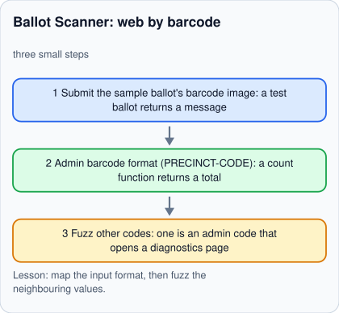
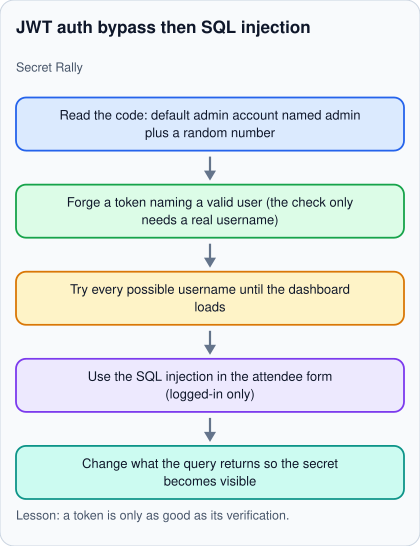
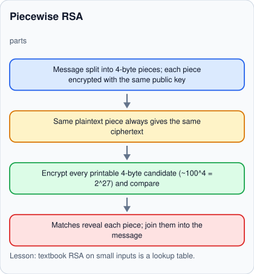
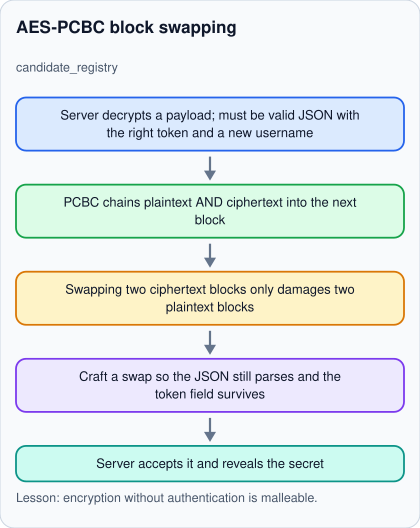
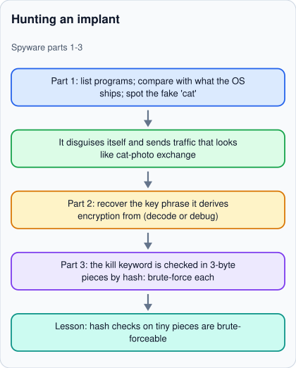
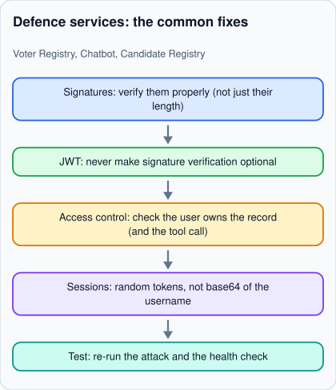

# 32. Writeups: CyberSci Regionals 2024/25

Concept-level writeups of the published challenges, built from the organizers' READMEs, walkthroughs and solve notes in `CyberSCI/PastChallenges` (`challenges/regionals-2024-25/`). **Flags are left out.** Try each challenge first with the learn-by-doing loop, then read.

> **Safety.** Read the repo, don't run it on your main machine. Run services only in a lab VM or Docker with ports on `127.0.0.1`. I haven't run anything. Executable challenges (the pwn binaries, the RE binaries) stay in a VM.

**Theme: "Val Verde".** A fictional country's election is under attack; you defend its systems, so many challenges are election-themed (voter registries, ballot scanners, candidates).

| # | Challenge | Category | Level | Notes |
|---|---|---|---|---|
| 1 | Leaked and Loaded | Crypto | warmup | CyberChef recipe |
| 2 | Encrypted MFA | Crypto | easy | CyberChef recipe |
| 3 | Tricky Communications | Forensics/stego | easy | images |
| 4 | Ballot Scanner | Web | easy to medium | 3 small parts |
| 5 | Secret Rally | Web | medium | auth bypass + SQLi |
| 6 | parts | Crypto | medium | RSA misuse |
| 7 | candidate_registry | Crypto | medium to hard | AES-PCBC |
| 8 | Data is the new currency | Forensics | medium | pcap, AES-CBC and RSA |
| 9 | Spyware (1-3) | Forensics/RE | easy to hard | implant hunt |
| 10 | Voter Emailer | Cloud / AI | medium | LLM tool calling |
| 11 | Chatbot | Defence | medium | LLM agent |
| 12 | Voter Registry | Defence | medium | signatures, JWT |
| 13 | Vector Veil | RE | hard | AVX2 obfuscation |
| 14 | Call Centre, Polling Station, Registration Oriented Programming | Pwn | hard | ROP and heap |

---

## 1. Leaked and Loaded (Crypto, warmup)

**Given.** A text file; the story says a campaign manager "protected" a password before emailing it.

**Plain English.** Three simple transformations were stacked. Peel them in reverse order.

| Layer (as encrypted) | To undo |
|---|---|
| Base64 | decode Base64 |
| ROT13-style rotation (a rotation of 5 letters) | rotate back (the reverse rotation) |
| Binary (8-bit groups separated by spaces) | convert binary to text |

**Order matters:** encryption was Base64 → rotation → binary, so decryption is binary → rotation → Base64.

**Thinking.** Look at the final string: only `0`, `1` and spaces means binary; the result looks like random letters (rotation); the next looks like Base64.
**Practice.** CyberChef "Magic" is a hint, but do it by hand once. Build your own three-layer puzzle.
**Reading.** Module 4 §4.1; Lab 2.
**Teach it back.** "How do you decide the order to undo layers?"

---

## 2. Encrypted MFA (Crypto)

**Given.** A PDF containing a QR code.

**Plain English.** A QR code holds text; the text is an encoded message; the key words are hidden in the theme.

| Step | Operation |
|---|---|
| 1 | read the QR code (CyberChef has a QR parser) |
| 2 | Base64 decode |
| 3 | Vigenère decode with a key that comes from the story (the country's name) |
| 4 | XOR with a short key (a four-digit year in the story) |

**Thinking.** Each operation produces something that *looks* like the next one's input. The keys come from the document's context ("Val Verde", a year).
**Practice.** Build a recipe in CyberChef and save it; share with a friend.
**Reading.** Module 4 §4.2-4.3, Module 12 §12.6 (QR).
**Teach it back.** "Where do puzzle authors hide keys?"

---

## 3. Tricky Communications (Forensics / stego, easy)

**Given.** `recovered.zip`: intercepted images. The flag is a bitcoin address.

**Plain English.** Images hide data. Check the cheap tricks first.

| Step | Do |
|---|---|
| 1 | list the files; `file`, `exiftool`, `strings` on each image |
| 2 | check for appended data (`binwalk`, `xxd | tail`) |
| 3 | try stego tools by format (`zsteg`, `steghide`, colour planes) |
| 4 | an extracted message or image holds the address |

The folder includes a write-up PDF: read it after Attempt 1.
**Reading.** Module 2 §2.8; Module 12 §12.6.
**Teach it back.** "What are the first three checks on any image?"

---

## 4. Ballot Scanner (Web, three parts)

**Given.** A web app that "scans" a ballot barcode image.

| Part | Idea | Method |
|---|---|---|
| 1 Test ballot | the sample PDF has a test barcode | submit a screenshot of it as a ballot; a test message appears |
| 2 Ballot count | barcode text follows `PRECINCT-CODE`; an admin code returns the total and a signature | craft a barcode with the admin code for your precinct |
| 3 Diagnostics | explore other codes | fuzz the codes; a special admin code redirects to a hidden diagnostics page showing the machine ID |

**Thinking.** The input is a barcode but the logic is *"parse text, dispatch on a code"*. Understand the format, then try neighbouring values.
**Practice.** Generate barcodes with a small script; fuzz a range of numeric codes.
**Reading.** Module 3 §3.2 (recon, map inputs); Module 11.
**Teach it back.** "Why does fuzzing neighbouring values work on a code-dispatch design?"

---

## 5. Secret Rally (Web)

**Given.** `secret_rally.zip` and a hosted site.

| Step | Detail |
|---|---|
| 1 | read the code: a default admin account is created on startup as `admin` plus a random number between 1000 and 1999 |
| 2 | the login accepts a **forged JWT** as long as it **names a valid user**; so forge tokens for each possible admin name until one works |
| 3 | inside the dashboard, a form that adds an attendee is **SQL injectable** (logged-in users only) |
| 4 | use the injection to change what the query returns (for example mark every rally visible); the secret shows up on the dashboard |

**Why it works.** Weak token verification, a guessable account name, and string-built SQL.
**Reading.** Module 3 §3.3, §3.5; Lab 8.
**Teach it back.** "What two checks should a JWT login do that this one didn't?"

---

## 6. parts (Crypto)

**Given.** `parts.zip`: the encryption script and the ciphertext.

**Plain English.** RSA was used on tiny chunks of the message, one at a time. RSA is deterministic, so the same chunk always gives the same ciphertext, which means you can encrypt every possible chunk and see which matches.

| Step | Detail |
|---|---|
| 1 | read the script: each piece is **4 bytes**; there's a public key |
| 2 | restrict to printable ASCII (≈ 100⁴ ≈ 2²⁷ candidates per piece) |
| 3 | for each candidate, compute `pow(m, e, n)` and compare with the pieces |
| 4 | join the matches into the message |

**Thinking.** 2²⁷ is a few hundred million operations: **feasible with an optimised loop** (precompute, use `gmpy2`, or a compiled language).
**Practice.** Write the brute force for 2-byte pieces first; measure; scale up.
**Reading.** Module 4 §4.6; Module 11 §11.3.
**Teach it back.** "Why is chunked textbook RSA insecure even though RSA itself is strong?"

---

## 7. candidate_registry (Crypto)

**Given.** `candidate_registry.zip` and a service (`nc`): register a candidate by sending an encrypted payload.

| Step | Detail |
|---|---|
| 1 | the server accepts a payload only if it decrypts to **valid JSON**, contains the **correct registration token**, and has a **new username** |
| 2 | you get one encrypted example but not the key or token |
| 3 | the cipher is **AES-PCBC**: swapping adjacent ciphertext blocks only disturbs two plaintext blocks |
| 4 | from the scripts you know the plaintext layout; choose a swap so the token field is intact, the username changes, and the JSON still parses (the damaged area lands in a harmless field) |
| 5 | the server reveals a password |

**Why it works.** There's no authentication on the ciphertext; the mode's error propagation is limited.
**Reading.** Module 4 §4.5.
**Teach it back.** "Which property of the plaintext layout made the swap possible?"

---

## 8. Data is the new currency (Forensics, pcap)

**Given.** `artifact.pcap` and a write-up PDF. Hint: the two kinds of crypto used are **AES-CBC** and **RSA**. Questions: which file was sent to the customer who bought access (the full URL path), and what is a named person's occupation?

**Thinking (concept).**

| Step | Idea |
|---|---|
| 1 | summarise the capture (protocols, conversations) |
| 2 | find the "service": who connects, what they send |
| 3 | notice that a key is exchanged with RSA and data is protected with AES-CBC |
| 4 | recover the AES key from the RSA exchange (using what the capture or challenge supplies) and decrypt the stream |
| 5 | read the decrypted data for the two answers |

I didn't read the PDF write-up; **open it after your attempt** for the exact steps.
**Reading.** Module 2 §2.3; Module 4 §4.5-4.6.
**Teach it back.** "Why do real protocols use RSA *and* AES together?"

---

## 9. Spyware (RE / forensics, three parts)

| Part | Task | Method |
|---|---|---|
| 1 | find the malicious application and report its path | list running programs and compare with what the OS ships; a program under `/etc/systemd/system/` named like a standard tool (`cat`) is the implant; it also talks on the network |
| 2 | find the phrase the encryption key is derived from | the app speaks to a "cat photo exchange" site; command traffic is hidden in the image exchange; the key is stored encoded in the app: re-trace the decoding or bypass the anti-debug protections and read it from memory |
| 3 | find the keyword that shuts it down | the keyword is checked in **3-byte pieces**, each against a stored **SHA-256**; brute-force each piece (a few minutes on a laptop) |

**Why it works.** Hash checks on tiny pieces are brute-forceable; masquerading binaries hide in plain sight.
**Practice.** Compare a clean VM's running processes with a suspect one.
**Reading.** Module 2 §2.4; Module 13; Module 5.
**Safety.** Analyse in a VM only.
**Teach it back.** "How can you check a piecewise hash quickly?"

---

## 10. Voter Emailer (Cloud / AI)

**Given.** A FastAPI endpoint that uses a small local LLM to help email voters; the VM should have limited access to a voter list stored in cloud storage.

**Thinking (concept).**

| Step | Idea |
|---|---|
| 1 | the API exposes its documentation (Swagger UI); it lists a `/tools` path that takes a `query` |
| 2 | the response shows the model **choosing tool calls**, including one that **runs an OS command** |
| 3 | so a crafted query becomes command execution on the VM |
| 4 | the VM has a cloud **role** granting access to the protected data; the metadata service issues a **token** for it; use that to read the list |

(The published walkthrough includes the exact commands; read them after your attempt.)

**Why it works.** The model decides what to run; the platform's role grants more than needed.
**Reading.** Module 14 (metadata, IAM); chapter 25's AI note.
**Teach it back.** "Which two controls would have stopped this: one in the app, one in the cloud?"

---

## 11. Chatbot (Defence)

**Given.** A QA chatbot for voters built as an LLM agent with tools, a Flask API and a frontend; captured attack traffic replays on demand.

| ID | Bug | Fix |
|---|---|---|
| V1 | the session token is just the base64 of the username | use random tokens |
| V2 | the agent's `get_user_info` tool trusts a user supplied by the frontend, so the agent can be tricked into returning another user's info | check access in code using the **session token** |
| V3 | `update_candidate_platform` is protected only by instructions in the prompt | enforce authorisation in code, not the prompt |

**Lesson.** Don't let the model be the authorisation layer.
**Reading.** Chapter 24 §5-6; Module 3 §3.5-3.6.

---

## 12. Voter Registry (Defence)

**Given.** A Python voter-registry site, an attack portal, and walkthrough slides.

| Bug | Fix |
|---|---|
| badge **signature verification** only checks that the signature is 64 bytes long | verify the real **Ed25519** signature against the public key |
| JWT **signature verification** was accidentally optional | always verify, with a fixed algorithm |
| a voter can see another voter's record | ownership check on every record access |

**Reading.** Chapter 24; Module 3 §3.5-3.6.

---

## 13. Vector Veil (RE, hard)

**Given.** A binary implementing a voter check-in code system; the check is obfuscated with **AVX2** vector instructions.

**Plain English.** The arithmetic lives in SIMD registers (`xmm`, `ymm`) instead of ordinary ones, which defeats habits and makes decompilers struggle.

| Idea | Detail |
|---|---|
| tooling fix | the disassembler can't define a function because a stray null byte after the final `exit` is never used; change it to a `ret` so the code is recognised as a function |
| anti-debug | the program forks a child that attaches to its parent with `ptrace`; if attaching fails (a debugger is present) it takes a wrong path; bypass it |
| algorithm | the registration code comes from an **FNV-1a** loop; input is parsed by an **AVX2 `atoi`** |

The folder contains a full walkthrough with screenshots (`docs/WALKTHROUGH.md`).
**Reading.** Module 5; look up FNV-1a and the ptrace anti-debug trick.
**Teach it back.** "Why does ptrace self-attach detect a debugger?"

---

## 14. Pwn trio (advanced)

All three give `src`, `hosted` and `solve` folders. They are advanced; read these summaries after attempting.

| Challenge | Core idea (from the solve notes) |
|---|---|
| **Call Centre** | the program runs code at an address you choose using `call`; jumping into the **middle of a function** skips its frame setup, which lets you overwrite the return address of nested calls; ROP leaks libc through a GOT entry, restarts the program, then calls `system("/bin/sh")` |
| **Polling Station** | a `strlcpy` length can become `0xffffffffffffffff` when `read` fails, giving a **heap overflow** and a leak; out-of-band data hangs the poller, enabling reliable **heap grooming**; tcache poisoning builds a fake chunk in the GOT and overwrites a function pointer with `system` |
| **Registration Oriented Programming** | strings are stored at a user-chosen **index with no bounds**; printing all indices leaks stack pointers (libc); out-of-bounds writes reach the saved return address and a ROP chain |

**Reading.** Module 5 §5.7; pwn.college; ROP Emporium.

---

## What this year teaches

| Pattern | Seen in |
|---|---|
| Layered encodings and recipes | Leaked and Loaded, Encrypted MFA |
| Crypto misuse | parts (RSA pieces), candidate_registry (PCBC) |
| Chains of small web bugs | Secret Rally, Ballot Scanner |
| LLMs with tools are dangerous | Voter Emailer, Chatbot |
| Defence is patching real flaws | Voter Registry, Chatbot |
| Implants and anti-debug | Spyware, Vector Veil |

## Check yourself

1. Which two challenges here exploit missing authentication on a cryptographic message?
2. What rule would have fixed both defence services' authorisation problems?
3. Why is brute-forcing a 4-byte RSA piece feasible?
4. What does a PCBC block swap preserve and damage?
5. Order this year's challenges by what you'd attempt first and defend your order.
