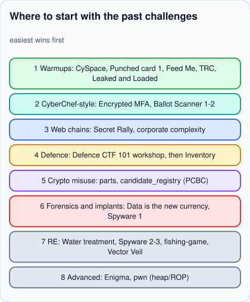

# 33. Past-challenge primers and drills

The past regionals reward one meta-skill above all: **getting competent at an unfamiliar technology in 20 minutes.** This chapter gives you (1) short primers on the odd technologies that appeared, (2) a research routine for new ones, and (3) **drills with code I wrote and ran** so you can rebuild the key ideas yourself.

## 1. Where to start



Suggested order, easiest to hardest. Each uses the loop: **Read the primer → Attempt → Review → Reinforce → Attempt 2**.

| Order | Challenge (repo) | Prepare with |
|---|---|---|
| 1 | CySpace.com (25/26) | primer 3.1, drill D1 |
| 2 | Punched cards 1 (25/26) | primer 3.2 |
| 3 | Feed Me! (25/26) | Module 4 §4.1, §4.5 |
| 4 | TRC (25/26) | drill D2 |
| 5 | Leaked and Loaded, Encrypted MFA (24/25) | Lab 2; CyberChef |
| 6 | Ballot Scanner 1-2 (24/25) | Module 3 §3.2 |
| 7 | Secret Rally (24/25) | drill D5; Module 3 §3.3, §3.5 |
| 8 | Defence CTF 101 workshop, then Inventory | chapter 24 |
| 9 | parts, candidate_registry (24/25) | drills D3, D4 |
| 10 | Spyware 1, Data is the new currency | Module 2 |
| 11 | corporate complexity, Rabbit Holes | primers 3.6, 3.7 |
| 12 | Water treatment, fishing-game, Spyware 2-3, Vector Veil | primers 3.8, 3.9 |
| 13 | enigma, enigmail; pwn trio | primer 3.4; Module 5 |

## 2. The 20-minute research routine

When you meet something unfamiliar (gopher, punched cards, MD2, BASIC, Lua):

| Minute | Do |
|---|---|
| 0-3 | write one sentence: *what is this and what is it normally for?* |
| 3-8 | read one good overview (Wikipedia plus the format's spec or a tutorial) |
| 8-12 | find a **tool** that reads/writes it (decoder, interpreter, emulator) |
| 12-17 | do the smallest possible experiment (encode your name; run hello-world) |
| 17-20 | write what you now know and what is still unknown |

In the competition you won't have an AI assistant, so your **notes and cheat sheets** are your memory: add every new format you meet.

## 3. Primers

### 3.1 Phone-keypad multi-tap ("vanity") code

Old phones typed letters by pressing a digit key repeatedly: `2` = A, `22` = B, `222` = C; `7` has four letters (PQRS), `9` has WXYZ. A message is a list of digit groups; the group's digit selects the key and its length selects the letter. See drill D1.

### 3.2 Punched cards and tape

| Medium | Idea |
|---|---|
| **IBM 80-column punched card** | 80 columns × 12 rows (rows 12, 11, 0 to 9). Each column encodes one character by which holes are punched: digits use a single hole; letters combine a "zone" punch (12, 11 or 0) with a digit punch. Decoding is a lookup against a chart. |
| **Paper tape / telegraph (ITA2, "Baudot")** | 5 holes per character; two "shift" states (letters and figures) change the meaning of the next characters, so decoding must track the shift. |
| **Damaged data + a hash** | decode what you can, enumerate candidates for the unknown positions, and use the **hash** to confirm (drill D5). |

### 3.3 MD2 and old hashes

MD2 (1989) is an obsolete 128-bit hash. For a CTF, the point is: **if the program only stores a hash of the secret and the secret is likely weak, hash a wordlist and compare.** Python's `hashlib` may not include MD2; a small implementation or a library supplies it.

### 3.4 Enigma and cribs

| Part | Role |
|---|---|
| **Rotors** (typically 3 chosen from a set) | substitution that changes with every keypress; each has a **ring setting** and a **start position** |
| **Reflector** | sends the signal back through the rotors, making the machine reciprocal, and guarantees **no letter ever encrypts to itself** |
| **Plugboard** | swaps pairs of letters before and after the rotors |

**The attack (conceptual).**

1. Guess a phrase that probably appears (a **crib**), for example a header or a repeated greeting.
2. Slide the crib along the ciphertext; any alignment where a letter would encrypt to itself is impossible.
3. Use a **Bombe** (a simulation program) to search rotor order and start positions that are consistent with the crib, then recover plugboard pairs.
4. Refine ring settings and remaining plugboard pairs until the rest is readable.

Practise by installing an Enigma simulator, encrypting a message with known settings, and then attacking your own ciphertext with a known crib.

### 3.5 AES modes: CBC versus PCBC

| Mode | Chaining |
|---|---|
| CBC | each plaintext block is XORed with the previous **ciphertext** before encryption |
| PCBC | XORs with the previous plaintext **and** ciphertext |

Both are malleable without a MAC. In PCBC, **swapping two adjacent ciphertext blocks damages only the two corresponding plaintext blocks**; later blocks decrypt correctly. Drill D4 demonstrates this with a toy cipher.

### 3.6 Gopher and URL-scheme filters

**Gopher** (RFC 1436) is a pre-web menu protocol on port 70: a client sends a *selector* line; a server returns text or a menu of items (type `0` text file, `1` directory, `7` search). Searches send the selector, a tab, then the query. In *Rabbit Holes*, the search handed your text to a fetcher. Lesson: **URL schemes are case-insensitive**, so a blocklist for lowercase `ftp` fails (drill D6).

### 3.7 Upload to code execution

An upload form that stores files under a **predictable name** and serves them from a web-executable directory is an RCE path. The defence checklist: allow-list types, store outside the web root, random names, no execute permission, scan content. In *corporate complexity* the upload gave code on the web server; that code could then reach internal services (SSRF-like pivot), and an SQL injection could write a file that cron would run.

### 3.8 16-bit DOS and scan codes

| Topic | Notes |
|---|---|
| Running DOS programs | emulators such as **DOSBox / dosbox-x**; 16-bit executables don't run on 64-bit Windows |
| Scan codes | keyboards send *key-position codes* (not characters); a program may check scan codes, so you'll look up a scan-code table for your keyboard layout |
| RE approach | run it, observe its prompts, find the comparisons in a disassembler |

### 3.9 Anti-debugging and SIMD obfuscation (Vector Veil)

| Trick | What it does | What you do |
|---|---|---|
| `ptrace` self-attach | a forked child attaches to its parent; only one tracer can attach at a time, so a debugger makes the attach fail and the program changes behaviour | patch the check or make the debugger attach later |
| AVX2 arithmetic | values live in `xmm`/`ymm` registers; common idioms (like `atoi`) look unrecognisable | recognise the algorithm (FNV-1a) by constants and structure |
| Tool confusion | stray bytes stop the disassembler defining a function | patch the byte so the code is recognised |

### 3.10 Prompt injection and LLM agents

| Concept | Detail |
|---|---|
| Prompt injection | instructions inside content the model reads (a document, a web page, text in an image) are treated like instructions |
| Tool calling | the model proposes calls (database lookup, update, OS command); the application executes them |
| The mistake | using the **prompt** as the authorisation system ("only the candidate may change this"), or letting the model choose OS commands |
| The fix | authorisation in code, from the session; least-privilege tools; allow-listed commands; treat model output as untrusted input |

### 3.11 Heap and ROP (for the pwn trio)

Out of scope for most first regionals, but know the vocabulary: **ROP** chains existing code snippets (gadgets); a **libc leak** defeats ASLR; **tcache poisoning** abuses the heap's free-list to get an arbitrary write; **GOT overwrite** redirects a library call. Learn them with pwn.college and ROP Emporium after Nov 21.

## 4. Drills (code that I ran)

Run these in your own lab, in a scratch folder, with Python 3.

### D1: Multi-tap decoder

```python
KEYS = {"2": "ABC", "3": "DEF", "4": "GHI", "5": "JKL",
        "6": "MNO", "7": "PQRS", "8": "TUV", "9": "WXYZ"}

def multitap(s):
    return "".join(KEYS[g[0]][len(g) - 1] for g in s.split("-"))

print(multitap("222-999-22-33-777"))     # CYBER
```

**Extend:** write the encoder; handle a space (`0`).

### D2: Morse + Base32 codec (the TRC layers)

```python
import base64
MORSE = {"A": ".-", "B": "-...", "C": "-.-.", "D": "-..", "E": ".", "F": "..-.", "G": "--.",
         "H": "....", "I": "..", "J": ".---", "K": "-.-", "L": ".-..", "M": "--", "N": "-.",
         "O": "---", "P": ".--.", "Q": "--.-", "R": ".-.", "S": "...", "T": "-", "U": "..-",
         "V": "...-", "W": ".--", "X": "-..-", "Y": "-.--", "Z": "--..",
         "2": "..---", "3": "...--", "4": "....-", "5": ".....", "6": "-....", "7": "--...", "=": "-...-"}
REV = {v: k for k, v in MORSE.items()}

def encode(text):
    return " ".join(MORSE[c] for c in base64.b32encode(text.encode()).decode())

def decode(morse):
    return base64.b32decode("".join(REV[c] for c in morse.split())).decode()

m = encode("GET /")
print(decode(m))                          # GET /
```

**Extend:** use it to talk to a socket server that speaks this protocol (a toy server you write yourself).

### D3: Piece-wise RSA brute force (small-scale)

```python
import itertools
p, q, e = 10007, 10009, 65537
n = p * q
msg = b"HELLO!"
pieces = [int.from_bytes(msg[i:i+2], "big") for i in range(0, len(msg), 2)]
cts = [pow(x, e, n) for x in pieces]          # what an attacker sees

table = {pow(int.from_bytes(bytes(t), "big"), e, n): bytes(t)
         for t in itertools.product(range(32, 127), repeat=2)}
print(b"".join(table[c] for c in cts))        # b'HELLO!'
```

**Scale-up thought:** 2-byte pieces have ~9,000 candidates; 4-byte pieces ~9×10⁷: you'd precompute with a fast language or `gmpy2`.

### D4: PCBC block swap (toy cipher)

The *property* is independent of the block cipher, so a toy cipher is enough to see it.

```python
def E(block, key):  return bytes((b + k) % 256 for b, k in zip(block, key))[::-1]
def D(block, key):  return bytes((b - k) % 256 for b, k in zip(block[::-1], key))
def xor(a, b):      return bytes(x ^ y for x, y in zip(a, b))

def pcbc_enc(pt, key, iv):
    bs, c_prev, p_prev, out = len(key), iv, bytes(len(key)), []
    for i in range(0, len(pt), bs):
        p = pt[i:i+bs]
        c = E(xor(xor(p, p_prev), c_prev), key)
        out.append(c); p_prev, c_prev = p, c
    return b"".join(out)

def pcbc_dec(ct, key, iv):
    bs, c_prev, p_prev, out = len(key), iv, bytes(len(key)), []
    for i in range(0, len(ct), bs):
        c = ct[i:i+bs]
        p = xor(xor(D(c, key), p_prev), c_prev)
        out.append(p); p_prev, c_prev = p, c
    return b"".join(out)

key, iv = b"KEYKEYKEYKEYKEY!", b"IVIVIVIVIVIVIVIV"
pt = b'{"token":"AAAAAAAAAAAAAAAAAAAA","user":"davey_jones","bio":"hello world, this is a long bio"}'
pt += b" " * (-len(pt) % 16)
ct = pcbc_enc(pt, key, iv)
blocks = [ct[i:i+16] for i in range(0, len(ct), 16)]
blocks[3], blocks[4] = blocks[4], blocks[3]               # swap two adjacent blocks
res = pcbc_dec(b"".join(blocks), key, iv)
print([res[i:i+16] == pt[i:i+16] for i in range(0, len(pt), 16)])
# [True, True, True, False, False, True]   <- only the two swapped blocks are damaged
```

**Question:** the real challenge needs the JSON to still be valid after the damage. Where in the message would you want the two garbled blocks to land?

### D5: A hash as an answer checker (partial secret)

```python
import hashlib, itertools
secret = b"Ab"
target = hashlib.sha256(secret).hexdigest()
found = next(bytes(t) for t in itertools.product(range(32, 127), repeat=2)
             if hashlib.sha256(bytes(t)).hexdigest() == target)
print(found)                                  # b'Ab'
```

**Extend:** brute-force the last two characters of a six-character password given the first four and its MD5 (this is the punched-card part 2 idea).

### D6: A scheme blocklist that fails

```python
from urllib.parse import urlparse
BLOCK = ("file", "ftp")
url = "ftP://anonymous@localhost/x"
print(urlparse(url).scheme)                   # 'ftp'  (the parser lowercases it)
print(url.split(":")[0] in BLOCK)             # False: the naive check was fooled
```

**Fix:** parse first, normalise (lowercase), then allow-list only `http` and `https`.

### D7: JWTs by hand

```python
import base64, hashlib, hmac, json
def b64u(b): return base64.urlsafe_b64encode(b).rstrip(b"=").decode()

def jwt(payload, secret=None):
    header = {"alg": "HS256" if secret else "none", "typ": "JWT"}
    head = b64u(json.dumps(header, separators=(",", ":")).encode())
    body = b64u(json.dumps(payload, separators=(",", ":")).encode())
    signing = head + "." + body
    sig = b64u(hmac.new(secret, signing.encode(), hashlib.sha256).digest()) if secret else ""
    return signing + "." + sig

print(jwt({"user": "admin1234"}))                      # unsigned token (alg "none")
print(jwt({"user": "admin1234"}, secret=b"s3cret"))    # HS256 token
```

**Think:** if a server only checks that the token *names a real user*, what happens when you try `admin1000`…`admin1999`? (The Secret Rally idea.) How should the server verify?

### D8: FNV-1a (the hash in Vector Veil)

```python
def fnv1a32(data):
    h = 0x811C9DC5
    for b in data:
        h ^= b
        h = (h * 0x01000193) & 0xFFFFFFFF
    return h
print(hex(fnv1a32(b"a")))                     # 0xe40c292c
```

**Why it helps:** recognising the offset basis `0x811C9DC5` and prime `0x01000193` in a decompiler tells you the algorithm.

## 5. How to track this

Add each drill as an activity: `python scripts/activity.py note PC-03 "D2 done"`. Do the full loop on the challenge it supports, then attempt the next one in the table.

## 6. Check yourself

1. What are the five steps of the 20-minute research routine?
2. Why does a reflector make Enigma weaker against cribs?
3. What does a PCBC block swap preserve?
4. Why does a lowercase-only blocklist fail?
5. Which constants identify FNV-1a?
6. Why is "only the candidate may change this" in a prompt not access control?
