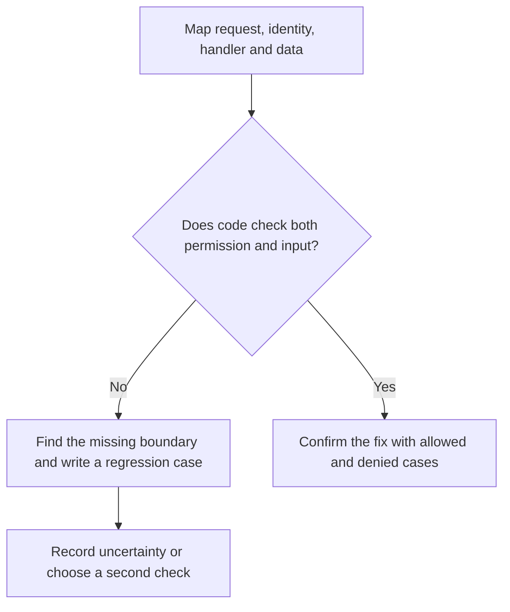

# Web, HTTP and SQL review

Start with this question: **Where does untrusted data cross into an application decision?** Keep the original evidence, work on a copy where applicable, and write down the output that would change your conclusion before running a test.

## Decision tree

Offline text path: Map request, identity, handler and data. Ask “Does code check both permission and input?” If yes, confirm the fix with allowed and denied cases. If no, find the missing boundary and write a regression case, then record what is still uncertain.

## Glossary

| Term | Meaning |
|---|---|
| authorization | Permission to do a specific operation. |
| parameter binding | Sending SQL values separately from query structure. |
| output encoding | Representing data for its destination context. |

## Worked example and verification

On paper review `read_report(user, id)`. Trace identity, requested object and permission check before returning data. Build an owner/non-owner/missing-object test matrix. In SQLite, compare `COUNT(*)` with `COUNT(column)` over a NULL row to practice explaining a surprising result with a control.

Write a three-line record: what you were given, which observation supports your conclusion, and what alternative explanation remains. Include filenames, frame numbers or timestamps where applicable.

## Troubleshooting

| Symptom or assumption | What to check next |
|---|---|
| Login works but access is wrong | Check object ownership and server-side policy |
| Query totals disagree | Compare NULL handling, filters and duplicate joins |
| HTML displays markup unexpectedly | Check encoding for the actual output context |

## Recall and transfer

1. Define **authorization** without looking. Explain how it changes the interpretation of this example.
2. Repeat the worked example with a different input or write a paper variant. Predict an observation that would falsify your first conclusion and record whether you saw it.
3. Hand a teammate your evidence record. Ask them to reproduce the finding without reading your conclusion first.

[Return to field guide](../README.md)
