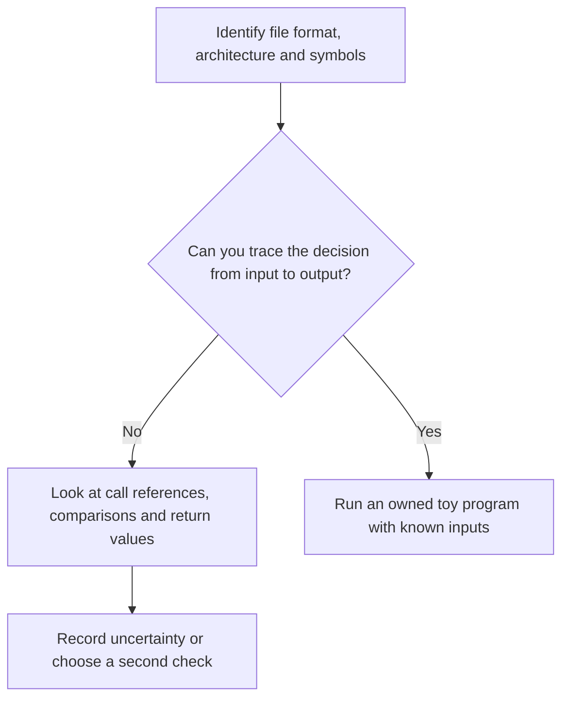

# Static analysis and native code review

Start with this question: **What input or branch explains the behavior?** Keep the original evidence, work on a copy where applicable, and write down the output that would change your conclusion before running a test.

## Decision tree

Offline text path: Identify file format, architecture and symbols. Ask “Can you trace the decision from input to output?” If yes, run an owned toy program with known inputs. If no, look at call references, comparisons and return values, then record what is still uncertain.

## Glossary

| Term | Meaning |
|---|---|
| ELF | Common Linux executable format. |
| symbol | Named function or object in a binary. |
| bounds check | Validation against the actual size of a destination or range. |

## Worked example and verification

Create a toy C program returning 0 when argc is 2 and 1 otherwise. Compile `gcc -O0 -g demo.c -o demo`; use `readelf -hW demo`, `objdump -d --disassemble=main demo` and run with zero and one argument. Explain how each return value maps to the source. Rebuild with `-O2` and compare.

Write a three-line record: what you were given, which observation supports your conclusion, and what alternative explanation remains. Include filenames, frame numbers or timestamps where applicable.

## Troubleshooting

| Symptom or assumption | What to check next |
|---|---|
| No recognizable symbols | Use header and section data and seek references from known entry points |
| Decompiler disagrees with behavior | Read the relevant assembly and verify a controlled input |
| Length check concerns | Review signed conversions, units and destination capacity before copying |

## Recall and transfer

1. Define **ELF** without looking. Explain how it changes the interpretation of this example.
2. Repeat the worked example with a different input or write a paper variant. Predict an observation that would falsify your first conclusion and record whether you saw it.
3. Hand a teammate your evidence record. Ask them to reproduce the finding without reading your conclusion first.

[Return to field guide](../README.md)
