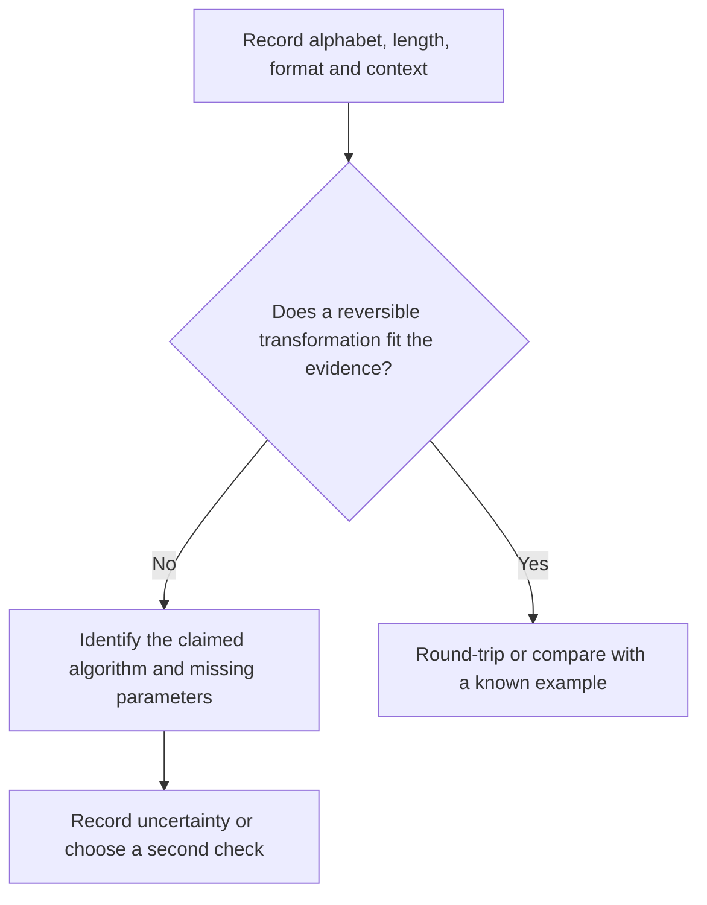

# Encodings, cryptography and scripting

Start with this question: **Does the input need decoding, parsing or cryptographic interpretation?** Keep the original evidence, work on a copy where applicable, and write down the output that would change your conclusion before running a test.

## Decision tree

Offline text path: Record alphabet, length, format and context. Ask “Does a reversible transformation fit the evidence?” If yes, round-trip or compare with a known example. If no, identify the claimed algorithm and missing parameters, then record what is still uncertain.

## Glossary

| Term | Meaning |
|---|---|
| encoding | Reversible representation without a key. |
| nonce | Value whose required uniqueness depends on a protocol. |
| authentication tag | Value used to verify integrity and authenticity with the appropriate key. |

## Worked example and verification

Decode `aGVsbG8=` with `base64 -d` and compare the bytes to `hello`. Re-encode and compare. Then supply malformed input and check the exit status. When inspecting a purported ciphertext, record algorithm, nonce, tag and which are actually present before drawing conclusions.

Write a three-line record: what you were given, which observation supports your conclusion, and what alternative explanation remains. Include filenames, frame numbers or timestamps where applicable.

## Troubleshooting

| Symptom or assumption | What to check next |
|---|---|
| Decoded output is unreadable | Inspect bytes and type before guessing another encoding |
| Round trip differs | Look for line endings or padding normalization |
| Parser stops early | Test truncated and empty records separately |

## Recall and transfer

1. Define **encoding** without looking. Explain how it changes the interpretation of this example.
2. Repeat the worked example with a different input or write a paper variant. Predict an observation that would falsify your first conclusion and record whether you saw it.
3. Hand a teammate your evidence record. Ask them to reproduce the finding without reading your conclusion first.

[Return to field guide](../README.md)
