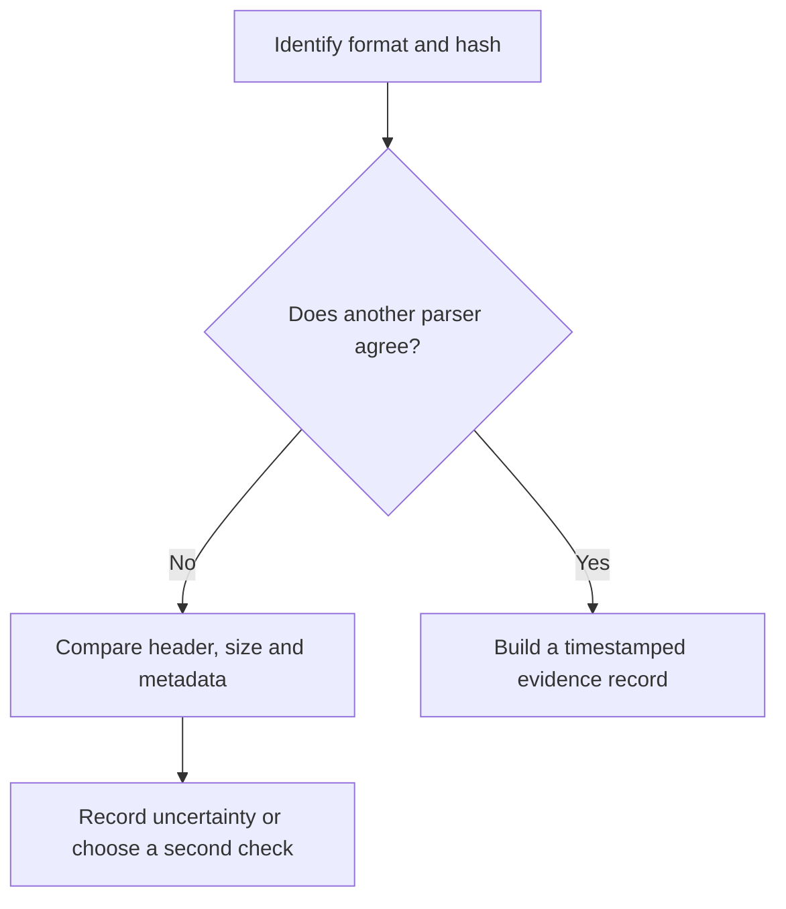

# Files, archives, logs and timelines

Start with this question: **Which observation answers the question?** Keep the original evidence, work on a copy where applicable, and write down the output that would change your conclusion before running a test.

## Decision tree

Offline text path: Identify format and hash. Ask “Does another parser agree?” If yes, build a timestamped evidence record. If no, compare header, size and metadata, then record what is still uncertain.

## Glossary

| Term | Meaning |
|---|---|
| hash | Digest of exact bytes; compare against a trusted copy. |
| magic bytes | Header bytes often identifying a file format. |
| provenance | Recorded origin and handling of evidence. |

## Worked example and verification

A file named report.jpg starts with 50 4b 03 04. Use `file`, `xxd -l 16` and `unzip -l` to compare the filename with the header and directory. Work on a copy. List paths and sizes before unpacking. The expected finding is ZIP-like content; the header alone does not identify what produced it.

Write a three-line record: what you were given, which observation supports your conclusion, and what alternative explanation remains. Include filenames, frame numbers or timestamps where applicable.

## Troubleshooting

| Symptom or assumption | What to check next |
|---|---|
| Logs disagree by five hours | Compare UTC offsets and capture times before sorting |
| Archive listing fails | Check truncation, archive type and whether the directory is encrypted |
| Metadata proves who created a file | Metadata is editable; corroborate with independent evidence |

## Recall and transfer

1. Define **hash** without looking. Explain how it changes the interpretation of this example.
2. Repeat the worked example with a different input or write a paper variant. Predict an observation that would falsify your first conclusion and record whether you saw it.
3. Hand a teammate your evidence record. Ask them to reproduce the finding without reading your conclusion first.

[Return to field guide](../README.md)
