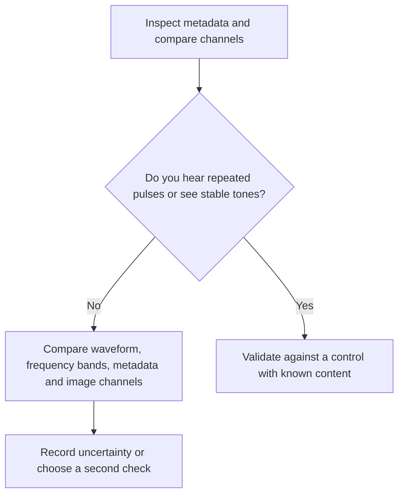

# Audio, images and hidden messages

Start with this question: **Where is the clue represented?** Keep the original evidence, work on a copy where applicable, and write down the output that would change your conclusion before running a test.

## Decision tree

Offline text path: Inspect metadata and compare channels. Ask “Do you hear repeated pulses or see stable tones?” If yes, validate against a control with known content. If no, compare waveform, frequency bands, metadata and image channels, then record what is still uncertain.

## Glossary

| Term | Meaning |
|---|---|
| sample rate | Audio samples per second. |
| FFT window | Number of samples used for each spectral estimate. |
| phase cancellation | Opposite-polarity signals cancel when combined. |

## Worked example and verification

Use the [companion media drill](../media.md) to synthesize 697 and 1209 Hz tones. Inspect them with a wide then narrow range, compare the single-tone control, and record channel and interval. At 16 kHz, a 1024-sample window spans 64 ms and bins are about 15.6 Hz apart; doubling the window halves the bin spacing and doubles the observation interval.

Write a three-line record: what you were given, which observation supports your conclusion, and what alternative explanation remains. Include filenames, frame numbers or timestamps where applicable.

## Troubleshooting

| Symptom or assumption | What to check next |
|---|---|
| Letters not visible | Check channel, frequency range, gain and time zoom |
| Short pulses blur together | Reduce FFT window and check timing in waveform |
| Clip goes quiet in mono | Solo original channels and look for opposite polarity |

## Recall and transfer

1. Define **sample rate** without looking. Explain how it changes the interpretation of this example.
2. Repeat the worked example with a different input or write a paper variant. Predict an observation that would falsify your first conclusion and record whether you saw it.
3. Hand a teammate your evidence record. Ask them to reproduce the finding without reading your conclusion first.

[Return to field guide](../README.md)
