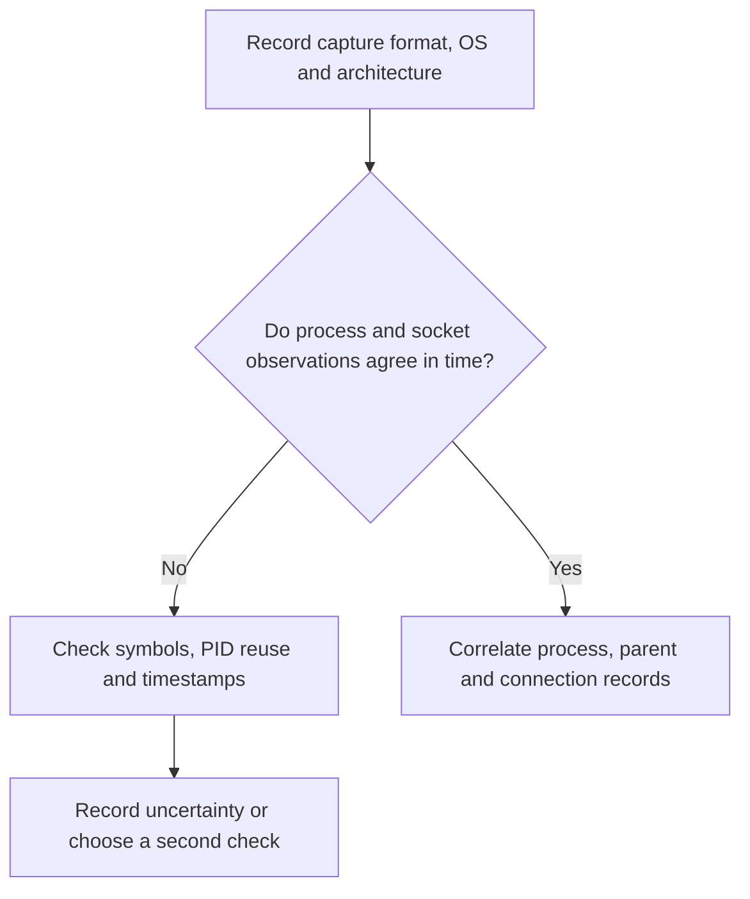

# Memory forensics and process evidence

Start with this question: **Which process owned the evidence at capture time?** Keep the original evidence, work on a copy where applicable, and write down the output that would change your conclusion before running a test.

## Decision tree

Offline text path: Record capture format, OS and architecture. Ask “Do process and socket observations agree in time?” If yes, correlate process, parent and connection records. If no, check symbols, pid reuse and timestamps, then record what is still uncertain.

## Glossary

| Term | Meaning |
|---|---|
| PID | Process identifier that can be reused. |
| symbols | Metadata mapping operating system structures to names and layouts. |
| snapshot | State captured at a particular time. |

## Worked example and verification

On paper compare process A, PID 42, running 08:00–08:15 UTC, process B, PID 42, starting 08:20, and a socket observed at 08:24. B is the stronger candidate if times share a clock and source. Record both assumptions and look for a process start timestamp in the same capture.

Write a three-line record: what you were given, which observation supports your conclusion, and what alternative explanation remains. Include filenames, frame numbers or timestamps where applicable.

## Troubleshooting

| Symptom or assumption | What to check next |
|---|---|
| Parser cannot locate symbols | Verify OS build and cache matching symbols before going offline |
| Different process views disagree | Consider terminated objects or malformed acquisition; corroborate |
| Clock sources differ | Normalize offsets and record precision before joining |

## Recall and transfer

1. Define **PID** without looking. Explain how it changes the interpretation of this example.
2. Repeat the worked example with a different input or write a paper variant. Predict an observation that would falsify your first conclusion and record whether you saw it.
3. Hand a teammate your evidence record. Ask them to reproduce the finding without reading your conclusion first.

[Return to field guide](../README.md)
