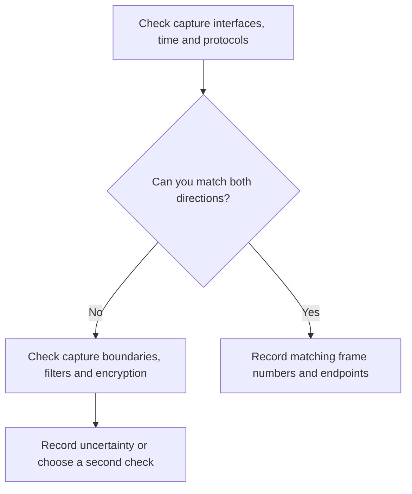

# Networking and packet captures

Start with this question: **Did the peer reply?** Keep the original evidence, work on a copy where applicable, and write down the output that would change your conclusion before running a test.

## Decision tree

Offline text path: Check capture interfaces, time and protocols. Ask “Can you match both directions?” If yes, record matching frame numbers and endpoints. If no, check capture boundaries, filters and encryption, then record what is still uncertain.

## Glossary

| Term | Meaning |
|---|---|
| five-tuple | Source/destination addresses, source/destination ports and transport protocol. |
| stream | Packets grouped into one conversation. |
| capture point | Location where traffic was observed. |

## Worked example and verification

Open a saved capture. Compare Protocol Hierarchy with Conversations, then filter `dns`. Match a query and answer using transaction ID and endpoints. Record both frame numbers. Remove the filter to see what it hid. A query without a visible answer establishes only that this capture has no matching answer.

Write a three-line record: what you were given, which observation supports your conclusion, and what alternative explanation remains. Include filenames, frame numbers or timestamps where applicable.

## Troubleshooting

| Symptom or assumption | What to check next |
|---|---|
| No packets displayed | Clear display filters and inspect capture duration |
| Repeated DNS IDs | Match endpoint pair, time and query name as well |
| HTTPS body unreadable | Report transport metadata separately from encrypted content |

## Recall and transfer

1. Define **five-tuple** without looking. Explain how it changes the interpretation of this example.
2. Repeat the worked example with a different input or write a paper variant. Predict an observation that would falsify your first conclusion and record whether you saw it.
3. Hand a teammate your evidence record. Ask them to reproduce the finding without reading your conclusion first.

[Return to field guide](../README.md)
