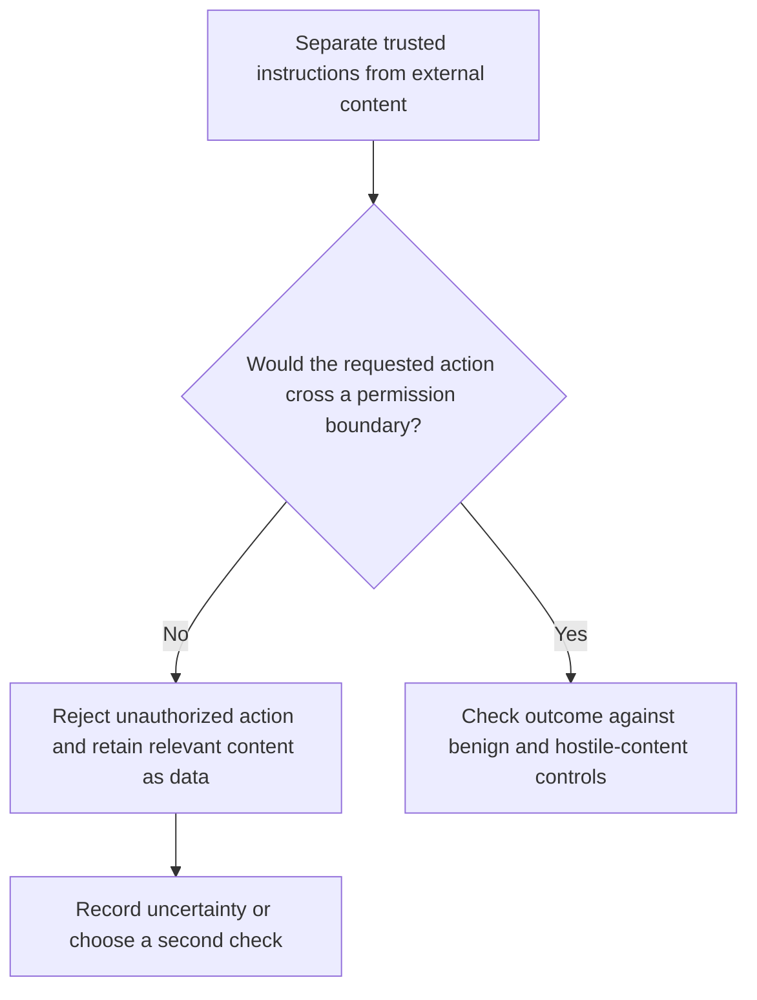

# Defensive prompt injection and trust boundaries

Start with this question: **Who authorized this action?** Keep the original evidence, work on a copy where applicable, and write down the output that would change your conclusion before running a test.

## Decision tree

Offline text path: Separate trusted instructions from external content. Ask “Would the requested action cross a permission boundary?” If yes, check outcome against benign and hostile-content controls. If no, reject unauthorized action and retain relevant content as data, then record what is still uncertain.

## Glossary

| Term | Meaning |
|---|---|
| indirect prompt injection | Untrusted material attempting to act as an instruction. |
| trust boundary | Point where data crosses between authority levels. |
| least privilege | Only the permissions necessary for a task. |

## Worked example and verification

On paper review a fictional report that asks the reader to change the recipient of a summary. Draw user → application → report content → proposed output. The report cannot grant permission to send anything. Compare with a benign report and confirm both produce the requested summary while the fictional send action remains unavailable.

Write a three-line record: what you were given, which observation supports your conclusion, and what alternative explanation remains. Include filenames, frame numbers or timestamps where applicable.

## Troubleshooting

| Symptom or assumption | What to check next |
|---|---|
| Filter only checks keywords | Evaluate authorization independently of wording |
| Model labels content trusted | Use application-owned provenance and permission checks |
| Unexpected disclosure | Check what data was supplied and what output destinations were available |

## Recall and transfer

1. Define **indirect prompt injection** without looking. Explain how it changes the interpretation of this example.
2. Repeat the worked example with a different input or write a paper variant. Predict an observation that would falsify your first conclusion and record whether you saw it.
3. Hand a teammate your evidence record. Ask them to reproduce the finding without reading your conclusion first.

[Return to field guide](../README.md)
